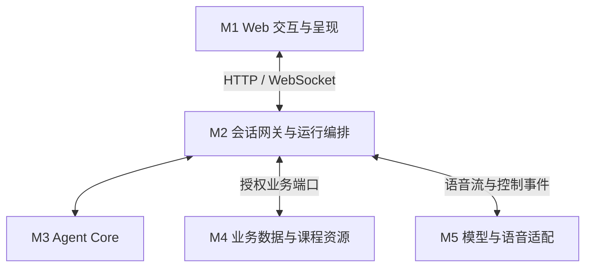
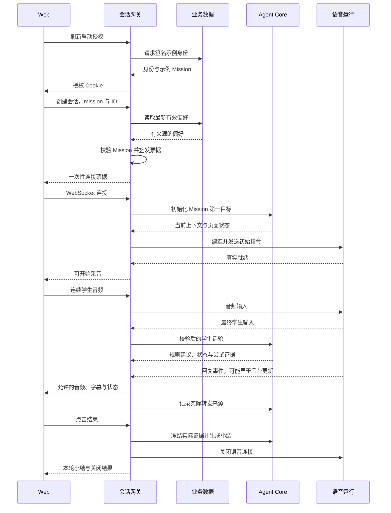
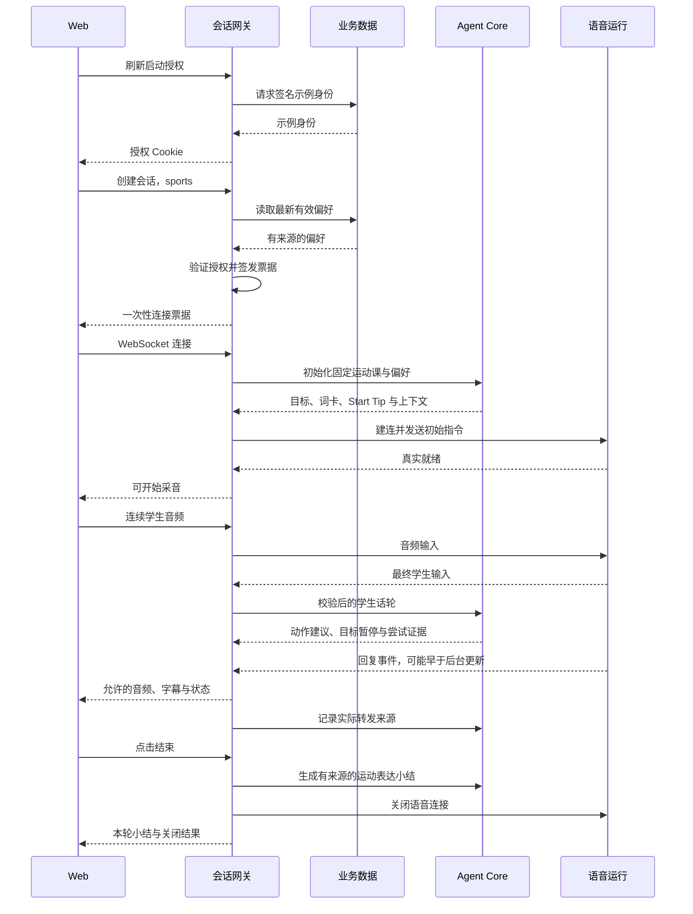
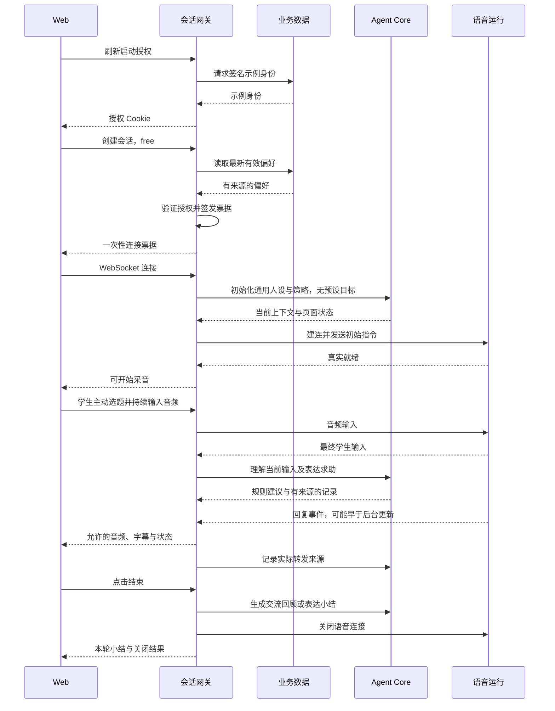

# Ask Kai

面向 HSK 1 初学者的实时中文对话教学 Agent。

> 更新于 2026-10-13。当前为独立 Web POC：真实豆包语音＋本地 Mock 业务数据。普通 Web 纵向验收已有用户确认；内容质量与剩余设备场景尚未整体验收通过。动态初始化、整体规划与逐轮规划已完成详细设计，尚未实现。

[产品介绍](#1-产品介绍) · [架构设计](#2-架构设计) · [三个入口](#3-使用方式三个入口) · [评测](#4-评测机制与现有结果) · [现状](#5-实现范围与当前状态) · [计划](#6-接下来的计划) · [启动](#7-快速启动) · [文档](#8-文档导航)

## 1. 产品介绍

Ask Kai 希望让学生在真实交流中学习中文：既可以承接刚完成的 Mission，也可以围绕一个主题练习，或从自己感兴趣的事情开始聊天。Kai 先理解学生想表达什么，再选择适量示范、澄清、追问或练习；学生可以换话题、拒绝教学、随时打断或结束。

三个入口共享同一位 Kai、实时语音、渐进字幕与有来源的会话小结：

| 入口 | 使用目的 |
| --- | --- |
| Mission Call | 把 Mission 中的内容带入后续生活交流，按学生情况巩固、补缺或迁移 |
| 主题式对话 | 围绕选定主题，根据兴趣选择内容，根据学习证据选择目标与策略；当前示例为运动 |
| 自由聊天 | 学生话题优先，按能力与偏好适配交流；初始教学目标为空，允许零知识点 |

目标教学闭环是：根据入口和学生背景制定整体计划，在每轮对话中观察实际表现、规划下一步、执行并获得反馈。一次完整交流可以没有教学动作；计划或关键词命中不能直接证明学生掌握。

当前 POC 已有实时对话、规则教学决策和会内证据；完整动态规划闭环处于设计阶段。产品要求见 [PRD](docs/prd/ask-kai-agent-prd-v1.1.md)。

## 2. 架构设计

### 2.1 Agent 核心能力

采用七类能力描述 Ask Kai 的参考架构。它们是职责视角，不要求拆成七个服务；一个工程模块可以承载多项能力。

| 核心能力 | 在 Ask Kai 中回答的问题 | 主要工程落点 |
| --- | --- | --- |
| 目标与约束 | 本次希望达到什么？学生选择、教学规则和权限允许做什么？ | M3 Agent Core；M2 执行权限与运行约束 |
| 感知 | 学生说了什么、想表达什么？发生了打断或拒绝吗？前次动作实际发生了什么？ | M5 语音事件适配、M2 事件归属、M3 意图与表现理解 |
| 记忆 | 学生的兴趣、学习证据和近期记录是什么？本会话正在做什么？ | M4 三类学生数据；M3 会话工作状态 |
| 规划 | 整体路径是什么？根据当前差距和最新上下文，下一步怎样推进？ | M3 整体与逐轮 Planner，待实现 |
| 决策 | 哪个行动适合当前学生？提案是否有效、允许且仍适用？ | M3 规划／策略校验；M2 接受与执行归属 |
| 行动 | 如何执行回复、示范、澄清、词卡和获准的数据操作？ | M3 教学动作；M2 编排；M5 语音；M1 呈现；M4 业务读写 |
| 反馈与适应 | 实际效果与计划相差多少？需要减少支架、调整或暂停吗？ | M3 观察与证据；M1／M2 执行和播放反馈；M4 后续记录 |

模型承担意图理解、语义判断与规划；确定性代码承担权限、归属、预算、版本和取消控制。反馈用于调整计划、策略和获准记忆，不等于自动修改生产提示词或训练模型。

### 2.2 五个核心工程模块

下图展示当前模块连接。M2 与 M3 在同一网关进程中，M1 由其静态服务提供，M4 的 Mock HTTP 服务由启动命令拉起；模块边界不等于独立部署。状态以本节表格及第 5 节为准。



| 工程模块 | 核心职责与包含内容 | 承载的 Agent 能力 | 当前实现与主要差距 |
| --- | --- | --- | --- |
| **M1 Web 交互与呈现** | 入口选择、采音、播放、渐进字幕、Start Tips／词卡、总结卡、连接与异常状态 | 感知输入、行动呈现、反馈采集 | 三入口与基本音频／展示已实现；入口目标和提示仍有硬编码，未来改为消费统一计划 |
| **M2 会话网关与运行编排** | BFF 授权、一次性票据、会话／话轮／回复状态、迟到事件隔离、打断、超时、上下文更新与回执 | 感知归属、决策提交、行动编排、执行反馈；约束落地 | 实时网关和归属控制已实现；当前回复可早于后台更新，规划先于受控生成的路径待实现与验证 |
| **M3 Agent Core** | Kai 人设、目标与策略、语言支架、Context Compiler、教学状态、学习观察／证据／总结；拟新增整体与逐轮 Planner、计划校验 | 目标与约束、工作记忆、规划、决策、教学行动、反馈与适应 | 已有规则决策、上下文快照和有来源总结；运动目标固定、Mission 取首目标，动态语义规划与通用 KP 证据尚未实现 |
| **M4 业务数据与课程资源** | HSKai Bridge／数据端口、本地 Mock；身份、偏好、Mission／主题资源；拟扩展个人画像、学习画像、近期记录 | 长期记忆输入、目标／知识依据、工具读写、反馈保存 | 五字段偏好、签名示例 Mission 和内存工作流已实现；完整三类数据、跨会话学习记录及生产持久化待补 |
| **M5 模型与语音适配** | Doubao Adapter、供应商事件映射、音频格式、上下文／取消控制、能力边界；规划模型与受控生成端口待扩展 | 语音感知、模型推理能力供给、语言／语音行动及执行回执 | 豆包实时全双工已接入；结构化 Planner 与本轮生成控制尚未接入，能力不能仅凭内部事件名推断 |

实现位置：M1／M2 在 `apps/realtime-gateway/`；M3 在 `packages/agent-core/`；M4 在 `packages/hskai-bridge/` 与 `apps/hskai-mock/`；M5 在 `packages/provider-doubao/`，合成供应商在 `packages/provider-replay/`。

### 2.3 支撑与治理

可信课程知识与学生记忆分开管理：课程资源说明可以教什么，学生记录说明实际经历和表现；Context Compiler 选择本轮相关信息。当前只支持有限运动资源和偏好，完整资源检索与三类背景数据见 [动态规划设计](docs/dynamic-planning-design.md)。

Harness 的横向职责覆盖五个模块：状态版本、权限、取消、预算与幂等；数据来源、更正和删除；可观测性、评测与版本发布；教研审核和人工复核。当前有基础运行／策略边界，生产多机构隔离、完整持久化和真人接手另属产品化范围。本地 Mock 回执不代表真实账号、实际监护同意或真人处理完成。

评测运行器 `apps/eval-runner/` 是独立验证支撑，通过生产入口采集与回放实际行为；它的 `agent-harness.js` 是评测驱动器，不是生产 Agent Core。LangChain Judge／Langfuse 为可选配置，不是 POC 启动依赖。

参考：[Agent 动态决策与环境反馈](https://www.anthropic.com/engineering/building-effective-agents)、[企业 AI 应用设计](https://learn.microsoft.com/en-us/azure/well-architected/ai/application-design)。项目中的实际取舍以当前实现与 [Harness Review](docs/tutor-agent-harness-review.md)、[Pi 理想设计](docs/pi-ideal-tutor-harness-design.md) 为准。

## 3. 使用方式：三个入口

三种入口共用持续采音、随时打断、慢速选项、中文优先与按需短英文支架，以及结束后的有来源小结。只有供应商真实就绪后才申请麦克风并显示连接成功。语音在 Kai 说话时仍可上送，实际 AEC、停顿、打断和字幕体验需分别验收。

### 3.1 Mission Call

适合在 Mission 后把刚学的内容带入交流。当前使用本地签名的已完成 Mission 示例，只有标题和目标等有限内容；完整 Mission 内容与动态承接目标尚待实现。

| 阶段 | 学生体验 | 当前行为 |
| --- | --- | --- |
| 进入 | 选择 Mission 后对话，查看本次练习方向 | 显示示例 Mission 与第一个目标 |
| 交流 | 分享、求助或尝试表达，Kai 提供适量支架 | 短回复与规则教学建议已接入，实际自然度仍需验证 |
| 调整 | 可换题、拒绝、打断或结束 | 原目标可暂停；打断清理旧输出 |
| 小结 | 查看实际练过的表达和可再练项 | 仅受支持目标有证据；Mission 完成不等于掌握 |

### 3.2 主题式对话

学生选择主题后进行相关交流。当前只有运动示例，目标固定为用“我喜欢……”表达喜好；Start Tip 与词卡也来自固定版本课程。

| 阶段 | 学生体验 | 当前行为 |
| --- | --- | --- |
| 进入 | 选择运动，查看目标和可选 Start Tip | 固定“我喜欢……”目标、“喜欢／足球”词卡 |
| 交流 | 聊喜欢的运动，需要时获得短示范 | 动作可随回应调整；不代表目标已经个性化生成 |
| 调整 | 继续聊内容，或换题、拒绝、打断 | 已尝试后减少支架；换题／拒绝暂停原目标 |
| 小结 | 查看实际表达尝试，选择是否再聊 | 支持的运动喜好表达可留证；其他 KP 未评估 |

### 3.3 自由聊天

学生可以先提问题、讲生活或从一个词开始。Kai 尊重当前话题，必要时澄清或帮助表达，不强制完成运动课。

| 阶段 | 学生体验 | 当前行为 |
| --- | --- | --- |
| 进入 | 选择开放式对话，提出自己的话题 | 通用人设与已授权偏好，无预设运动目标 |
| 交流 | 分享或追问，Kai 先回应意图 | 普通交流允许零知识点；求助可给单点支持 |
| 调整 | 随时换话题、拒绝教学、打断或结束 | 当前意图优先于旧偏好和教学建议 |
| 小结 | 看交流回顾或确有来源的表达记录 | 可显示“本轮以交流为主”；不虚构学习成果 |

### 当前实现：三个入口的技术时序

以下三图是当前正常路径的简化时序：省略签名、nonce、PCM 分块和取消 ACK 的细节。`业务数据` 表示本地 Mock HSKai，`语音运行` 表示 Doubao Adapter＋豆包服务。当前 Agent Core 给出规则建议，语音模型可在后台更新前开始回复；图中不表示新 Planner 已控制本轮生成。

| 入口 | 当前请求参数 | 当前 Agent Core 初始化 | 动态初始化要求（设计待实现） |
| --- | --- | --- | --- |
| Mission Call | `mode: mission`、`mission_id`，可选 `speech_pace` | 签名 Mission 标题、`targets[0]`、最新授权偏好 | 完整 Mission 内容／目标／KP＋三类学生数据，生成本次整体目标、重点内容、支架与策略 |
| 主题式对话 | `mode: sports`，可选 `speech_pace` | 固定 `SPORTS_LESSON` 目标、词卡、Start Tip＋偏好 | 选定主题资源＋三类学生数据，分别选择内容与目标，生成知识点、Start Tips 和策略；显式 `topic_id` 接口待实现 |
| 自由聊天 | `mode: free`，可选 `speech_pace` | 通用人设、语言／交流策略、授权偏好 | 三类学生数据用于能力与偏好适配；初始目标为空，学生话题优先，允许零知识点 |

**Mission Call 当前时序**



**主题式对话当前时序**



**自由聊天当前时序**



对话中上述音频／事件流程重复发生；后续上下文只在允许的回复边界发送，并分别记录确认与实际回复。迟到 ACK 不能证明本轮已经使用新建议。详细旧时序保留在 [参考快照](docs/readme-reference-20261013.md#当前实现三个入口的技术时序)，控制边界见 [上下文快照](docs/context-snapshots.md)。

**目标设计：** 三入口每次读取 `${STUDENT_PROFILE}`、`${LEARNING_PROFILE}`、`${LEARNING_HISTORY}`，生成版本化 `ConversationPlan`；每个有效完整学生话轮形成 `TurnPlan`，观察前次执行与目标差距，再决定下一步。Mission／主题有本次教学目标，free 初始 `primary_goal: null`、`key_points: []`。本轮规划先于受控生成的路径尚需实施与语音能力验证，详见 [动态规划设计](docs/dynamic-planning-design.md)与 [DP 清单](docs/dynamic-planning-tasking.md)。

## 4. 评测机制与现有结果

### 4.1 如何评测

| 层级 | 检查内容 | 机制与边界 |
| --- | --- | --- |
| 工程与契约 | 权限、话轮归属、乱序／取消、上下文、Mock 接口、页面 | 单测、合成事件回放、CI 浏览器；通过不等于真实语音或教学合格 |
| 对话内容 | 意图、知识正确性、指令遵循、教学适配、表达、连贯、目标推进、画像、人格、安全 | 十维评分＋逐项要求；实际多轮采集、模型辅助审阅，人工／独立 Judge 校准另列 |
| 实时体验 | 首音、停顿、抢话、打断、回声／噪声、渐进字幕和总结展示 | 真实供应商与设备测试；不能从文字评分推断 |
| 动态规划（待实现） | 整体／逐轮计划合理性、执行顺序与遵循、观察真实性 | 独立规划案例与配对 fixture，未来接入新执行路径；参考答案不进入 Agent |

评测运行器通过生产 Agent 链路发送输入，前文采用实际 Kai 回复；参考、未来脚本与评分规则隔离。模型判断不自动更新学生事实。沿用十维权重，关键失败不能被平均分抵消。完整方法见 [内容回归](docs/p0-regression.md)、[多轮运行器](docs/multiturn-eval.md)、[真实记录评分](docs/recorded-scoring.md)。

### 4.2 最新结果

以下均为固定脚本／录音的自由会话及语言对照，不能外推为三个入口全部验收。评分来源为模型辅助离线审阅，尚无人工批准或本轮独立 Judge API 调用。

| 记录 | 范围与有效数据 | 评分结果 | 结论／报告 |
| --- | --- | --- | --- |
| 改造前全量候选评分 | 48 案／255 轮；47 案完整，244 轮评分 | 149 通过／72 待复核／23 失败；011 缺 11 轮 | 保留为历史对照；[全量比较](docs/eval-results/2026-10-13-task05-formal-comparison.md) |
| Harness 改造后针对性回归 | 26 案／149 轮；24 案完整，145 轮评分；候选 `307f56e` | 103 通过／29 待复核／13 失败；005／027 共缺 4 轮，12 项要求未评分 | **质量验收未通过**；[正式结果](docs/eval-results/2026-10-13-harness-formal-comparison.md) |

最新候选与上轮 `93b5cff` 的共同可比范围为 **134 轮**，均分 **94.60 → 96.44**；37 轮有改善、18 轮有退化，其中 2 轮同时有改善与退化；该范围关键失败均为 0。两次采集范围不同，不能直接比较总通过率；上述结果也不单独证明每项修复的因果效果。

主要残留问题：首轮语言偏好、歧义澄清、结束时长口头回顾、新表达的英文支架，以及部分采集／取消与完成信号缺口。工程侧已记录 338 项测试、三个回放和 CI 浏览器检查通过，见 [实现记录](docs/eval-results/2026-10-13-harness-cross-case-regression.md)；它们与内容质量、真设备体验分别报告。

## 5. 实现范围与当前状态

| 能力 | 实现状态 | 验证状态与限制 |
| --- | --- | --- |
| 独立 Web、三个入口、真实豆包语音 | 已实现 | 普通 Web 纵向验收已有用户确认；三个入口及剩余设备场景仍需补验 |
| 话轮归属、取消、上下文快照与更新确认 | 已实现 | 工程与部分真实链路已检查；仍有采集／时序缺口，不保证本轮新决策生效 |
| 短回复、语言支架、规则教学与拒绝／换题暂停 | 已实现 | 真实内容已有改善及退化，残留失败见第 4 节 |
| 渐进字幕、词卡与 Web 总结 | 已实现 | 同步按播放进度近似处理；真实设备及改造受影响项待复验 |
| 有来源的会内学习证据 | 已实现，范围有限 | 主要支持运动喜好及受支持表达；其他 KP 未评估，不输出掌握或发音结论 |
| Mock 身份、Mission、偏好和管理接口 | 已实现 | 固定虚构成年学习者；五字段偏好仅存内存，重启重置，业务闭环待验 |
| 三类学生数据、动态初始化与整体／逐轮规划 | 详细设计已交付 | 尚未实施，不能从当前偏好注入或规则建议推断具备完整规划能力 |
| 跨会话学习历史、生产持久化、独立发音评分 | 尚未实现 | 真实业务库、完整能力模型与发音服务另列产品化工作 |
| 生产机构权限与真人接手、正式服务部署 | 尚未完整实现／验收 | 当前只限本机内部 POC，Mock 回执不等于外部处理完成 |

当前 POC 不依赖外部 HSKai 仓库、生产数据库或队列。后续可通过端口替换真实业务提供方，现有 Mock 数据不能当作真实学习者信息。范围依据见 [独立 POC](docs/standalone-poc.md)；正式产品发布条件见 [发布与评测](docs/release-and-eval.md)。

## 6. 接下来的计划

现有 POC 收尾与动态规划建设分开记录，工程交付和质量验收分别判断。

| 工作线 | 近期重点 | 交付与验收依据 |
| --- | --- | --- |
| POC 内容质量 | 复核最新失败、退化与不可比轮；验证首轮语言、歧义进入生成、结束回顾收束及音频完成／取消原因；按类修复 | [正式报告](docs/eval-results/2026-10-13-harness-formal-comparison.md)、[收尾 Task05](docs/task05-implementation-tasking.md) |
| POC 体验与收尾 | 补未覆盖设备／入口旅程、偏好闭环、异常连续使用、安全与隐私边界；最后完成可重复演示 | [收尾 Task06–10](docs/poc-completion-todo.md) |
| 动态规划基础 | 冻结候选基线；三类数据与课程契约、Mock fixture、初始化、整体计划与逐轮提案 | [DP-00–04](docs/dynamic-planning-tasking.md) |
| 动态规划执行与验收 | 先验证语音控制能力，再接受控执行、观察／写回、页面投影与跨入口评测 | [DP-05–10](docs/dynamic-planning-tasking.md) |

动态规划的核心验收条件是本轮计划先于受控生成，并依据实际执行与学生反应继续规划。若当前 Seeduplex 未证实生成门控，需验证可控组合路径及额外等待／打断体验；不能用延迟播放证明模型按本轮计划生成，也不能让后台迟到建议冒充本轮控制。

完整进度见 [实施记录](docs/implementation-plan.md)。Pi 完整设计是参考输入，不要求先迁移框架。

## 7. 快速启动

需要 Node ≥22.18。默认业务后端为本地 Mock，无需外部 HSKai 地址或数据库。

```bash
npm ci --ignore-scripts
npm run verify
npm run poc
```

打开 http://127.0.0.1:4310。未配置语音时可以查看入口和偏好；不能进行真实对话，也不会申请麦克风。合成工程回放在 http://127.0.0.1:4310/dev/replay，始终标记“豆包未连接”。

真实语音需在本机 `.env` 配置服务端密钥及已审核 profile：

```dotenv
ASK_KAI_BACKEND=mock
ASK_KAI_PROVIDER=doubao
DOUBAO_API_KEY=你的本地密钥
DOUBAO_REALTIME_PROFILE=./.local/seeduplex-profile.json
```

首次设置参照 `.env.example`；已有 `.env` 保留并修改。profile 模板审核开关默认关闭，复制模板不等于已完成协议／账号验证；GitHub Secret 不自动出现在本机环境。完整步骤见 [Seeduplex 接入](docs/protocol/seeduplex-integration.md)和 [Web 音频](docs/web-realtime.md)。密钥、原始 wire trace 和真实学生录音不提交仓库。

工程检查使用 `npm run verify`、`npm run replay`；浏览器检查按 [测试说明](docs/testing.md) 执行。真实模型调用须使用已配置权限并显式启动，合成测试成功不替代真实验收。

## 8. 文档导航

| 方向 | 主要入口 |
| --- | --- |
| 产品与范围 | [PRD](docs/prd/ask-kai-agent-prd-v1.1.md) · [独立 POC 与 Mock](docs/standalone-poc.md) |
| Agent 设计 | [动态规划详细设计](docs/dynamic-planning-design.md) · [Harness Review](docs/tutor-agent-harness-review.md) · [Pi 理想架构](docs/pi-ideal-tutor-harness-design.md) |
| 接口与实时运行 | [事件契约](docs/contracts.md) · [HSKai 边界](docs/hskai-bridge.md) · [协议接入](docs/protocol/seeduplex-integration.md) · [上下文快照](docs/context-snapshots.md) |
| 教学与呈现 | [自然教学](docs/natural-teaching.md) · [语言支架](docs/language-support.md) · [渐进字幕](docs/progressive-captions.md) · [学习总结](docs/session-summary.md) |
| 评测与结果 | [测试说明](docs/testing.md) · [多轮运行器](docs/multiturn-eval.md) · [真实评分](docs/recorded-scoring.md) · [最新正式报告](docs/eval-results/2026-10-13-harness-formal-comparison.md) |
| 开发与计划 | [POC 收尾](docs/poc-completion-todo.md) · [动态规划清单](docs/dynamic-planning-tasking.md) · [实施记录](docs/implementation-plan.md) |
| 详细参考与历史 | [原 README 参考快照](docs/readme-reference-20261013.md)：保留原完整时序、操作细节、原始路线图和历史说明，不作为最新状态来源 |

后续 README 主要更新第 4 节结果、第 5 节状态和第 6 节计划；具体运行、设计和历史过程更新对应专题文档。工程实现变化后再同步架构与当前时序，设计提案不提前写成已实现行为。
