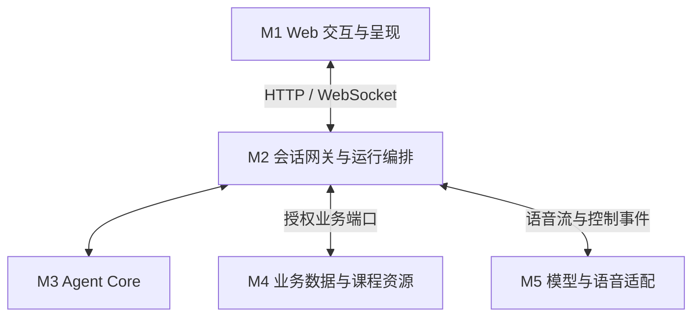
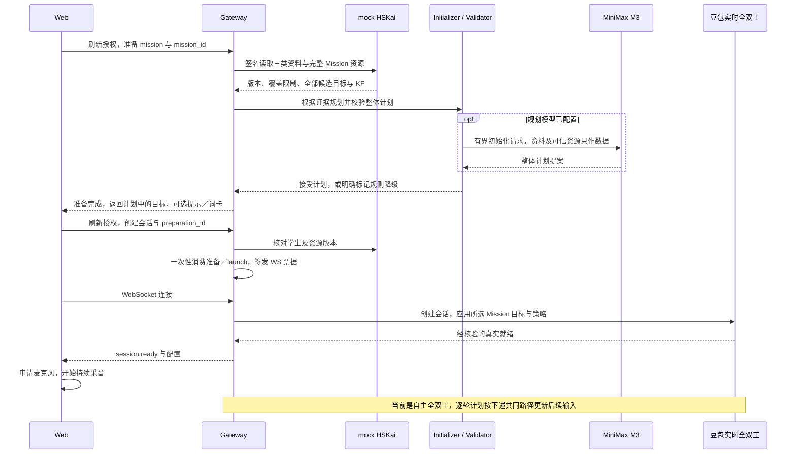
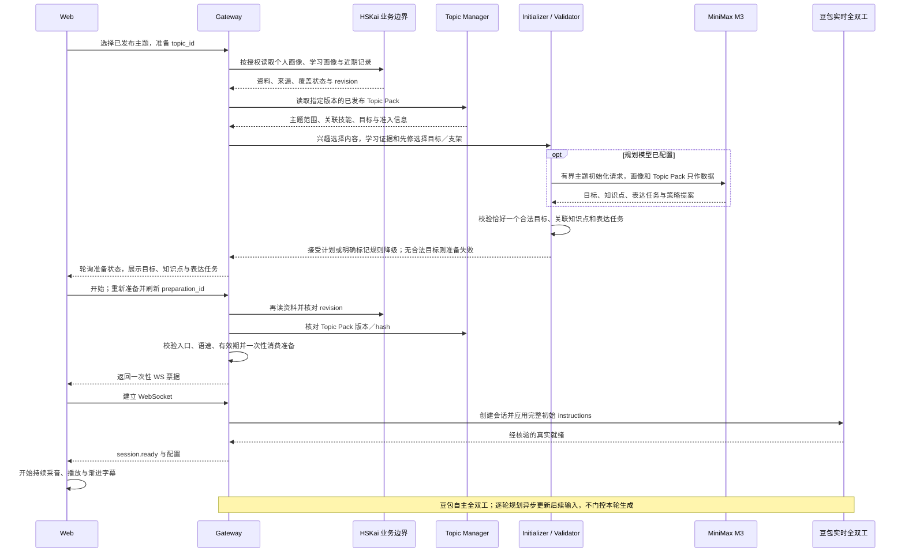
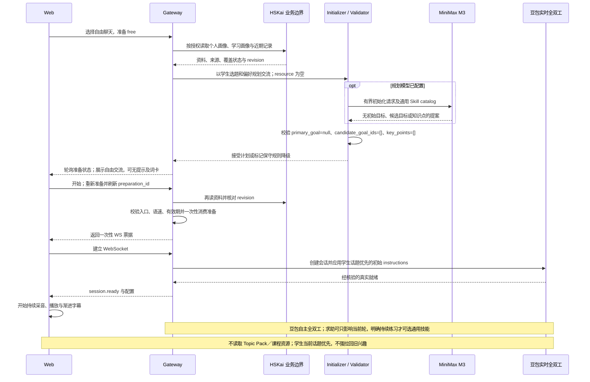
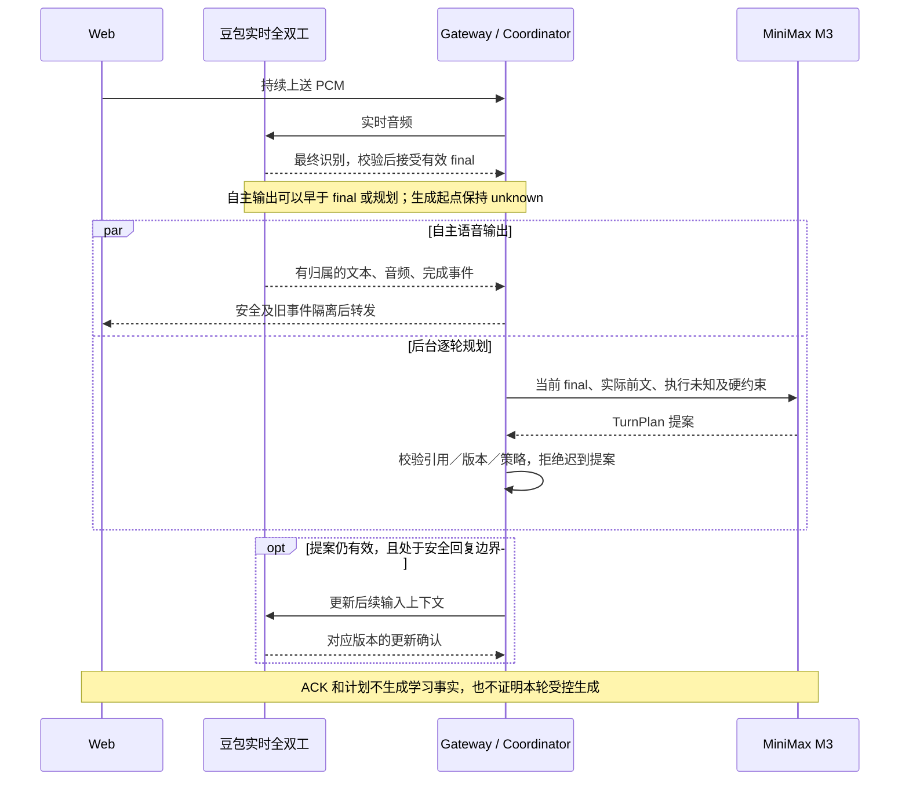

# Ask Kai

面向不同中文学习阶段的实时对话教学 Agent。

> 更新于 2026-10-15。当前为独立 Web POC：真实豆包语音＋本地 Mock 业务数据。动态初始化、会话／逐轮规划、目标替换／暂停／停止及 free 自愿练习已接入；语音保持豆包实时全双工，当前为 next_turn_advisory。主题式对话新链路已加入独立 Topic Manager、已发布 Topic Pack、四位学习者自适应初始化和 2 秒逐轮预算；461 项测试、三个 synthetic replay 及两组 Chromium 合成设备浏览器检查通过。真实 M3 规划在当前 8 组固定包样本全部超时并按规则降级；结果见[主题链路实施记录](docs/topic-chain-implementation.md)。可替换 LLM 的接口、原始规划快照、Agent reasoning／learner feedback、shadow ObservationPort、辅助规划语义审阅及独立豆包 Function Calling 实验已加入；M3 可靠性、正式本轮生成门控及完整设备验收仍开放。

**回复机制更新：** 当前 `kai-reply-v5` 取消默认一句、最多两句和固定字数限制，按语境与理解需要调整长度；Kai 先接住具体内容，再自然补充或追问。本轮 461 项测试及三个 synthetic replay 通过；真实豆包自然度与浏览器听感尚未验证。见[回复策略](docs/short-replies.md)。

**主题目标更新：** 主题式对话初始化必须有一个合法教学目标，并同时提供关联知识点与表达任务；Web 准备完成后展示这三项。资料不足可安排探索性表达，已有稳定能力可安排新情境应用；无合法目标或明确只想聊天时准备失败并给出提示，不以空目标进入主题会话。会中仍可调整／暂停练习；free 初始化仍无预设目标。见[目标准备与展示](docs/topic-chain-implementation.md#主题目标准备与展示)。

[产品介绍](#1-产品介绍) · [学习者画像](docs/learner-profiles.md) · [架构设计](#2-架构设计) · [三个入口](#3-使用方式三个入口) · [降级清单](docs/planner-fallback-inventory.md) · [评测](#4-评测机制与现有结果) · [现状](#5-实现范围与当前状态) · [计划](#6-接下来的计划) · [启动](#7-快速启动) · [文档](#8-文档导航)

## 1. 产品介绍

Ask Kai 希望让学生在真实交流中学习中文：既可以承接刚完成的 Mission，也可以围绕一个主题练习，或从自己感兴趣的事情开始聊天。Kai 先理解学生想表达什么，再选择适量示范、澄清、追问或练习；学生可以换话题、拒绝教学、随时打断或结束。

三个入口共享同一位 Kai、实时语音、渐进字幕与有来源的会话小结：

| 入口 | 使用目的 |
| --- | --- |
| Mission Call | 把 Mission 中的内容带入后续生活交流，按学生情况巩固、补缺或迁移 |
| 主题式对话 | 围绕选定主题，根据兴趣选择内容，根据学习证据选择目标与策略；当前工程示例为运动和音乐；已发布主题由管理端提供 |
| 自由聊天 | 学生话题优先，按能力与偏好适配交流；初始教学目标为空，允许零知识点 |

目标教学闭环是：根据入口和学生背景制定整体计划，在每轮对话中观察实际表现、规划下一步、执行并获得反馈。一次完整交流可以没有教学动作；计划或关键词命中不能直接证明学生掌握。

当前 POC 已有实时对话、动态初始化、会话／逐轮 M3 计划和有来源尝试；逐轮建议在回复边界更新后续输入，完整本轮受控生成尚未验证。产品要求见 [PRD](docs/prd/ask-kai-agent-prd-v1.1.md)。

目标、回复策略及逐轮 `action`／`task`／`expected_observation` 如何传给豆包、用了哪些事件、何时生效及如何区分执行证据，见[规划到豆包实时语音链路](docs/planning-to-doubao-chain.md)。

## 2. 架构设计

### 2.1 Agent 核心能力

采用七类能力描述 Ask Kai 的参考架构。它们是职责视角，不要求拆成七个服务；一个工程模块可以承载多项能力。

| 核心能力 | 在 Ask Kai 中回答的问题 | 主要工程落点 |
| --- | --- | --- |
| 目标与约束 | 本次希望达到什么？学生选择、教学规则和权限允许做什么？ | M3 Agent Core；M2 执行权限与运行约束 |
| 感知 | 学生说了什么、想表达什么？发生了打断或拒绝吗？前次动作实际发生了什么？ | M5 语音事件适配、M2 事件归属、M3 意图与表现理解 |
| 记忆 | 学生的兴趣、学习证据和近期记录是什么？本会话正在做什么？ | M4 三类学生数据；M3 会话工作状态 |
| 规划 | 整体路径是什么？根据当前差距和最新上下文，下一步怎样推进？ | M3 Agent Core 的整体与逐轮 Planner，使用 MiniMax M3；当前为 next_turn_advisory |
| 决策 | 哪个行动适合当前学生？提案是否有效、允许且仍适用？ | M3 规划／策略校验；M2 接受与执行归属 |
| 行动 | 如何执行回复、示范、澄清、词卡和获准的数据操作？ | M3 教学动作；M2 编排；M5 语音；M1 呈现；M4 业务读写 |
| 反馈与适应 | 实际效果与计划相差多少？需要减少支架、调整或暂停吗？ | M3 观察与证据；M1／M2 执行和播放反馈；M4 后续记录 |

模型承担意图理解、语义判断与规划；确定性代码承担权限、归属、规划用时上限、教学任务边界、版本和取消控制。反馈用于调整计划、策略和获准记忆，不等于自动修改生产提示词或训练模型。

**Time budget** 是完成规划所允许的最长时间，请求、格式修复、校验和提交共用时限；会中逐轮仍最多 2 秒。它与 Tutor 回复长短是两回事。当前回复采用自适应策略，不设固定字数、句数或中英文合计额度；根据本轮意图、理解需要及学生偏好充分回应，避免冗长独白。每轮保留一个交流重心和一个主要问题／练习邀请，承接内容、相关补充与自然追问可以一起完成。主动教学仍聚焦一个新点和一个示范，普通聊天允许零知识点。历史字段 `reply_budget` 的长度项为 `null`，`budget_ref` 引用当前回复策略版本，不代表存在固定长度限制。

### 2.2 五个核心工程模块

下图展示当前模块连接。M2 与 M3 在同一网关进程中，M1 由其静态服务提供，M4 的 Mock HTTP 服务由启动命令拉起；模块边界不等于独立部署。状态以本节表格及第 5 节为准。



| 工程模块 | 核心职责与包含内容 | 承载的 Agent 能力 | 当前实现与主要差距 |
| --- | --- | --- | --- |
| **M1 Web 交互与呈现** | 入口选择、采音、播放、渐进字幕、Start Tips／词卡、总结卡、连接与异常状态 | 感知输入、行动呈现、反馈采集 | 三入口与基本音频／展示已实现；目标、Start Tip 和词卡已改为服务端计划，准备与入口竞态已检查 |
| **M2 会话网关与运行编排** | BFF 授权、一次性票据、会话／话轮／回复状态、迟到事件隔离、打断、超时、上下文更新与回执 | 感知归属、决策提交、行动编排、执行反馈；约束落地 | 已实现准备版本核对、一次性消费和迟到规划隔离；当前自动回复可早于后台更新，本轮受控生成仍待验证 |
| **M3 Agent Core** | Kai 人设、目标与策略、语言支架、Context Compiler、整体／逐轮 Planner、计划校验、教学状态及观察／总结 | 目标与约束、工作记忆、规划、决策、教学行动、反馈与适应 | 会话和逐轮 M3 提案、来源校验与 learner feedback 已接入；困难／实际尝试／提示输出分开；通用语义 KP 与独立表达仍未验收 |
| **M4 业务数据与课程资源** | HSKai Bridge／数据端口、本地 Mock；身份、偏好、Mission／主题资源、个人画像、学习画像和近期记录 | 长期记忆输入、目标／知识依据、工具读写、反馈保存 | 四位可切换学习者、三个资料接口、有限课程、A～E fixture 和自愿尝试写回已实现；记录仅存进程内存，生产持久化待补 |
| **M5 模型与语音适配** | Doubao Adapter、供应商事件映射、音频格式、上下文／取消控制；MiniMax M3 PlannerPort 与受控生成能力边界 | 语音感知、模型推理能力供给、语言／语音行动及执行回执 | MiniMax M3 提案与豆包全双工已接入；没有已验证的本轮生成门控，controlled 保持关闭 |

实现位置：M1／M2 在 `apps/realtime-gateway/`；M3 在 `packages/agent-core/`；M4 在 `packages/hskai-bridge/` 与 `apps/hskai-mock/`；M5 在 `packages/provider-doubao/` 与 `packages/provider-minimax/`，合成供应商在 `packages/provider-replay/`。

### 2.3 支撑与治理

可信课程知识与学生记忆分开管理：课程资源说明可以教什么，学生记录说明实际经历和表现；Context Compiler 选择本轮相关信息。当前已支持三类 mock 数据及有限 Mission／运动资源，未知和截断明确标记；外部业务和通用资源检索未接入。见 [实施记录](docs/dynamic-planning-implementation.md)。

Harness 的横向职责覆盖五个模块：状态版本、权限、取消、规划用时上限、教学任务边界及幂等；数据来源、更正和删除；可观测性、评测与版本发布；教研审核和人工复核。当前有基础运行／策略边界，生产多机构隔离、完整持久化和真人接手另属产品化范围。本地 Mock 回执不代表真实账号、实际监护同意或真人处理完成。

评测运行器 `apps/eval-runner/` 是独立验证支撑，通过生产入口采集与回放实际行为；它的 `agent-harness.js` 是评测驱动器，不是生产 Agent Core。LangChain Judge／Langfuse 为可选配置，不是 POC 启动依赖。

参考：[Agent 动态决策与环境反馈](https://www.anthropic.com/engineering/building-effective-agents)、[企业 AI 应用设计](https://learn.microsoft.com/en-us/azure/well-architected/ai/application-design)。项目中的实际取舍以当前实现与 [Harness Review](docs/tutor-agent-harness-review.md)、[Pi 理想设计](docs/pi-ideal-tutor-harness-design.md) 为准。

## 3. 使用方式：三个入口

三种入口共用持续采音、随时打断、慢速选项、中文优先与按需短英文支架，以及结束后的有来源小结。只有供应商真实就绪后才申请麦克风并显示连接成功。语音在 Kai 说话时仍可上送，实际 AEC、停顿、打断和字幕体验需分别验收。

### 3.1 Mission Call

适合在 Mission 后把刚学的内容带入交流。当前使用本地签名的已完成 Mission 示例及其完整有限资源，结合三类学生资料选择承接目标；示例完成不等于真实课程完成或能力掌握。

| 阶段 | 学生体验 | 当前行为 |
| --- | --- | --- |
| 进入 | 选择 Mission 后对话，查看本次练习方向 | 准备本次计划，显示从全部可信候选中选择的目标 |
| 交流 | 分享、求助或尝试表达，Kai 提供适量支架 | 自适应回复与规则教学建议已接入，实际自然度仍需验证 |
| 调整 | 可换题、拒绝、打断或结束 | 原目标可暂停；打断清理旧输出 |
| 小结 | 查看实际练过的表达和可再练项 | 仅受支持目标有证据；Mission 完成不等于掌握 |

### 3.2 主题式对话

学生选择已发布主题后，结合个人画像、学习画像与近期记录选择一个教学目标，说明相关知识点和本次表达任务。主题包由独立 Topic Manager 提前生成并发布，初始化只读取固定版本；运动和音乐用于工程检查。当前知识点来自主题包关联的交流能力目录，不代表完整 HSK 语法清单。

| 阶段 | 学生体验 | 当前行为 |
| --- | --- | --- |
| 进入 | 选择主题，查看目标、知识点和表达任务 | 三项完整且通过校验才准备成功；不接受空目标；切换选择时清除旧内容 |
| 交流 | 围绕主题完成表达任务，需要时获得支持 | 任务是表达方向，允许不同说法；M3 提案经校验后作为后续输入建议，实际语义质量单独验收 |
| 调整 | 继续聊内容，或换题、拒绝、打断 | 已尝试后减少支架；换题／拒绝暂停原目标 |
| 小结 | 查看实际表达尝试，选择是否再聊 | 支持的喜好句／限定时间句记 attempted；其他 KP 未评估 |

### 3.3 自由聊天

学生可以先提问题、讲生活或从一个词开始。Kai 尊重当前话题，必要时澄清或帮助表达，不强制完成运动课。

| 阶段 | 学生体验 | 当前行为 |
| --- | --- | --- |
| 进入 | 选择开放式对话，提出自己的话题 | 通用人设与已授权偏好，无预设运动目标 |
| 交流 | 分享或追问，Kai 先回应意图 | 普通交流允许零知识点；求助可给单点支持 |
| 调整 | 随时换话题、拒绝教学、打断或结束 | 当前意图优先于旧偏好和教学建议 |
| 小结 | 看交流回顾或确有来源的表达记录 | 可显示“本轮以交流为主”；不虚构学习成果 |

### 当前实现：三个入口的技术时序

**2026-10-14：动态初始化、会话计划和逐轮规划已接入运行代码，语音保持豆包实时全双工。** 独立 mock POC 默认使用 `next_turn_advisory`：整体计划在建连前接受并编译为初始指令；逐轮 MiniMax M3 提案经校验后，在安全回复边界更新后续输入的上下文。当前没有核验本轮自动生成门控，不能声称本轮语音先经过外部 Planner；`controlled` 返回明确的未验证错误，不发起连接。真实 M3 可靠性仍未通过；独立 FC 实验观察到部分合成输入等待规划结果，尚不构成普通 Web 的每轮门控保证。设备体验仍待新版本验收。工程记录见[动态规划实施结果](docs/dynamic-planning-implementation.md)。

三个入口共用 `POST /api/conversation-preparations`、查询／取消和一次性消费。准备按已验证身份读取三类学生数据；Mission／主题再读取可信资源。`POST /api/sessions` 开始前重新核对同学生、入口、语速、有效期、学生及资源版本，失效则重新准备。旧客户端未传 `preparation_id` 时，由服务端使用相同模块内部准备。页面不再写死目标、Start Tip 或词卡，也不把准备完成当作语音已连接。

| 入口 | 当前动态初始化 | 页面展示与语音指令 | 证据范围 |
| --- | --- | --- | --- |
| Mission 后对话 | 读取已授权 Mission 的完整本地资源和全部候选目标，结合学习证据／近期记录选择本次承接目标；不固定 `targets[0]` | 同一计划中的目标、内容切入、可选提示和资源词卡 | 课程已完成不代表掌握；目标仅在对应资源规则支持时记录本轮尝试 |
| 运动主题 | `sports` 兼容映射为 `topic:sports`；兴趣选择内容，学习证据选择目标及支架，先修未知不擅自升级 | 篮球／跑步等内容可不同；有喜好独立表现及时间练习证据时可选择简单时间表达目标 | 喜好表达及限定时间句规则只记录 attempted；提示程度、独立使用和发音继续未知 |
| 自由聊天 | 无 Topic Pack／课程资源；读取三类资料，初始 `primary_goal:null`、`key_points:[]`，学生当前选题优先 | 无强制目标，提示和词卡可为空；普通交流允许零知识点 | 库外表达不自动变成正式 KP；当前不把局部求助登记为整场已学目标 |

**当前学生数据与保存边界：** 新签名 `HskaiPlanningPort` 聚合个人画像、学习画像和最近最多 10 项活动，并显式返回 available／partial／unavailable、revision、来源及截断。Mock 有四位可切换的虚构成年学习者（Alex／HSK1、Maya／HSK3、Leo／HSK5、Nina／HSK7），三类资料分别通过独立签名接口读取后聚合；A～E 保留为测试场景。网页可查看知识点、模拟掌握和近期历史。模拟掌握来自作者设定，不由本轮尝试升级。见 [四位学习者完整画像与累计知识](docs/learner-profiles.md)及[Mock 服务计划](docs/mock-learners.md)。原 `/api/memory` 五字段接口继续用于查看／更正／删除偏好，更正会使准备与旧规划失效，并刷新活动会话的最小学生上下文。

学习状态来自合成后端证据，与本轮实际观察分开。结束时默认不写回；学生主动勾选保存后，提交经过校验、按 learner＋session 去重的最小尝试记录，并等待 mock 回执。没有原始音频／逐字稿或自动掌握写入；仅存本地进程内存，重启重置。写回失败不显示保存成功。

**会中目标调整：** 明确选择可替换为可信资源中的目标；拒绝／换题立即暂停，明确取消则停止目标并清空旧提示／词卡。连续两轮明确表示当前练习太难，才允许退回资源中已有的先修目标；英文、单词或沉默不算困难证据。Free 的初始化和逐轮规划只读取三类授权学习者资料与实际对话，不读取 Topic Pack 或课程资源。单次求助只影响当前轮；明确要求持续练习时，从通用 Skill catalog 选择技能并验证先修，内容跟随当前交流，mode 保持 free，`resource` 为 null、`resource_refs` 为空。技能版本独立记入 `skill_catalog_ref`，不套用运动词卡；当前观察规则为 unassessed，不累计表达尝试或声称掌握。观察绑定发生时的目标与计划版本，总结保留会中涉及的目标。达成规则列出语义、提示和不同情境证据缺口，次数或自述不能证明独立／达成。见 [目标生命周期](docs/dynamic-goal-lifecycle.md)。

**入口 1｜Mission 后对话**



**入口 2｜运动主题对话**



**入口 3｜自由聊天**



**共用逐轮规划与观察：** 每个已接受的唯一 `user.final` 绑定不可变输入、实际此前话轮、上一回复转发结果／播放未知、整体计划、语言与拒绝／冷却状态，调用 MiniMax M3。提案需通过字段、大小、来源引用、目标、回复限制及策略校验；格式修复至多一次，共用截止时间。告别等明确控制可由规则直接处理；模型未配置／超时／非法输出的保守降级单独记录。新输入、偏好更正、打断、撤权或退出使旧在线规划失效，迟到结果不进入新回合。

当前 `next_turn_advisory` **不会等待规划再让豆包开始本轮自动回复**。逐轮建议在没有活动回复、待取消或待更新确认的边界发送；ACK 只确认对应上下文版本，不能追溯证明已开始的生成用了计划。执行账本将计划接受、自动输出首次观察、转发及客户端报告分开，供应商生成起点和实际播放没有证据时保持 unknown。普通 Web 尚不发送播放消费回执，不能从转发推断听到或理解。



连续 PCM 上送、原回复身份隔离、取消串行、字幕渐进与实际语音就绪规则保留。准备阶段不申请麦克风；未配置语音时 `/api/sessions` 仍返回 501。正常／普通异常结束先返回有来源总结，再关闭；安全限制或撤权清空学习展示。动态总结只展示支持目标的实际识别尝试，不生成独立使用、掌握或发音结论。

`legacy` 明确保留旧固定课／Mission 第一目标路径供比较；`shadow` 产出计划供获准观测，运行回复和页面仍使用旧行为；`controlled` 目前关闭。新主路径的本轮受控生成、完整语义知识点观察和真实成本／等待验收仍列为缺口，不能把当前工程通过视为 DP-05／06／10 已完成。见[实施与验收清单](docs/dynamic-planning-tasking.md)。

时序核对代码：[准备与身份校验](apps/realtime-gateway/src/preparations.js)、[初始化](packages/agent-core/conversation-initializer.js)、[规划器](packages/agent-core/planner-port.js)、[逐轮状态](packages/agent-core/planning-state.js)、[教学会话](packages/agent-core/teaching.js)、[实时网关](apps/realtime-gateway/src/realtime.js)、[动态观察](packages/agent-core/planning-observations.js)、[Mock 资源](apps/hskai-mock/src/planning-fixtures.js)。

## 4. 评测机制与现有结果

### 4.1 如何评测

| 层级 | 检查内容 | 机制与边界 |
| --- | --- | --- |
| 工程与契约 | 权限、话轮归属、乱序／取消、上下文、Mock 接口、页面 | 单测、合成事件回放、CI 浏览器；通过不等于真实语音或教学合格 |
| 对话内容 | 意图、知识正确性、指令遵循、教学适配、表达、连贯、目标推进、画像、人格、安全 | 十维评分＋逐项要求；实际多轮采集、模型辅助审阅，人工／独立 Judge 校准另列 |
| 实时体验 | 首音、停顿、抢话、打断、回声／噪声、渐进字幕和总结展示 | 真实供应商与设备测试；不能从文字评分推断 |
| 动态规划 | 整体／逐轮计划合理性、执行顺序与遵循、观察真实性 | 独立 fixture 与真实 M3 提案检查已接入；语义评分、真实本轮受控生成和设备验收仍开放 |

评测运行器通过生产 Agent 链路发送输入，前文采用实际 Kai 回复；参考、未来脚本与评分规则隔离。模型判断不自动更新学生事实。沿用十维权重，关键失败不能被平均分抵消。完整方法见 [内容回归](docs/p0-regression.md)、[多轮运行器](docs/multiturn-eval.md)、[真实记录评分](docs/recorded-scoring.md)。

### 4.2 最新结果

以下均为固定脚本／录音的自由会话及语言对照，不能外推为三个入口全部验收。评分来源为模型辅助离线审阅，尚无人工批准或本轮独立 Judge API 调用。

| 记录 | 范围与有效数据 | 评分结果 | 结论／报告 |
| --- | --- | --- | --- |
| 改造前全量候选评分 | 48 案／255 轮；47 案完整，244 轮评分 | 149 通过／72 待复核／23 失败；011 缺 11 轮 | 保留为历史对照；[全量比较](docs/eval-results/2026-10-13-task05-formal-comparison.md) |
| Harness 改造后针对性回归 | 26 案／149 轮；24 案完整，145 轮评分；候选 `307f56e` | 103 通过／29 待复核／13 失败；005／027 共缺 4 轮，12 项要求未评分 | **质量验收未通过**；[正式结果](docs/eval-results/2026-10-13-harness-formal-comparison.md) |

最新候选与上轮 `93b5cff` 的共同可比范围为 **134 轮**，均分 **94.60 → 96.44**；37 轮有改善、18 轮有退化，其中 2 轮同时有改善与退化；该范围关键失败均为 0。两次采集范围不同，不能直接比较总通过率；上述结果也不单独证明每项修复的因果效果。

主要残留问题：首轮语言偏好、歧义澄清、结束时长口头回顾、新表达的英文支架，以及部分采集／取消与完成信号缺口。工程侧已记录 338 项测试、三个回放和 CI 浏览器检查通过，见 [实现记录](docs/eval-results/2026-10-13-harness-cross-case-regression.md)；它们与内容质量、真设备体验分别报告。


2026-10-14 动态规划候选：363 项测试、三个回放和 Chromium 合成设备通过。真实 M3 初始化 4/6 接受 LLM 计划、1 组规则降级、1 组失败；逐轮 4/5 接受 LLM 计划、1 组降级。豆包动态初始配置连接探针收到真实就绪，不上传麦克风，不证明双向音频或本轮生成门控。见 [验证报告](docs/eval-results/2026-10-14-dynamic-planning.md)。

后续目标迭代：381 项测试、三个 synthetic replay 和多目标总结的 Chromium 合成设备检查通过。12 案／18 轮独立离线行为检查通过；真实 M3 最后完整批次初始化 5/12 接受 LLM、7/12 降级，逐轮 7/18 接受 LLM、11/18 降级。自动行为检查初始 11/12、逐轮 17/18；发现的错误收束已增加硬约束并做单案复验。这些字段／行为检查不等于完整语义合格，旧十维分数不变。见 [新验证报告](docs/eval-results/2026-10-14-dynamic-goals.md)。

上一轮可靠性迭代（826f2b8）：394 项测试、三个 synthetic replay、Chromium 合成设备回归通过。同一独立 12 案／18 轮数据与原初始化 10 秒／逐轮 5 秒的规划用时上限下，旧完整契约初始化 4/12、逐轮 5/18 接受 LLM；Draft-v5 初始化 4/12、逐轮 4/18，其余明确降级。自动行为检查均通过，但不能证明语义合格或可靠性改善；当时 M3 默认保留旧 prompt，Draft 显式 opt-in。Provider transport、通用编译和业务校验分开，后续更强 LLM 使用相同生命周期／取消／评测。豆包 FC 三个规则隔离样本和最后一个已接受 M3 当轮计划的样本均在工具结果后观察到输出；两次 M3 联调分别为逐轮规则降级／LLM 接受，初始化都降级。controlled 保持关闭。见 [可靠性与控制实验结果](docs/eval-results/2026-10-14-planner-reliability.md)。

本次 Agent 优先迭代：406 项测试、三个回放、20 个独立反馈案例、原 12 案／18 轮离线回归及 Chromium 合成设备通过。Planner 的 attempted 必须引用当前目标实际观察；learner feedback 区分困难、限定句式尝试与最近实际输出中的匹配示范。内部 ID 和两条同语言显式问题会被拒绝；结构规则不代替通用语义判断，提示／独立／掌握继续 unknown。新增八项辅助语义 rubric，模型评分不进入学习事实。真实结果与限制见 [Agent 完善验证](docs/eval-results/2026-10-14-agent-feedback.md)。

后续四项工程：420 项测试、三个回放、20 个反馈案例、12 案／18 轮规划离线回归和新增三会话／44 轮全部通过。审阅使用目标修订前的原始快照与 hash 绑定；ObservationPort 只接纳／拒绝未校准候选，不增加学习事实；降级按明确意图区分。会内拒绝／停止过的目标不会因困难自动恢复。没有新模型／豆包调用，真实语义质量与完整设备验收保持开放。见 [四项结果](docs/eval-results/2026-10-14-agent-four-tasks.md)。

## 5. 实现范围与当前状态

| 能力 | 实现状态 | 验证状态与限制 |
| --- | --- | --- |
| 独立 Web、三个入口、真实豆包语音 | 已实现 | 普通 Web 纵向验收已有用户确认；三个入口及剩余设备场景仍需补验 |
| 话轮归属、取消、上下文快照与更新确认 | 已实现 | 工程与部分真实链路已检查；仍有采集／时序缺口，不保证本轮新决策生效 |
| 自适应回复、语言支架、规则教学与拒绝／换题暂停 | 已实现 | 真实内容已有改善及退化，残留失败见第 4 节 |
| 渐进字幕、词卡与 Web 总结 | 已实现 | 同步按播放进度近似处理；真实设备及改造受影响项待复验 |
| 有来源的会内学习证据 | 已实现，范围有限 | 主要支持运动喜好及受支持表达；其他 KP 未评估，不输出掌握或发音结论 |
| Mock 身份、Mission、偏好和管理接口 | 已实现 | 四个独立 UID、三类资料接口、网页切换；五字段偏好仅存内存，重启重置，分层目标与会话对比待补 |
| 三类学生数据、动态初始化与整体／逐轮规划 | 工程已接入，MiniMax M3＋本地 Mock；主题入口读取独立已发布 Topic Pack | 同组旧契约与 Draft 对照均大量超时／降级，尚无可靠性提升证据；可替换 adapter 已拆分，当前为后续输入建议，不代表本轮先规划后生成通过 |
| 独立 Topic Manager、版本发布／回滚／撤销 | 已实现；后台生成、管理页面、持久化和运行只读端口 | synthetic 与真实生成分开记录；辅助内容审阅不等于独立教学质量认证 |
| 会中目标替换／暂停／停止、自愿练习与来源记录 | 旧资源的两个目标与新 Topic Pack 通用 GoalInstance 均已实现 | 规则／网关／页面已检查；独立表达、迁移及语义达成继续未评估，真实 M3 仍大量降级 |
| 跨会话记录、生产持久化、独立发音评分 | 自愿 mock 尝试写回已实现；后两者尚未实现 | 内存记录可进入下一会话历史，重启重置；不自动升级能力，真实业务库与发音服务另列 |
| 生产机构权限与真人接手、正式服务部署 | 尚未完整实现／验收 | 当前只限本机内部 POC，Mock 回执不等于外部处理完成 |

当前 POC 不依赖外部 HSKai 仓库、生产数据库或队列。后续可通过端口替换真实业务提供方，现有 Mock 数据不能当作真实学习者信息。范围依据见 [独立 POC](docs/standalone-poc.md)；正式产品发布条件见 [发布与评测](docs/release-and-eval.md)。

## 6. 接下来的计划

2026-10-16 已接入口头结束后的播放确认、自动关闭与本次会话记录写回／读回。小结包含本次目标和有来源的实际词汇／表达，保存到本地 mock 内存，重启重置；不自动升级掌握。豆包口头回顾已做有限作者合成语音检查，仍为 next_turn_advisory，完整知识语义覆盖与真人设备验收开放。见[实现记录与 CL-01～06](docs/conversation-closing-design.md#2026-10-16-实施记录)。

2026-10-15 最新安排：本轮按用户要求补齐主题初始化必有目标、知识点／表达任务及 Web 展示；其余主题链路工作继续保留在[主题 TODO](docs/topic-planner-tasking.md#搁置-todo)。自由对话已复现的问题、能力缺口与建议顺序见[自由对话工程审查](docs/free-conversation-engineering-review.md)。下列整体计划保留为后续范围。

2026-10-15 已补齐[全模块任务清单](docs/agent-completion-tasking.md)和[独立 Agent 评测计划](docs/agent-evaluation-plan.md)：针对最终三入口自适应对话，明确资源、执行、观察、总结与设备缺口，关联正在推进的 TP／DP 工作。当前为规划，不新增实现或质量通过结论。

现有 POC 收尾与动态规划建设分开记录，工程交付和质量验收分别判断。

| 工作线 | 近期重点 | 交付与验收依据 |
| --- | --- | --- |
| POC 内容质量 | 复核最新失败、退化与不可比轮；验证首轮语言、歧义进入生成、结束回顾收束及音频完成／取消原因；按类修复 | [正式报告](docs/eval-results/2026-10-13-harness-formal-comparison.md)、[收尾 Task05](docs/task05-implementation-tasking.md) |
| POC 体验与收尾 | 补未覆盖设备／入口旅程、偏好闭环、异常连续使用、安全与隐私边界；最后完成可重复演示 | [收尾 Task06–10](docs/poc-completion-todo.md) |
| 动态规划基础 | learner feedback、来源判断与辅助语义审阅已加入；当前 prompt-v7、完整契约为默认；后续更强 LLM 用同组数据验收目标选择、超时与语义 | [DP-00–04](docs/dynamic-planning-tasking.md)、[目标迭代验证](docs/eval-results/2026-10-14-dynamic-goals.md) |
| 初始化教学决策 | 主题管理、通用能力目录、Topic Pack 准入与版本、自适应初始化和第二主题已落地；逐轮规划上限 2 秒。当前 M3 的 8/8 初始化与 8/8 逐轮均为超时规则降级；豆包初始配置只观察到连接就绪，语义与完整设备验收待单独完成 | [正式 tasking](docs/topic-planner-tasking.md)、[主题服务与时延](docs/topic-management-service-design.md)、[教学决策设计](docs/initial-planner-teaching-design.md) |
| 动态规划执行与验收 | 验证豆包本轮门控与受控执行；完善语义 KP 观察、播放消费范围、跨入口真实音频与费用验收 | [DP-05–10](docs/dynamic-planning-tasking.md) |

当前优先完善 Agent：完整原始快照审阅、shadow 观察候选、贴合明确意图的降级与长会话回归已完成工程；更强 LLM 使用相同契约和评测。豆包门控与设备验收继续单独推进。见 [Agent feedback 设计](docs/agent-feedback-design.md)。

主题式对话当前从管理端定义主题、LLM／合成生成、准入审阅和发布进入学习端只读准备；四位学习者可在相同资源上得到不同教学方向，当前明确只想聊天可无目标。原 28 案保留设计 hash，主题范围内 24 案有工程契约 runner；语义仍待独立校准。真实模型与浏览器检查按 [本轮实施记录](docs/topic-chain-implementation.md) 分层报告。

动态规划的核心验收条件是本轮计划先于受控生成，并依据实际执行与学生反应继续规划。用户确认保持豆包实时全双工，本轮不引入独立 ASR／TTS。Seeduplex 本轮生成门控未证实前保留 next_turn_advisory，不能用延迟播放或迟到 ACK 证明本轮受控生成。

已重新读取最新官方 API／接入必读并实现独立 Function Calling probe；真实合成样本可观察到等待工具结果，尚未证明每轮强制调用、长会话与失败场景，因此不能启用 controlled。见 [控制能力核验](docs/protocol/seeduplex-planning-control.md)。

完整进度见 [实施记录](docs/implementation-plan.md)。Pi 完整设计是参考输入，不要求先迁移框架。

## 7. 快速启动

需要 Node ≥22.18。默认业务后端为本地 Mock，无需外部 HSKai 地址或数据库。

```bash
npm ci --ignore-scripts
npm run verify
npm run topics # 单独终端：本机主题管理 http://127.0.0.1:4320
npm run poc    # 学习端 http://127.0.0.1:4310
```

先在主题管理页面定义、生成、预览并发布主题；管理凭据可从本机忽略目录 `.local/topic-manager/credentials.json` 读取，两个服务自动共享只读凭据。`npm run topics:synthetic` 只用于工程演示，其包明确标记 synthetic。学习端不会在进入主题、初始化或逐轮规划时生成 Topic Pack；主题管理离线或尚未发布时，主题入口不可用，自由聊天仍可进入。

打开 http://127.0.0.1:4310。未配置语音时可以查看入口和偏好；不能进行真实对话，也不会申请麦克风。合成工程回放在 http://127.0.0.1:4310/dev/replay，始终标记“豆包未连接”。

真实语音需在本机 `.env` 配置服务端密钥及已审核 profile：

```dotenv
ASK_KAI_BACKEND=mock
ASK_KAI_PROVIDER=doubao
DOUBAO_API_KEY=你的本地密钥
DOUBAO_REALTIME_PROFILE=./.local/seeduplex-profile.json
```

首次设置参照 `.env.example`；已有 `.env` 保留并修改。profile 模板审核开关默认关闭，复制模板不等于已完成协议／账号验证；GitHub Secret 不自动出现在本机环境。完整步骤见 [Seeduplex 接入](docs/protocol/seeduplex-integration.md)和 [Web 音频](docs/web-realtime.md)。密钥、原始 wire trace 和真实学生录音不提交仓库。

工程检查使用 `npm run verify`、`npm run replay`、`npm run test:browser:topics` 和 `npm run eval:topics`；真实后台生成／规划检查需显式执行 `npm run eval:topics -- --live --publish`，会写入本机忽略的 Topic Manager 存储。浏览器检查按 [测试说明](docs/testing.md) 执行。真实模型调用须使用已配置权限并显式启动，合成测试成功不替代真实验收。

### 7.1 动态规划配置与检查

```dotenv
ASK_KAI_PLANNING_MODE=next_turn_advisory
ASK_KAI_PLANNER_PROVIDER=minimax
ASK_KAI_PLANNER_PROTOCOL=full_contract_v3
MINIMAX_API_KEY=你的本地规划模型密钥
MINIMAX_BASE_URL=https://api.minimax.cn/v1
MINIMAX_PLANNER_MODEL=MiniMax-M3
```

密钥仅放本机 `.env`。M3 初始化／逐轮请求与豆包实时 Key 分开；不启用额外 trace 或保存模型思维链。未配置 M3 时显示保守策略并记录 `planner_unconfigured`，不冒充真实语义规划。当前初始化规划用时上限为 15 秒、逐轮规划总用时上限为 2 秒；真实模型完成率与首音仍需校准。`npm run eval:planning` 使用 15 组独立合成 fixture 做离线契约检查；显式 `npm run eval:planning -- --live` 使用 6 组 fixture，最多 12 次规划请求及各至多一次格式修复，不调用豆包、Judge 或真实学生音频。`npm run probe:planning:voice` 单独验证一个动态初始上下文的真实连接，不上传麦克风。规划质量、生成因果、原十维内容和浏览器听感分别验收。

**什么时候会用规则代替模型规划、会使用什么规则：** 见[降级点与替代规则清单](docs/planner-fallback-inventory.md)。清单列出 8 类触发场景、三入口初始化规则、13 条逐轮规则及非降级边界；Topic Pack 生成失败不会自动替换成规则包。规则替代的是规划提案，不是豆包回复正文／音频；正常结束等规则控制与模型故障回退分别统计，当前资源失效路径存在降级标记缺口，详见文档。评估清单已记录，尚未改变运行行为或完成真实质量验收。

目标生命周期检查：npm run eval:goals。当前默认仍为完整契约 full_contract_v3，prompt 已加入通用 Agent reasoning 并升级为 kai-planner-v9；冻结对照仍为 kai-planner-v3。Draft 候选设 ASK_KAI_PLANNER_PROTOCOL=draft_v1，或评测时显式 --draft-contract。--legacy-contract 使用冻结在 88c98f7 的原始适配器作对照，两种契约选项不能同时使用。换模型需注册核验过的 transport／adapter，不是直接随意改模型名称；具体能力与成本策略独立配置，不改业务规划契约。显式 --live 使用 12 个虚构案例，共 12 次初始化＋18 次逐轮请求，每次最多一次有界修复；--case=refusal 可限定一个案例。不调用豆包或独立 Judge；独立期望不进入模型输入。初始化规划总用时上限为 15 秒、逐轮规划总用时上限为 2 秒；逐轮从接受输入计时并预留 200ms 提交窗口，修复不重置 deadline，超时明确降级；初始化预留 50ms。完整语义、当前轮控制和听感分别验收。

豆包 FC 检查为单独实验：先 npm run prepare:planning:fc，用本机系统语音生成固定作者输入；再 npm run probe:planning:fc -- --all --rule-planner 验证等待时序，或 --case=chat 用已配置 M3 联调。只上传这组本机合成 PCM，继续采音，不调用外部 ASR／TTS 服务；输出只有时序／数量／安全诊断。它不会改变普通 Web profile 或启用 controlled，亦不验证真实麦克风／听感。

Agent 检查：npm run eval:agent 使用 20 个独立案例验证角色、尝试来源及实际输出范围，默认不调用模型。显式 --live --case=difficulty-report,teacher-full-forwarded,teacher-reported 限定真实 M3 规划；再加 --semantic-review 对每个已接受提案新增最多一次、12 秒截止的辅助 M3 审阅。审阅不进入运行／写回，也不延长语音对话中的规划用时上限；它不等于人工校准或独立 Judge 验收。

完整快照检查：npm run eval:goals -- --capture-review 保存合成私有 snapshot-v2；npm run review:planning -- --preflight 检查全部绑定，不调用模型。旧不完整 artifact 不回填上下文。npm run eval:agent:long 运行三个入口共 44 轮离线序列；ObservationPort 需服务器显式注入，默认不调用模型、候选不进入规划或写回。见 [四项实现](docs/agent-four-tasks.md)。

## 8. 文档导航

| 方向 | 主要入口 |
| --- | --- |
| 产品与范围 | [PRD](docs/prd/ask-kai-agent-prd-v1.1.md) · [独立 POC 与 Mock](docs/standalone-poc.md) · [学习者画像与累计知识](docs/learner-profiles.md) · [四位学习者与三接口](docs/mock-learners.md) |
| 主题式对话实现 | [主题链路实施记录](docs/topic-chain-implementation.md) · [Topic Manager 与时延设计](docs/topic-management-service-design.md) · [TP tasking](docs/topic-planner-tasking.md) |
| Agent 设计 | [动态规划实施](docs/dynamic-planning-implementation.md) · [动态规划详细设计](docs/dynamic-planning-design.md) · [初始化教学决策](docs/initial-planner-teaching-design.md) · [Planner reliability 与模型替换](docs/planner-reliability-design.md) · [Agent reasoning 与 feedback](docs/agent-feedback-design.md) · [四项后续工程](docs/agent-four-tasks.md) · [Harness Review](docs/tutor-agent-harness-review.md) · [Pi 理想架构](docs/pi-ideal-tutor-harness-design.md) |
| 降级与规则回退 | [完整清单与评估 TODO](docs/planner-fallback-inventory.md) · [触发场景](docs/planner-fallback-inventory.md#triggers) · [初始化替代规则](docs/planner-fallback-inventory.md#initial-rules) · [逐轮替代规则](docs/planner-fallback-inventory.md#turn-rules) · [非降级边界](docs/planner-fallback-inventory.md#non-fallback) |
| 接口与实时运行 | [多端接入与集成](docs/multi-client-integration.md) · [事件契约](docs/contracts.md) · [HSKai 边界](docs/hskai-bridge.md) · [协议接入](docs/protocol/seeduplex-integration.md) · [上下文快照](docs/context-snapshots.md) |
| 规划到语音链路 | [目标、回复策略与逐轮字段到豆包的传递、生效时机和证据边界](docs/planning-to-doubao-chain.md) |
| 教学与呈现 | [自然教学](docs/natural-teaching.md) · [语言支架](docs/language-support.md) · [自适应语言支架需求](docs/adaptive-language-scaffolding-requirements.md) · [渐进字幕](docs/progressive-captions.md) · [学习总结](docs/session-summary.md) |
| 评测与结果 | [动态规划验证](docs/eval-results/2026-10-14-dynamic-planning.md) · [测试说明](docs/testing.md) · [多轮运行器](docs/multiturn-eval.md) · [真实评分](docs/recorded-scoring.md) · [最新正式报告](docs/eval-results/2026-10-13-harness-formal-comparison.md) |
| 开发与计划 | [POC 收尾](docs/poc-completion-todo.md) · [动态规划清单](docs/dynamic-planning-tasking.md) · [实施记录](docs/implementation-plan.md) |
| 详细参考与历史 | [原 README 参考快照](docs/readme-reference-20261013.md)：保留原完整时序、操作细节、原始路线图和历史说明，不作为最新状态来源 |

后续 README 主要更新第 4 节结果、第 5 节状态和第 6 节计划；具体运行、设计和历史过程更新对应专题文档。工程实现变化后再同步架构与当前时序，设计提案不提前写成已实现行为。
