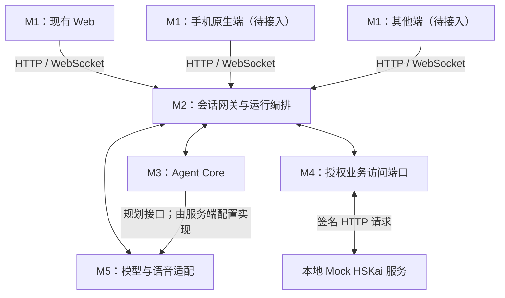

# Ask Kai 多端接入与集成说明

更新于 2026-10-14。本文说明当前代码的复用关系、已有接口，以及新增手机等客户端的实施方式。现状以当前工作区代码、[README](../README.md) 和 [实施计划](implementation-plan.md) 为准；标为“待实施”的内容是接入建议，不代表已经支持。

当前仍是独立本地 POC：业务身份、课程、学习资料和工作流使用 Mock HSKai，语音另行连接真实豆包。本文不扩大到外部 HSKai 系统集成，也不改变现有运行限制。

## 1. 多端如何使用同一个 Agent

客户端通过 M2 的网络接口使用 Agent；M2 在服务端加载 M3、M4、M5 的代码。新增客户端主要新增或适配 M1，同时复用服务端的会话编排和 Agent 能力。



这里有两种不同的接口：

| 接口 | 使用者 | 当前形式 |
| --- | --- | --- |
| 服务端代码接口 | 网关、Agent Core、评测程序 | 通过 `import` 调用函数、类或注入的 port 实现 |
| 客户端网络接口 | Web，以及未来的手机等客户端 | HTTP JSON、WebSocket 控制与音频消息 |

`packages` 中的代码不会因为所在目录而自动成为远程服务，也不要求发布到 npm。手机端通常无需打包或执行这些服务端模块；它接入 M2，间接使用这些能力。服务端仍负责模型密钥、业务签名、权限检查、规划和学习证据处理。

## 2. 工程目录与复用边界

M1–M5 是职责划分；`apps` 放应用装配与运行入口，`packages` 放供这些入口调用的模块。模块、目录和独立部署单元不是一一对应。

| 职责 | 当前主要位置 | 新客户端如何复用 |
| --- | --- | --- |
| M1 Web 交互与呈现 | `apps/realtime-gateway/public/` | 复用交互语义与协议；原生端重新实现界面、采音、播放和设备生命周期 |
| M2 会话网关与运行编排 | `apps/realtime-gateway/src/` | 复用服务端授权、准备、会话、话轮、取消和输出归属；入口需按端适配 |
| M3 Agent Core | `packages/agent-core/` | 复用教学策略、初始化、规划校验、会话状态、观察及总结 |
| M4 业务数据与课程资源 | `packages/hskai-bridge/` 与 `apps/hskai-mock/` | 通过网关复用授权数据访问；当前后端仍是本地 Mock |
| M5 模型与语音适配 | `packages/provider-doubao/`、`packages/provider-minimax/` | 复用语音接入与规划模型 transport；设备音频适配仍由客户端完成 |
| 合成事件回放 | `packages/provider-replay/` | 用于开发和回归测试，不提供真实对话能力 |
| 跨模块契约与策略 | `packages/contracts/`、`packages/policy/` | 复用数据语义、校验与运行约束；原生端按协议实现对应处理 |

当前 Web 静态资源由网关提供，M2、M3 在同一个 Node 进程内运行。Mock HSKai 是由同一启动命令拉起的独立本地 HTTP 服务，不等于独立操作系统进程。新增客户端不要求把 M3–M5 拆成微服务。

## 3. 当前可运行范围与手机接入差距

现有网络接口可以作为多端契约的基础，但当前构建尚不是可直接供远程手机访问的公共 Agent API。

| 项目 | 当前实现 | 新端接入需要的工作 |
| --- | --- | --- |
| 网络监听 | 配置仅允许 `127.0.0.1`／`::1` | 为远程设备设计并实现可访问的测试入口和部署配置 |
| HTTP／WS 来源 | Host 限制本机，写请求和 WS 要求匹配 `http://Host` 的 Origin | 按部署确定可信来源、HTTPS／WSS 和代理转发规则 |
| Web 授权 | Mock launch 设置短期 HttpOnly Cookie；Bridge 也能校验签名 Bearer assertion | 原生端授权获取、刷新和 WS 凭证绑定方案仍需实施；不是任意登录 token 都能使用 |
| 浏览器跨域 | 当前页面与 API 同源 | 独立域名前端需要明确跨域与 Cookie 策略；当前没有通用跨域接入能力 |
| 实时音频 | Web 使用 AudioWorklet、PCM 与播放队列 | 原生端／其他运行环境实现自己的采集、重采样、播放和回声处理 |
| 持久化与恢复 | Mock 和会话主要为进程内状态 | 断线按新会话处理；当前没有跨端无损续聊或持久恢复保证 |

手机上的 `127.0.0.1` 指向手机自身。只修改客户端 URL、把监听地址改成局域网地址或增加反向代理，都不足以完成接入：当前配置、Host、Origin、凭证和音频设备约束需要一起处理。

## 4. 现有 HTTP 接入流程

以下是当前本机同源 Web 路径，原生端可据此实现客户端状态机；远程网络与授权入口适配属于待实施工作。

| 顺序 | 接口 | 客户端行为与约束 |
| --- | --- | --- |
| 1 | `GET /api/runtime` | 读取业务来源、语音是否配置、规划模式；配置可用不代表实时已连接 |
| 2 | `POST /api/poc/launch` | 仅本地 Mock 的授权入口，设置 60 秒 Cookie；现有工作区支持选择白名单中的合成 `uid`，不能当作生产登录 |
| 3 | `GET /api/bootstrap`、`GET /api/speech-paces` | 获取授权入口、Mission 信息和支持的语速 |
| 4 | `POST /api/conversation-preparations` | 以入口参数准备会话，返回 202、`preparation_id` 和状态 |
| 5 | `GET /api/conversation-preparations/{id}` | 查询到 `ready` 后展示服务端返回的 `view`；准备失败显示可重试状态 |
| 6 | `DELETE /api/conversation-preparations/{id}` | 切换入口、学习者或放弃时取消旧准备；客户端同时隔离迟到结果 |
| 7 | `POST /api/sessions` | 必要时刷新授权，以相同入口和语速提交 `preparation_id`；获得一次性 WS 票据 |
| 8 | `/api/realtime` WebSocket | 使用返回的路径、协议和票据连接，先接收配置，再等待真实就绪 |

当前三入口参数示例：

```json
{"mode":"sports","speech_pace":"slow"}
```

```json
{"mode":"free","speech_pace":"slow"}
```

```json
{"mode":"mission","mission_id":"<bootstrap 返回的授权 Mission ID>","speech_pace":"slow"}
```

以上用于准备请求。只有 `/api/speech-paces` 返回支持时才传 `speech_pace`，否则省略；创建会话沿用相同参数并增加 `preparation_id`。准备接口内部可将 `sports` 规范化为 `topic:sports`，但当前创建会话接口只接受 `sports`、`free`、`mission`，不要直接发送 `mode:topic`。

```json
{"mode":"sports","speech_pace":"slow","preparation_id":"<准备返回的 ID>"}
```

准备绑定授权学习者、入口、语速、资料与资源版本，默认有效期 60 秒且受授权期限约束。创建会话时服务端会重新核对并一次性消费准备和 launch；返回 409 `PREPARATION_UNAVAILABLE_OR_STALE` 时重新准备，不复用旧页面计划。401 时按授权流程刷新，429 时提示容量不足，避免无界重试。创建会话失败或返回丢失时，不应假设原票据仍可使用。

旧客户端可以不传 `preparation_id`，服务端会内部准备；新端建议显式准备，以便展示目标、提示与失败状态。目标、Start Tip、词卡由服务端返回，自由聊天允许没有教学目标。

## 5. WebSocket、音频与呈现

### 5.1 建立连接并等待真实就绪

创建会话响应包含 `session_id`、`ticket`、`websocket_path`、`protocol`、`expires_in`。票据最长 30 秒，受授权有效期限制，一次使用，包括失败的升级尝试。当前握手采用两个 WebSocket 子协议值：

```js
// 当前同源 Web 示例；native 需使用其 WS 库实现相同握手语义。
const ws = new WebSocket(
  `${location.protocol === 'https:' ? 'wss:' : 'ws:'}//${location.host}${result.websocket_path}`,
  [result.protocol, `ticket.${result.ticket}`],
);
```

HTTP 201、WS 已打开、`session.config` 和准备 `ready` 均不能显示“语音已连接”。客户端先保存 `session.config.audio`，再等待 `type:event` 包中的 `event.type:session.ready`，并确认 `synthetic:false`、`provider_connected:true` 后申请麦克风和上送音频。当前网络入口本身仍只接受本机 HTTP Origin；上例的 WSS 分支不代表远程 HTTPS 部署已经完成。

### 5.2 音频格式与流式播放

- 上行：WS 二进制消息，单声道 PCM signed 16-bit little-endian；按 `session.config.audio` 的采样率与帧长组织。当前 reviewed Seeduplex 配置为 16 kHz、20 ms，即每帧 640 字节，无 WAV 文件头。
- 下行：JSON 包 `type:event`，其中 `event.type:response.audio.chunk`；音频是包顶层 `audio` 的 base64 PCM，按 `sample_rate` 解码播放。当前 reviewed 配置输出 24 kHz；以配置和包字段校验，不按设备默认采样率播放。
- 持续采音：Kai 播报期间仍能上送学生音频；客户端负责合适的回声处理、播放缓冲和上传背压。现有 Web 上传缓冲超过 64 KiB 时结束会话并提示重试，可作为新端限界设计的参考。
- 字幕：消费 `response.text.delta`，按当前回复与实际播放进度渐进展示；不要用网络到达时间推定学生已经听到。

以上是客户端与 Ask Kai 网关的协议，不是豆包原始 wire 协议。供应商事件映射由 M5 负责，客户端不直接使用豆包事件名或供应商密钥。

### 5.3 消息处理与回复归属

| 消息 | 客户端处理 |
| --- | --- |
| `event` 包中的 `user.partial`／`user.final` | 更新学生转写；partial 不当作最终学习证据 |
| `response.started`／`response.text.delta`／`response.audio.chunk`／`response.done` | 绑定当前 `session_id`、`turn_id`、`response_id`；回复完成不等于设备播放完成 |
| 顶层 `output.stop` | 立即清理对应回复的播放与字幕；未指定回复时清理当前输出 |
| 顶层 `teaching.state`／`teaching.summary` | 使用服务端教学视图与有来源总结；校验会话，防止旧会话覆盖新页面 |
| 顶层 `session.failed`／`session.closed` | 释放采音、播放和连接资源，显示失败或结束状态 |
| 顶层 `safety.notice`／`safety.handoff` | 停止正常输出，按实际状态显示提示；Mock 回执不能显示真人已接手 |
| 顶层 `learning.record.receipt` | 只有明确接受的回执才显示保存成功，并保留本地 Mock／内存标识 |

手动打断：先停本地播放、取消旧字幕调度，再发送：

```json
{"type":"response.cancel","response_id":"<当前回复 ID>"}
```

结束：停止采音并发送下列消息，保留连接接收总结／终态，之后释放连接；失败时也必须清理本地设备。

```json
{"type":"session.end"}
```

仅当学生主动选择保存时，才发送 `{"type":"session.end","save_learning":true}`。记录来自服务端校验后的最小尝试证据；当前仍只保存在 Mock 进程内存，未收到回执不能显示成功，也不写成掌握、独立表达或发音结论。

新会话、打断、切换入口、学习者切换和退出时递增客户端 generation／epoch，拒绝旧异步任务及迟到音频、文字、总结恢复内容。不能只清空 UI 而保留旧播放队列。

服务端已接收 `playback.report`，但现有普通 Web 未发送播放消费回执。新端如需接入，先对齐 `packages/agent-core/planning-state.js` 的消费校验并补充验证；实际播放未知时保持 unknown，不从音频转发、回复完成推定听到或理解。

## 6. 不同客户端的实施方式

| 端形态 | 可沿用部分 | 需要新增或适配 |
| --- | --- | --- |
| 现有同源 Web | 当前 HTTP／WS 流程与 Web 实现 | 目标浏览器、权限与真实音频体验验收 |
| 手机浏览器 H5 | Web 业务流程、页面和大部分 JS | 可访问的 HTTPS／WSS 入口、移动浏览器音频恢复和前后台状态；当前远程入口待实施 |
| 手机原生端 | M2–M5 和客户端网络协议 | 原生界面、授权 transport、PCM 音频引擎、音频中断与应用生命周期 |
| WebView 容器 | 可考虑承载现有 Web 页面 | 容器权限、Cookie、Origin、音频 API 支持；若用原生音频桥，明确唯一采音／播放所有者并验收 |
| 其他受限运行环境 | 网关服务端能力与协议语义 | 先核对二进制 WS、持续双向音频和 PCM 播放能力；能力不足时需新 transport，当前没有现成适配 |

建议按以下顺序实施，每步先形成可验证结果：

1. **确定一个目标端和联调入口。** 选择 H5 或一种原生端，梳理授权来源、网络可达性、Cookie／Bearer 和 WS 库能力。当前本机 Web 是协议基线；真实手机入口属于新增工程。
2. **适配 M2 的网络与授权入口。** 实施配置化可信 Host／Origin、HTTPS／WSS 与代理规则；为 native 定义授权获取、刷新、撤销和票据绑定。保留签名、owner／learner／scope、一次性消费和超时校验，不能以删除校验实现接入。当前 Mock 仅用于内部合成账号联调，不承担公网认证。
3. **先接准备和会话状态。** 实现 HTTP client、准备轮询／取消、失败重试与服务端 view，验证三入口和旧请求隔离。新端不自行拼教学目标、学习画像或 Mission 完成状态。
4. **接实时消息与音频。** 实现 WS 握手、真实 ready 门控、PCM 采播、重采样、背压、回复归属、字幕与手动打断。前后台切换、电话／设备中断时明确停止或结束策略；当前断线重连创建新会话，不声称无损续聊。
5. **接总结、保存和资料操作。** 通过 M2 的授权接口访问资料和偏好，不从端上直接调用 Mock 内部业务端口；处理撤权、删除和切换学习者时的内容清理。多端共享资料与跨端共享正在进行的会话是两件事，后者尚未实现。
6. **分层验收。** 运行下节检查，确认 Agent 复用没有破坏话轮、取消、学习证据或 Mock 标识。M3／M5 通常不因增加端而修改；需要变化时按已有契约单独验证。

当前语音仍为 `next_turn_advisory`：逐轮规划可更新后续输入，但不保证每次本轮语音先经过外部 Planner；`controlled` 仍关闭。客户端改变不改变这一能力边界。

## 7. provider-replay 的用途

`packages/provider-replay/` 是**合成事件回放器**，可以理解为语音供应商的测试替身。它读取 `docs/test-fixtures/` 下人工编写的 JSON，校验 `synthetic:true` 及内部事件契约，再按顺序输出事件，可设置固定输出间隔。

| 场景 | 检查目的 |
| --- | --- |
| `normal` | 正常回合、字幕及有来源尝试证据的事件处理 |
| `interruption` | 打断、取消确认与迟到事件隔离，防止旧回复污染新回复 |
| `failure` | 失败状态处理，防止把失败显示为已连接 |

它不调用豆包或 MiniMax，不理解输入、不生成回答、不包含真实学生录音，也不生成可播放语音。音频事件仅携带字节长度、格式等元数据。`sendAudio` 明确拒绝音频，取消行为来自脚本，不支持交互式 `cancel` 或 `updateContext`。

目前使用方式：

```bash
npm run replay
npm run replay -- interruption
```

第一条运行全部三个场景，第二条只运行打断场景。浏览器可访问 `/dev/replay`；其 `/api/replays/{id}` SSE 是工程诊断路径，不是学习者实时语音协议。回放中的 `session.ready` 是人工事件，外层仍须显示 `synthetic:true`、`provider_connected:false`，不能触发真实麦克风或显示豆包已连接。

Mock HSKai 与 ReplayProvider 模拟的是两侧不同依赖：前者模拟业务身份／课程／资料，后者模拟模型与语音侧的内部事件。当前普通 POC 可以组合“Mock 业务 + 真实豆包”；配置默认值为 replay 时，主启动入口不会据此创建一个可交互的假语音会话。

Replay 适合无密钥、无模型费用、可重复地验证状态处理。它不能证明真实供应商协议、语音自然度、教学质量、网络时序或真实设备音频表现。手机端也可借鉴这些场景建立协议测试，但当前 Replay 包是 Node 代码、SSE 输出是诊断投影；还没有供原生端直接连接的交互式测试 WS 服务。

## 8. 验证与交付范围

未来涉及运行时／契约修改时，按仓库要求执行 `npm run verify` 和 `npm run replay`。Web 受影响时执行 `npm run test:browser`；新原生端增加对应客户端验证。结果分开报告：

| 验证层 | 能说明什么 | 不能替代什么 |
| --- | --- | --- |
| 合成／契约检查 | 准备绑定、事件归属、取消、迟到隔离、失败和 Mock 授权逻辑 | 真实供应商连接、真实内容与设备听感 |
| 真实供应商检查 | 用现有授权配置验证真实连接、音频与控制行为 | 手机采音、AEC、字幕同步或人体实际体验 |
| 浏览器音频检查 | 目标浏览器中的音频 API、播放与采集行为；注明合成设备还是真设备 | 原生端音频和未经覆盖的真实设备 |
| 手机真机检查 | 麦克风权限、耳机／外放、打断、网络波动、音频中断及前后台 | Agent 语义质量和学习达成 |

本文交付的是集成说明，不实施网络开放、外部业务接入或手机 SDK，也未因文档创建新增真实供应商／设备检查。现有代码还没有跨平台客户端 SDK；后续可按需要抽出不依赖 DOM 的 HTTP／WS 状态处理，音频与 UI 保持各端实现。

## 9. 实现参考

- 装配与运行：[main.js](../apps/realtime-gateway/src/main.js)、[config.js](../apps/realtime-gateway/src/config.js)。
- HTTP 与准备：[server.js](../apps/realtime-gateway/src/server.js)、[preparations.js](../apps/realtime-gateway/src/preparations.js)、[PreparationClient](../apps/realtime-gateway/public/preparation-client.js)。
- 实时消息与客户端：[realtime.js](../apps/realtime-gateway/src/realtime.js)、[web.js](../apps/realtime-gateway/public/web.js)、[audio.js](../apps/realtime-gateway/public/audio.js)、[presentation.js](../apps/realtime-gateway/public/presentation.js)。
- 授权边界：[identity.js](../packages/hskai-bridge/identity.js)、[独立 POC](standalone-poc.md)、[动态规划实现](dynamic-planning-implementation.md)。
- 合成回放：[ReplayProvider](../packages/provider-replay/index.js)、[CLI](../apps/eval-runner/src/replay.js)、[内部事件校验](../packages/contracts/events.js)。

部分基础契约文档保留早期阶段说明；接入时以当前路由与实现为准，客户端协议与供应商原始协议始终分别核对。
