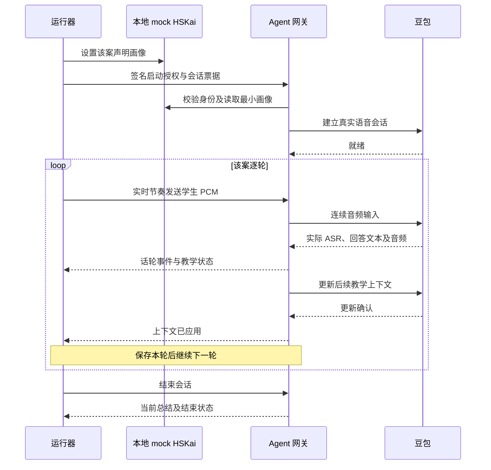

# 自由会话多轮评测运行器

运行器是同仓库的命令行工具，用 V3.1 固定学生脚本收集真实 Ask Kai 回复。它复用现有 Agent 实现和本地 mock HSKai，不需要独立部署评测平台。参考、评分锚点、软目标和未来学生输入只供评审，不进入待测模型。

2026-10-11 已完成工程实现和本地协议模拟测试，随后开始独立保存首案真实试跑记录。全量评测和评分尚未完成，Task 10 仍待验收。模拟测试经过生产适配器和网关，但供应商 ASR 与回答来自明确标记的测试 fixture；不能冒充下方实际调用记录。

## 实际调用路径

每案启动独立的 mock HSKai 和生产网关，沿签名启动授权、会话票据和 WebSocket 路径建立 `free` 会话。初始语言画像经过现有 HSKai 校验；未声明的理解程度、已知表达保持未知，默认足球偏好不会混入案例。按轮发送音频，等待实际 ASR、完整回复及上下文更新确认，再发下一轮。



同案前文由真实供应商会话积累，包含此前实际 Kai 回复。运行器不把作者参考填入前文，也不逐轮新建裸模型请求。安全、语言策略、教学状态、话轮归属和总结仍由现有生产实现处理。

当前 Seeduplex 接入确认的是音频查询：16 kHz、单声道、PCM16 小端，每 20 ms 发送 640 字节；轮间继续发静音，与 Web 持续上传路径一致。`speech_text_buffer.commit` 是固定文本语音合成，不当成模型查询；`conversation.item.create` 的历史问答也不当成未经核验的用户文本输入。依据见 [Seeduplex 接入说明](protocol/seeduplex-integration.md)及[官方接入必读](https://docs.volcengine.com/docs/DoubaoVoice/access-mustread?lang=zh)。

## 三步使用

### 使用 GitHub 中已有的 Key 试跑

已有 Repository Secret `DOUBAO_API_KEY` 时，不需要再提供 Key，也不需要 Judge、Langfuse 或 HSKai Key。GitHub Secret 只能注入 Actions 步骤，不能读取出来自动填入本机 `.env`；下方 CLI 的本地配置与 Actions 配置是两个运行环境。

仓库已新增 **Doubao first-case multi-turn trial**。首次提交或修改 `.github/live/doubao-multiturn-request.json` 会在 main 启动；之后可在 GitHub → Actions → 该工作流 → Run workflow → main 手动重跑。普通提交与日常 CI 不启动真实调用。

该入口固定第 001 案／4 轮，整体供应商调用预算 5 分钟，不自动重试：先用同一个 Key 合成固定学生文本，再通过现有授权 Agent 网关进行实际 ASR／多轮回答。数据集与静态 profile 的哈希绑定在请求文件，不能通过工作流输入扩大范围或注入其他文本。

试跑沿用已完成真实适配器复测的专用 `protocol_smoke` 机制：只在内存中建立明确的探针配置，并显式传入 `protocolProbe: true`。普通 Web 和本地 CLI 仍拒绝探针配置，已提交模板和正常实时审核开关保持原值。其目的是取得首个持续音频、ASR 和模型回答观测，不预先认定这些行为已验收。

运行结束后打开 Actions 的 **Artifacts → doubao-multiturn-trial**：`observations.json` 是实际识别／AI 回复与总结，`report.json` 和 `trial-report.json` 是元数据，`audio-manifest.json` 记录作者合成输入来源。Artifact 保留 3 天；不上传输入 PCM、密钥、真实学生录音或原始供应商 wire trace。逐字稿只来自本仓库作者脚本和生成的 AI 回复，终端日志不打印它们。失败时同样保存已完成的记录。该入口不自动赋分，不完成 Task 10 或开启 Web 语音。

首次[实际试跑 38143125703](https://github.com/yqhuang-cyber/ask-kai/actions/runs/38143125703) 使用已有 Key 成功生成 4 条输入音频，并取得 Agent 供应商就绪；第一轮以 `PROVIDER_PROTOCOL_ERROR` 结束，没有有效 ASR final 或完整回复。已保留失败记录与诚实的部分总结，没有评分。第二个请求补充仅字段类型／长度与会话内 ID 别名的结构诊断，用于定位实际 ASR 映射，不记录原始帧、逐字稿字段值或密钥。它仍是一次显式、固定范围的试跑，不是自动重试。

[结构诊断 38143585810](https://github.com/yqhuang-cyber/ask-kai/actions/runs/38143585810) 定位到同一 `item_id` 的 ASR 完成事件含 `text` 字符串、没有 `transcript`，原适配器因读取缺失字段而抛出 `INVALID_PROVIDER_TEXT`。已修复实际 `text` 映射，保留既有 `transcript` fixture 兼容；两字段同时存在但内容冲突，或字段为空／类型不正确时仍拒绝形成学习证据。最终识别之前的文本不会变成学生最终话轮。第三个请求用于验证修复后的实际四轮链路。

### 本机运行

在仓库根目录运行。默认使用已提交的 V3.1 JSON，默认只选第一个原始案例。`.env` 中使用现有 `DOUBAO_API_KEY` 和 `DOUBAO_REALTIME_PROFILE`，不需要额外 Judge Key。正常语音 profile 的静态、实时和有序 ACK 审核必须完成；仅探针审核的配置不能用于运行器，工具不会修改审核开关。

先执行离线预检：

```bash
npm run eval:multiturn
npm run eval:multiturn -- --case ask-kai-v2-001 --prepare-audio
```

不加 `--live` 不连接豆包。输出案例数、轮数和缺失条件；缺 Key、缺已审核 profile、工作区未提交或缺输入音频会列出阻碍。离线预检列出阻碍时退出成功；格式错误或显式真实运行被阻止时退出失败。正常 CI 只做离线预检和模拟测试。

如果没有学生输入音频，可显式用同一个豆包 Key 合成固定学生脚本：

```bash
npm run eval:multiturn -- --live --prepare-audio \
  --case ask-kai-v2-001 --out .local/eval-input-001
```

这一步会产生真实供应商费用。每个不同输入文本使用独立固定 TTS 会话，同批重复文本复用缓存；24 kHz 输出重采样为 16 kHz。产物是作者脚本音频和 `audio-manifest.json`，标记 `authored_tts`，没有 Agent 回答或成绩。失败保留部分 manifest，不自动重试。输出目录必须全新，重跑使用新目录。

准备完音频后，再收集实际 Agent 回复：

```bash
npm run eval:multiturn -- --live --case ask-kai-v2-001 \
  --audio-manifest .local/eval-input-001/audio-manifest.json \
  --out .local/eval-run-001
```

manifest 必须匹配本次数据集与所选每轮脚本的 SHA-256，并通过音频格式、大小、路径和文件校验。输入每轮最多 30 秒，回复等待默认 45 秒，可用 `--turn-timeout-ms 60000` 调整至最多 120 秒。`synthetic_fixture` 输入不能作为真实运行音频。已授权录音可按同一 manifest 格式声明 `approved_recording`；该标签由提供者声明，文件哈希不证明授权或内容正确，使用前需实际检查。

## 扩大范围

| 参数 | 选择范围 |
| --- | --- |
| 不传选择参数 | 第一个原始案例 |
| `--case ask-kai-v2-001,ask-kai-v2-002` | 指定原始案例，保持数据集顺序 |
| `--limit 5` | 前 5 个原始案例 |
| `--all` | 全部 40 个原始案例／244 轮 |
| `--all --include-language` | 40 案加 8 组语言对照，共 255 轮 |
| `--include-language --case ask-kai-language-03` | 指定语言画像对照 |

音频准备、预检和收集使用相同选择参数。可以用完整 manifest 跑其中一案。真实运行前要求工作区干净，保存当前 Git 提交、数据集、音频 manifest、模型、profile 哈希及各策略版本。先试一案并复核 ASR 和上下文依赖，再扩至小批，最后全量运行。

## 结果和失败处理

| 文件 | 内容与用途 |
| --- | --- |
| `observations.json` | 实际识别文本、实际 Kai 文本、输入脚本、完成状态、元数据诊断、总结及版本，格式 `ask-kai-multiturn-observations` v1 |
| `report.json` | 案例／轮数、失败代码、需复核的 ASR 和上下文依赖轮次、是否观察到总结；不含逐字稿 |
| `audio-manifest.json` 与 `input-*.pcm` | 音频准备阶段输出，绑定脚本、数据集和音频哈希 |

全部结果只写在 Git 忽略的 `.local/` 新目录，目录权限 700、文件权限 600。逐轮保存检查点并原子替换 JSON；不覆盖其他运行，不提交逐字稿或音频，不上传 Langfuse。终端只打印元数据和安全失败代码。`observations.json` 含实际对话，仍需按本地私密结果处理。

单案超时或断连会保留此前完整轮次和失败轮已收到的内容，随后下一案重新建立会话。Ctrl+C 停止后续案例并尝试正常结束。运行器不自动续接失败会话或用参考修补前文；重跑失败案例从第一轮开始，使用新目录。报告 `incomplete` 时退出失败。`observations_collected` 只表示所选链路完整收集到回复、总结和正常结束，不表示内容合格。

脚本与 ASR 的比较只忽略大小写、标点、空格和 Unicode 表面差异。数字、同音词、词义和遗漏仍需复核；不会把实际 ASR 换成输入脚本。依赖前轮语义的回合一律标记待审核，需依据实际此前回复判定 `context_mismatch`，不能把连锁偏离重复算成独立问题。

本次实现负责收集，不自动赋十维分数。准备 JSON 和观测 JSON 都不能直接冒充 `eval:content` 的评分输入；后续把实际完整记录与独立要求适配到已有十维评测器，再进行人工或可选 Judge 评分。报告始终保留 `content_scored: false`、`judge_calls: 0` 和 `real_experience_accepted: false`。

CLI 不打开浏览器、不播放模型音频，不测真麦克风、打断听感、字幕同步、发音准确或所有三个入口。豆包合成的学生音频也不代表真人噪声、口音或自然对话。Task 10 的真实 Web／设备验收继续单独执行。

## 验证

```bash
node --test tests/multiturn.test.js
npm run verify:p0
```

覆盖数据与参考隔离、授权网关路径、真实适配器协议映射、会话隔离、上下文确认、归属拒绝、超时记录、ASR 偏离、输入 TTS、音频校验、私密文件和 CLI 阻止条件。所有协议对端均为本地 fixture，不能报告真实豆包内容通过。
