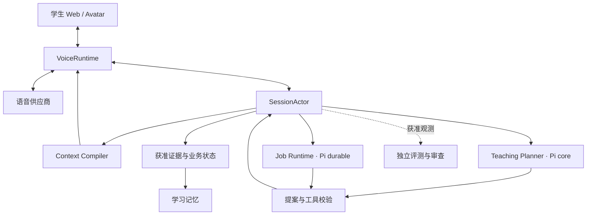

# Ask Kai Tutor：基于 Pi、从第一天完整设计的 Harness

设计日期：2026-10-12（Asia/Shanghai）  
状态：架构设计稿；仅设计，不实施、不迁移现有代码、不改变当前评测计划。  
对象：中文 Tutor，面向初级中文学习者，覆盖自由聊天、主题教学和 Mission。  
假设：在项目开始前完成所有关键契约设计，不受现有代码结构约束；豆包全双工作为默认语音体验候选。  
解释：这里的 harness 指智能体运行、上下文、工具、状态、权限、恢复及质量治理框架，并非网页视觉页面。

## 1. 设计决策摘要

推荐形态是 **Pi 在线教学决策 + 专属实时语音运行时 + Pi 可恢复后台任务 + 独立评测系统**。

Pi 构成真实的 Agent 执行基础。Tutor Harness 负责教学与语音领域契约，并持有最终业务控制权。每个学习者面对同一个 Kai，后台有不同执行配置，但没有多个助手轮流对学生说话。

从第一天确立六项架构决策：

1. 每个活动会话由一个 SessionActor 串行管理，所有业务状态修改经过同一入口。
2. 在线 Teaching Planner 使用 pi-agent-core；后台获准的总结、证据整理等任务使用 pi-durable。两者是不同任务配置，不是在一个推理循环里叠加两个框架。
3. 默认实时语音走独立 VoiceRuntime，后台 Pi 不阻塞默认首句；需要严格生成前控制的教学任务使用另一条可控路径。
4. Planner 返回有有效范围的结构化提案；运行时负责验证、接受、应用和记录，模型不能直接修改事实状态。
5. 默认完整对话仅在活动会话内短暂使用。长期学习记忆与可恢复任务只接收明确获准的最小数据。
6. 评测从开始就与 Agent 隔离，同一生产入口采集实际结果，参考答案、未来脚本与评分规范不进入待测 Agent。

这是完整目标设计，不是任务排期，也不意味着现在开始建设这些模块。

## 2. Pi 的选择与准确边界

本文按官方 v1.1.0 的文档接口快照设计；实施前应固定具体包版本、提交及依赖锁，并重新检查接口。公开搜索中的旧缓存不能代替标签源码。

| Pi 部件 | 设计中的明确用途 | Tutor 自己承担的责任 |
| --- | --- | --- |
| @earendil-works/pi-ai | 在线 Planner 和后台任务的模型访问 | 模型能力清单、选路、用量预算、供应商策略 |
| @earendil-works/pi-agent-core | 活动会话的在线教学决策循环、上下文构建、工具执行与取消 | 教学动作结构、时效校验、证据规则、SessionActor |
| @earendil-works/pi-durable | 获准数据上的可恢复后台任务 | 数据许可、任务版本、幂等业务提交、持久存储与调度隔离 |
| @earendil-works/pi-telemetry | 跨层观测契约 | 导出适配、脱敏、采样、容量、指标与报警 |
| pi-coding-agent 的 Skills/扩展思想 | 参考能力组合与资源分发方式 | 设计 Tutor 专属能力包；不默认加载编码 CLI 的配置或工具 |

pi-durable 在该快照明确标为 Experimental。它提供独立的 Harness 与任务/扩展机制，不能描述为给 Agent 实例加一个持久化开关。其默认会保存输入、模型输出和工具记录；上下文压缩也不是删除旧存储。Tutor 必须控制送入持久任务的数据，而不是事后靠压缩满足删除要求。[P3]

Pi 的 Agent turn 是模型请求及工具执行单元；Tutor 的 student turn 是一次学生发言与相应回复。一次教学后台任务可能包含多个 Pi turn；两者有单独 ID。

本设计不假定 pi-ai 已原生支持豆包 Seeduplex 的 PCM、VAD、取消 ACK 或上下文控制。独立 VoiceProviderPort 描述并验证这些能力。Pi 的 steering/follow-up 也不等于音频打断。

## 3. 目标架构



VoiceRuntime 对延迟、识别、生成、播放和取消负责。SessionActor 对事实、归属、版本与权限负责。Pi Planner 对教学解释和下一步提案负责。后台任务对可延后的整理负责。Context Compiler 将已接受的策略编译成供应商可用的上下文。

观测系统贯穿各模块，但不在图中增加控制箭头：trace 丢失或导出失败不能改变会话结果。业务证据不能仅依赖日志。

### 从第一天定义的模块边界

| 模块 | 输入 | 输出与职责 |
| --- | --- | --- |
| SessionActor | 校验后的领域事件、提案、回执 | 串行状态转换、归属检查、版本提交 |
| VoiceRuntime | PCM、用户动作、上下文命令 | 有归属的 ASR/生成/转发/消费/取消事件 |
| Teaching Planner | 截至已知时刻的快照、实际文本、可用能力 | 一个有来源、有截止时间的教学动作提案 |
| PolicyKernel | 授权、模式、风险、资源状态 | 硬约束、允许动作与降级规则 |
| Context Compiler | 被接受的计划、画像、语言策略、可信内容 | 有 hash 与预算的上下文快照 |
| Capability Registry | 版本化工具与教学资源定义 | 按模式和权限选择的最小能力集合 |
| Tool Broker | 已校验的能力调用 | 带真实状态和回执的结果 |
| Evidence Store | 被许可的引用或结构化观察 | 可核验且能更正/删除的证据 |
| Learner Memory | 被批准的学习证据和明确偏好 | 跨会话检索结果、来源及适用范围 |
| Job Runtime | 数据许可内的最小任务输入 | 可恢复候选结果、待提交副作用 |
| Evaluation Runtime | 固定案例、真实观测、独立规范 | 覆盖、评分、关键失败、比较与根因假设 |

## 4. 首日的数据契约：事实、提案与呈现分开

业务状态真相位于 SessionActor；Pi 的工作消息不是学习者画像数据库，语音模型的聊天历史也不是业务事件账本。

| 领域对象 | 最少字段 | 约束 |
| --- | --- | --- |
| SessionState | tenant/learner/session、mode、status、state_version、consent_epoch | server 绑定身份；模型参数不能选择 owner |
| TeachingState | 当前阶段、目标、拒绝/换题、澄清次数、支架与冷却状态 | 每个变化带来源；unknown 不是 false |
| TurnRecord | student_turn、ASR revision/final、response_id、generation status | 更正识别不能重复制造学生尝试 |
| ContextSnapshot | id/hash、base_state_version、来源段、预算、有效范围、应用状态 | 提案、发送、ACK、实际生成依据分别记录 |
| LearningEvidence | 类型、source turn/片段、真实性、授权、审查状态 | 不将“出现过”升级为“掌握” |
| JobRecord | job/task id、owner、输入 hash、版本、状态、预算、恢复策略 | 每次运行与副作用可定位；撤权后不能复活 |
| PresentationRecord | 生成/转发/消费范围、取消位置、对齐质量 | 客户端消费只证明播放器报告，不证明理解 |
| RunManifest | agent/data/model/policy/voice/rubric/judge 版本 | Agent 与评测工具分别版本化 |

领域事件统一携带 event_id、session_id、connection_epoch、student_turn_id、response_id（若有）、causation_id、observed_at、source、schema_version。状态写入使用 expected_state_version；时间戳用于诊断，事件顺序由会话序列确定。

供应商事件名与以上领域事件分离。Adapter 必须保留能够证明转换的元数据；没有 ID 的供应商事件需要明确归属规则，归属未知时隔离，不猜测归入最新回复。

## 5. 完整生命周期与取消作用域

会话生命周期为 created → authorized → initializing → active → closing → closed；初始化失败、供应商断线和等待恢复用独立状态表达。学习教学阶段另有状态机，不能与网络连接状态混合。

每个层级有单独取消令牌：

- connection_epoch：旧连接回调失效。
- student_turn_id / response_id：停止对应输出和当前轮工作。
- decision_id：使过时教学提案失效。
- job_id：取消具体后台任务。
- consent_epoch：所有执行点必须重新检查数据许可版本。

学生开始讲话时，由 VoiceRuntime 本地先关闭旧 response 的播放/转发入口，再请求供应商取消；后续记录 ACK、超时和实际停止情况。停止播放不意味着远端计算已停止或不会计费。

正常打断仅取消旧回复及依附该轮的 Planner；已获准的会话总结任务可继续。明确退出按照会话政策关闭在线工作；删除或撤权取消相关后台任务并阻止迟到提交。安全锁定具有更高优先级，不能被新一轮普通输入清除。

客户端断线后恢复 UI 快照与允许恢复的业务状态。供应商连接断线后使用新 epoch，默认不重播旧音频，也不自动重发已经可能执行的副作用。

## 6. 在线 Pi Teaching Planner

每个活动会话有一个在线 Planner 配置；它处理经归属校验的实际文本和结构化状态。ASR partial 仅用于低风险预取和预测，只有最终或明确确认的输入才能形成学习事实与正式决策。

首日采用的职责配置：

| 配置 | 运行方式 | 可以产出什么 |
| --- | --- | --- |
| TeachingPlanner | 每轮按需运行，低延迟、有界 Pi Agent 循环 | 单个教学动作与计划更新提案 |
| SessionReviewer | 会话结束后，Pi durable 任务 | 证据绑定的总结候选与未知项 |
| MemoryCurator | 按获准证据批处理，Pi durable 任务 | 记忆候选、冲突、更正与复习建议 |
| EvaluationJudge | 独立评测工作流 | 评分证据与不可评原因；没有运行时写权限 |

前三者是同一个 Tutor 产品的执行配置，不要求每次同时启用三个模型。课程读取、规则校验、去重和权限处理优先用确定性代码。只有需要语义判断的任务才调用模型。

### 教学动作合同

Planner 每次提议一个主要动作：RESPOND、FOLLOW_UP、CLARIFY、SCAFFOLD、TEACH、INVITE_PRACTICE、CORRECT、REVIEW、SWITCH_TOPIC、CLOSE。动作词表只是领域设计，不是 Pi 自带教学机制。

每个提案至少包含：

```json
{
  "decision_id": "decision-example",
  "session_id": "session-example",
  "based_on_state_version": 17,
  "source_student_turn_id": "turn-5",
  "source_context_snapshot_id": "context-9",
  "action": "FOLLOW_UP",
  "reason_code": "learner_prefers_conversation",
  "evidence_refs": ["turn-5:student-span-0"],
  "primary_goal_id": null,
  "constraints": {
    "chinese_first": true,
    "english_support": "on_request",
    "max_questions": 1,
    "max_new_targets": 0
  },
  "effective_scope": "next_eligible_turn",
  "expires_after_student_turn_id": "turn-6"
}
```

这是假设数据，用于说明 schema，不是已有会话或已核实实现。

Planner 可解释“学生现在想继续聊球赛，因此不插入教学”。它不能直接声明学生已掌握、发音正确或某个远端操作已成功。所有提案经过 schema、权限、状态版本、证据存在性和动作预算校验；过时结果不适用时丢弃或重新评估。

以 Pi core 的实际边界实现请求前上下文准备、工具执行前后校验、轮次终结；硬规则最终仍在 SessionActor 和 Tool Broker 强制执行。[P2] 模型输出满足 schema 不代表事实正确。

## 7. 教学策略：让教学顺着对话发生

目标优先级为：安全/撤权等硬约束 → 学生本轮明确请求与拒绝 → 理解和话题连续性 → 可接受的教学机会 → 次要复习建议。

每轮一个主要动作、至多一个主要教学目标；新词数、追问数和英语支架占用共同受回复预算约束。被拒绝的教学提议设置冷却，不立即换一种话术再次要求练习。

| 模式 | 初始目标来源 | 默认策略 |
| --- | --- | --- |
| 自由聊天 | 学生意图与获准兴趣，教学目标可空 | 先回应，再寻找自然机会；允许没有教学动作的一轮 |
| 主题教学 | 可信主题资源与学生选题 | 围绕话题逐步展开，必要时给支架 |
| Mission | 经校验的任务目标与活动状态 | 保持情节与目标连续，必要时走严格控制路径 |

中文优先采用短句与可理解输入；英语作为获准的短支架。HSK 等级与学习者的理解偏好分别记录，不用等级推断一定懂某个词。请求“说慢一点”改变语速策略，不虚构已测得听力水平。

“纠正”限定为可核验的具体问题；发音结论必须来自获准音频与合适评测器。一般 ASR 文本不能证明发音标准。对话顺畅也不证明掌握。

闲置引导必须来自真实 idle 定义、学生许可及冷却规则；测试数据中的“主动发言”标注不自动成为运行时闲置事件。

## 8. 实时语音的两种执行配置

这是最需要在项目第一天明确的架构取舍。完整 Harness 必须能清楚描述生成前的控制保证。

### A. 默认自然全双工

供应商直接接收音频、识别并生成，使用最近已确认的 ContextSnapshot。Pi Planner 在并行或轮后提出下一次可应用计划。默认首句无需等待第二个模型。

新提案只有在已验证的边界应用成功后才成为后续控制依据。若新决策晚于 response_start，它只能标为后续生效，不能倒记成本轮已使用的策略。

学生本轮说“换成中文”可由语音模型在理解当前输入时响应；后台若晚到，只能证明后续策略调整，不能以 ACK 推断本轮遵循。教学内容、长度等需要实际结果评测。

### B. 严格控制教学

对必须在生成前决定目标、卡片或回答限制的任务，流程为：获得确认输入 → 有界教学决策 → 验证并冻结上下文 → 发起受控生成 → TTS/播放。能力允许时用可门控的实时接口；否则使用独立 ASR、文本生成、TTS 的组合。

这是同一 Tutor 的执行配置，不是学生面对的第二个助手。它会增加等待时间，应在交互边界透明呈现“思考中”，不插入无意义的补话。不能为了声称可控而假设供应商支持暂停生成或将音频缓冲当成已实现的生成门控。

| 要求 | 自然全双工 | 严格控制 |
| --- | --- | --- |
| 默认自由对话 | 首选 | 按任务需要 |
| 本轮复杂决策一定先于生成 | 不作此保证 | 架构要求 |
| Pi 是否阻塞首句 | 默认不阻塞 | 有界等待 |
| 输出前语义审查 | 只在缓冲策略确实允许时成立 | 可对文本/分段先审查 |
| 供应商缺少控制能力 | 限定为下一轮策略 | 换到经验证的可控组合 |

两条路径都保留监听、打断、归属与取消机制。不得用 Kai 说话时停止上传所有麦克风音频来代替回声控制和真实 VAD 设计。

### 供应商能力合同

每个 provider/profile 声明并验证：输入音频格式、final 的语义、response/turn 归属、上下文更新边界、取消 ACK、文本音频对齐、生成门控、工具链、usage 语义。能力未知时状态为 unknown；不可由同名接口推断支持。

## 9. Context Compiler 与能力包

上下文由明确分段生成：角色与人格、硬规则、模式/阶段、语言与语速、被接受的本轮或后续计划、可信课程内容、获准记忆、实际历史。每段记录来源、版本、优先级、token 预算与数据许可。

超出预算时优先裁剪无关历史和低相关记忆，不裁剪身份、硬约束、当前确认输入和控制范围。压缩保留拒绝、纠正、未知项和证据引用；压缩摘要不能创造新的学习事实。

| 信任层 | 来源 | 使用规则 |
| --- | --- | --- |
| 服务端可信控制 | 签名配置、权限、版本化政策 | 只能由可信入口修改 |
| 可信教学资源 | 已审查课程、词卡与 Mission | 固定版本与资源引用 |
| 学生输入 | ASR、文本和明确选择 | 可表达需求，不可提升权限 |
| 外部或模型产物 | 检索、工具文本、模型候选 | 作为数据；不能覆盖硬规则 |

TutorPack 是自定义领域合同，不是 Pi 原生包格式。每个包包含 manifest、兼容版本、适用模式、提示词段、只读资源、工具清单、数据政策、输出 schema、预算、fixtures、评测标签与来源。例：core-tutor、hsk1-sports、mission-number-code、language-scaffolding、session-summary。

Pi core 通过构造配置和宿主加载器组合这些能力；Pi durable 使用其独立 extensions 注册表接入获准任务。两者不假定扩展 API 相互兼容。代码扩展必须来自可信构建；模型可以建议使用能力，不能安装远程扩展或获得通用 bash 权限。

版本在会话开始时固定，普通更新对新会话生效。恢复任务必须重新装载匹配的实现版本；找不到时进入 blocked_version，不用最新实现盲目续跑。撤权、安全限制等即时收紧仍覆盖旧版本配置。

## 10. 工具与业务副作用

首日就建立受限 Tool Broker；业务端口可接本地 mock 或未来真实后端，真实/模拟状态必须显式标注。工具身份由宿主注入，模型参数不含任意 learner_id 选择能力。

| 能力 | 类别 | 主要限制 |
| --- | --- | --- |
| read_course_resource | 只读 | owner/course/mode、可信资源版本 |
| select_word_card | 只读或展示提案 | 相关性与每轮卡片数；被展示不是被学会 |
| propose_learning_evidence | 候选 | 真实 turn/片段存在、授权、不直接落掌握 |
| propose_memory_update | 候选 | 来源、更正、冲突与独立提交规则 |
| request_pronunciation_assessment | 外部调用 | 明确触发、音频许可、预算；无评测结果不下结论 |
| propose_session_summary | 候选 | 仅使用截至任务输入的事实 |
| update_explicit_preference | 受限写入 | 当前明确请求、字段白名单、版本检查 |
| request_human_support | 外部副作用 | 权限与真实回执；mock ACK 不算人工接手 |
| apply_data_rights_request | 控制流程 | 由产品授权入口验证，不由模型自发批准 |

所有工具声明 schema/version、读写类别、allowed_modes、权限、耗时/次数/费用预算、幂等键、取消语义、replay policy、留存和回执要求。只读且无冲突的调用可并发；同一会话的业务写入串行。

调用状态为 proposed → authorized → dispatched → succeeded/failed/unknown。取消时远端可能已执行，需查回执或进行补偿；不能把本地 abort 当成回滚。

pi-durable 的 replay-safe 只是调用方对重放安全性的声明。[P3] 外部写入必须另有业务幂等键、去重与查询回执。正常重试遵守预算；unknown 的副作用不盲目重试。

## 11. 学习证据与记忆

证据层级从 observed_input、model_generated、forwarded、client_consumed、learner_attempt，到经合适规则确认的 demonstrated_skill。层级之间没有自动升级关系。供应商没有可靠文本音频对齐时，文本消费范围标记为 approximate/unknown。

长期记忆划分为：

| 记忆 | 内容 | 更新依据 |
| --- | --- | --- |
| 明确偏好 | 主题、语速、英语支架等 | 学生明确请求及权限 |
| 学习观察 | 尝试过的表达、任务中的表现 | 有来源的实际记录 |
| 复习候选 | 可以以后再次提取的目标 | 已批准证据与教学规则 |
| 技能判断 | 限定任务下展示出的能力 | 独立定义的验证规则 |
| 对话连续性 | 下一次可以延续的话题 | 获准、简短、有来源的摘要 |

每条记忆带 owner、类型、来源、创建/更正时间、适用范围、置信来源、授权和到期/删除规则。学生更正“我不喜欢足球”会使旧偏好失效，同时撤销依赖它的候选计划。模型置信度不能代替事实来源。

检索先按身份、许可、适用模式和有效时间筛选，再按相关性与上下文预算选择。检索不到记忆时允许回到无历史的正常教学，不伪装记得。

教学状态不是知识追踪的全部。后续可以添加有经校准测量依据的 mastery model，但不得把聊天次数或关键词匹配直接映射成掌握分。

## 12. 持久化、后台恢复与隐私

### 三个存储域

1. 活动会话工作区：在线 Pi messages、供应商上下文及必要对话文本；默认在进程内，有会话结束/闲置清理规则。
2. 业务状态与证据库：保存数据许可允许的状态、来源和最小证据，具备版本、更正、删除与审计。
3. 后台任务工作区：Pi durable 仅接收获准的最小输入；任务的输入、输出、中间消息同样受许可、留存、删除约束。

未获准保存文本时，不把原始对话提交到 Pi durable 持久 backend。可在活动会话内使用内存工作区完成计算，或者只用获准结构化证据运行后台任务。持久任务不经过未经核实的“存储过滤器”偷偷删消息，以免损坏恢复语义。

### 可恢复任务的明确边界

在线 Pi Agent 被进程重启后从获准业务快照重新初始化，不宣称恢复原推理或原语音连接。被许可的后台任务恢复自固定输入、配置、版本与 checkpoint；输入被删除、授权被撤回或任务过期时，恢复必须终止。

任务分为会话内、会话结束后和独立获准批任务。每个任务都有取消范围和保存依据。后台模型产物先为候选，只有领域校验通过才提交业务状态。

### 部署与原子性

目标设计用按 session/learner 分区的单所有者执行，控制重复工作并限制状态冲突。Pi durable 快照的存储默认单进程所有，不具有跨进程锁；多 worker 不能同时打开同一存储。[P3] 宿主调度系统另做租约和 fencing，所有领域副作用提交检查当前 fence。

默认设计采用每分区的独占任务存储与共享业务数据库；具体 durable 存储 backend 是实施选型，不能只把 SQLite 文件放到共享目录来获得水平扩展。

业务数据库的状态变更与 outbox 在同一数据库事务提交。Pi durable 的任务提交与业务数据库不假定跨库原子：结果以唯一 job_id/result_hash 在业务库幂等提交，成功回执再写回任务。崩溃后重复提交可以查到既有结果。

删除流程首先提高 consent_epoch 并禁止读取/提交，再取消任务，覆盖活动缓存、记忆、证据、任务存储、评测副本和供应商处理范围。备份与第三方删除按真实能力及政策处理；不以本地删除完成宣称供应商已经删除。

## 13. 安全与呈现

安全分为生成前硬约束、生成/播放时可实际执行的输出控制、异步质量复核。默认全双工中若音频早于可审查文本，异步文本检查不能声称在学生听到前拦截。

需要输出前严格语义检查的场景，采用严格控制路径或经验证的分段缓冲；对应增加延迟。安全模型或规则失败时依风险降级、停止输出或进入获准人工流程，不能拿 mock 人工回执当真实送达。

Web/Avatar 只消费已许可的呈现事件：listening、thinking、speaking、paused、interrupted、summary_pending 等。口型/字幕跟随实际播放进度，后台 Pi 正在计算不触发 Kai 嘴部说话动画。

结束总结分别表达：学习尝试、有来源的表达卡、待复习候选、未知/未完成状态。没有合格证据时展示简短的诚实小结或空状态，不为填卡片创造学习成果。

## 14. 预算与故障策略

下面是设计预算起点，不是已测得的性能、费用承诺或上线门槛。实施时按供应商、设备、网络和目标用户校准。

| 工作 | 起始设计预算 | 超限处理 |
| --- | --- | --- |
| 快速本地状态/政策校验 | p95 目标 20ms 内 | 不启动额外推理；识别真正瓶颈 |
| 自然全双工首句的额外 Planner 等待 | 0ms | 使用已确认策略，迟到结果只影响后续 |
| 下一轮计划准备 | 目标 800ms；在适用轮前失效 | 继续有效旧计划或安全默认 |
| 严格模式在线决策 | 最多 1.5s，有界模型请求与工具轮 | 预设策略，或诚实显示稍候/失败 |
| 在线 Planner | 最多 2 次模型请求、2 次只读工具执行 | 终止循环，不自我无限反思 |
| 单会话总结任务 | 初始 deadline 30s，有限重试 | 保留 pending/failed，允许离线重评 |
| 单会话成本 | 语音/在线/后台分别上限 | 先关闭非必要后台任务，明确降级 |

SLO 从确认的学生输入结束到首个实际可播放音频测量，同时记录 ASR、模型生成、转发、播放各分段。不能只比较服务器 response_start。

| 故障 | 在线行为 | 后台与证据 |
| --- | --- | --- |
| Pi Planner 不可用 | 安全默认短回复/现有有效计划 | 标记 decision unavailable，不伪造决策 |
| Context 更新无 ACK | 不将新快照标为已应用 | 保存 requested/timeout；不重复无界发送 |
| 语音供应商断线 | 清空旧输出、显示恢复状态 | 新 epoch；业务恢复不重播音频 |
| ASR 不确定 | 澄清或按实际输入有限回应 | 不制造正确尝试/发音结论 |
| 证据写入失败 | 会话可按数据许可继续 | 总结标记不完整；恢复写入有幂等 |
| 观测平台不可用 | 不阻塞会话 | 有界缓冲/采样丢弃，保留必要业务账本 |
| 外部写入结果未知 | 不宣称成功 | 查询回执后再决定重试 |
| stale Planner/Job | 拒绝旧提案 | 保留脱敏原因，必要时重新评估 |

## 15. 两个具体场景

### 场景一：自由聊足球，学生不想学词

学生说：“我喜欢足球，不过今天不想学单词。”

运行时保存真实意图与拒绝状态；PolicyKernel 限制当前新教学目标为零。默认全双工下，语音模型根据其中文优先人格和当前输入继续简短聊天。后台 Pi 提案 FOLLOW_UP，给出拒绝证据、冷却和下一轮有效范围，运行时验收后更新后续上下文。

Kai 可以说：“好，我们聊球。你喜欢哪支球队？”示例仅为设计意图，不作为固定参考答案。

不弹练习卡、不制造“学习了足球”，总结只记录获准的对话事实与实际尝试。如果学生打断换成篮球，旧计划到期并被新状态替代；晚到的足球追问不能重新播放。

### 场景二：Mission 要学生表达“多少钱”

可信 Mission 当前需要一个明确交易任务。学生问“我要怎么说？”

选择严格控制配置，Pi 根据当前任务和实际输入提出 SCAFFOLD；冻结目标与短回答预算后再生成：“可以说：多少钱？你试试看。”如果需要卡片，展示与供应商回复独立具有同一目标来源。

学生真的尝试后才创建 learner_attempt。普通 ASR 识别到目标词不构成发音合格。发生中途退出时，完成状态保持 partial，后台任务可以整理获准证据，不能把任务自动判为通关。

两个示例体现相同 Harness 下的不同任务配置，不构成现在的 Agent 行为变更。

## 16. 从第一天配套的评测系统

评测系统在 Agent 之外；测试作者的目标、未来输入、参考回复和 rubric 仅用于驱动/评分。待测 Agent 只看到与真实用户入口一致的当前输入与已发生历史。

| 层 | 验证内容 | 方法 |
| --- | --- | --- |
| 领域合同 | 身份、版本、归属、拒绝、证据层级 | 确定性 fixtures 与不变量检查 |
| Pi 集成 | hooks、工具错误、取消、请求上下文、循环预算 | 假供应商与受限模型集成检查 |
| 任务恢复 | crash、重放、过期、撤权、跨库提交 | 在关键提交点注入故障并验副作用 |
| 语音协议 | PCM、识别更正、上下文 ACK、取消与迟到事件 | 合成协议回放与独立真实探针 |
| 教学内容 | 意图、正确性、语言、水平、连续性、安全 | 真实多轮记录、独立规范、人工校准 Judge |
| 实际呈现 | 噪声、回声、口音、自然停顿、字幕/Avatar | 真人与真实设备测试 |

内容评测沿用现有十维：intent、correctness、instructions、level、expression、continuity、progress、personalization、persona、safety，以及 0/1/2 锚点和已声明权重。新 Harness 的诊断不暗中改变评分尺度。

报告并列展示采集覆盖、ASR 偏离、上下文失配和内容问题。原始 40 案/244 轮与 8 个语言对照/11 轮分别统计，固定实际记录、输入音频和版本。失败记录不补参考；未知不打占位分。

质量更改需要相同数据和可比较运行条件，展示改善、退化、方差、关键失败及人工复核。某个案例失败可以形成假设，不能直接决定全系统修改。

### 首日必须写下的验收场景

- 学生打断后，旧回复音频/字幕和迟到工具结果不覆盖新轮。
- 计划晚于生成开始时，报表只能标为后续生效。
- 两个会话不能读写彼此画像、任务或证据。
- 学生拒绝练习后不会被不同 Planner 提案再次强迫。
- 删除/撤权与正在运行的后台任务竞态时，无迟到记忆提交。
- 远端已成功、本地回执未写入就崩溃，恢复不会重复写业务。
- 总结压缩、文本转发或客户端消费不能产生掌握/发音断言。
- Judge/日志不可用时不影响生产会话，也不产生虚构分数。
- 两种语音配置分别验证延迟、控制范围与降级。

## 17. 观测与运行面板设计

Pi telemetry 是观测契约；导出到 OpenTelemetry/Langfuse 等系统需要独立适配，不能说引入包即拥有完整平台。[P4]

从第一天为 Session → student turn → provider response/Planner/tool/job 建关联。最小指标包含：首个可播放音频延迟、取消停止延迟、上下文 ACK、生成开始的快照版本、stale 提案数、工具成功/未知/幂等命中、后台积压、证据拒绝原因、成本与评测覆盖。

后台 Harness Console 设计五个视图：

1. 会话时间线：学生输入、上下文请求/ACK、回复开始、音频转发/消费、打断。
2. 决策视图：输入快照、动作、理由码、证据、接受/拒绝、有效轮次。
3. 工具与任务视图：权限、预算、回执、取消范围、版本与恢复点。
4. 记忆视图：来源、授权、更正、有效范围、删除状态。
5. 评测视图：版本比较、实际分母、关键失败、最早偏离和待验证假设。

默认展示脱敏元数据；只有有权限且数据确实保留时才可展开实际片段。不能为了方便调试打开所有 transcript 留存，也不能要求保存未经许可的模型内部推理；结构化理由与引用已足够用于主要审查。

## 18. 最终架构判断与待验证条件

第一天最值得完整设计的是：谁拥有状态、什么可以改变、哪些数据能留、决策何时生效、工具如何证明成功、失败后恢复什么、怎样评测。实现规模可以调整，这些合同不应等出问题才补。

Pi 带来模型访问和 Agent 执行机制；Tutor 的差异化来自教学动作、实时控制、证据记忆和评测。推荐在线 Pi core 与后台 Pi durable 的分工，在同一个领域契约下运作；默认自然全双工与严格教学路径共享事实状态、工具、权限和质量标准。

仍需实施时验证的条件：

- 豆包实际接口能在哪些边界应用上下文、是否支持生成门控与可靠归属。
- 严格路径在目标设备/网络上的总等待与打断体验。
- Pi durable 固定版本的恢复、存储一致性、数据删除及宿主调度方案。
- 语义决策与 Judge 的可靠性、成本和人工校准。
- 学习记忆、第三方音频评测及外部业务的许可和实际回执能力。

这些是目标架构的验证条件，不是当前实现状态，也不是要求现在开展实施。

## 19. 一手来源与设计溯源

外部机制事实以官方标签文档为依据；TutorPack、SessionActor、教学动作、两种语音配置、数据政策、预算与验收均为本文设计，Pi 不自动提供这些领域能力。

- [P1：Pi 官方仓库](https://github.com/earendil-works/pi)，[v1.1.0 发布](https://github.com/earendil-works/pi/releases/tag/v1.1.0)
- [P2：Pi Agent core v1.1.0](https://github.com/earendil-works/pi/blob/v1.1.0/packages/agent/README.md)
- [P3：Pi durable v1.1.0](https://github.com/earendil-works/pi/blob/v1.1.0/packages/durable/README.md)
- [P4：Pi telemetry v1.1.0](https://github.com/earendil-works/pi/blob/v1.1.0/packages/telemetry/README.md)
- [P5：Pi AI v1.1.0](https://github.com/earendil-works/pi/blob/v1.1.0/packages/ai/README.md)
- [项目审查存档](https://github.com/yqhuang-cyber/ask-kai/blob/6eb0919565ee52ca42b252fc379d1f44d3e2757d/docs/tutor-agent-harness-review.md)

本文可作为后续架构决策的输入。仅交付设计，不对现有仓库、Agent、供应商设置或评测运行作修改。
