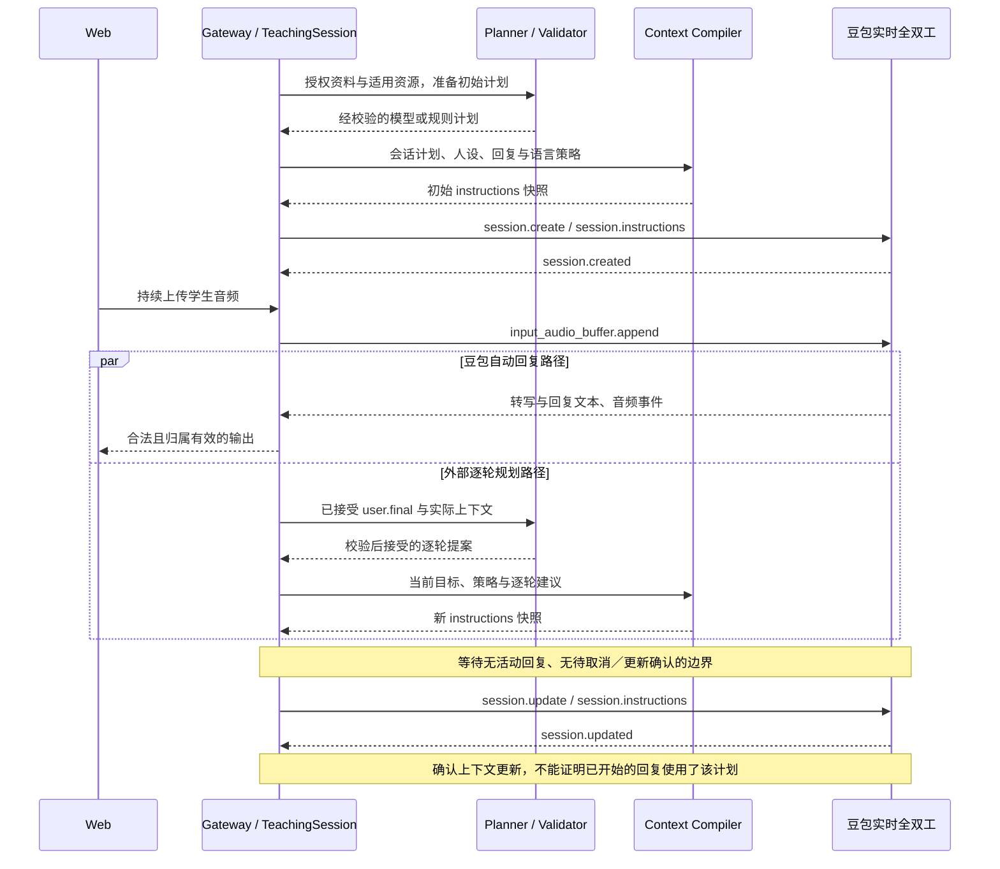

# 规划与回复策略到豆包实时语音的链路

更新于 2026-10-15。本文说明普通 Web POC 的 `next_turn_advisory` 实现：初始计划在建连前编译，逐轮计划通过会话指令更新影响后续输入。本文只整理现有调用链，不启用本轮生成门控，也不新增供应商能力或质量通过结论。

## 1. 规划如何影响语音回复

Ask Kai 负责选择目标、生成规划提案、校验并管理状态；豆包实时全双工负责理解上送音频，生成回复文本与语音。配置的 MiniMax M3 Planner 与豆包是两条不同的模型调用链；Planner 未配置、超时或提案不合格时，可以按现有规则降级，降级来源必须保留。

目标和策略被编译到豆包的 `session.instructions`，由模型结合实际对话理解并生成回应。当前没有单独的“设置教学目标”供应商接口，也没有先生成完整回复正文再交给独立 TTS 的步骤。

| Ask Kai 内容 | 进入指令的内容与用途 | 当前边界 |
| --- | --- | --- |
| 会话计划 | `content_focus`、`purpose`、有效 `goal`、`key_points`、`strategy`、`goal_status`、目标评估及适用的教学决策／学习支持 | 提供交流方向；计划不构成学习事实 |
| 目标生命周期 | 目标替换、暂停、停止后的最新状态；暂停／结束时明确停止推动旧目标 | 状态由宿主校验、更新；不能追回已开始的生成 |
| 全局回复策略 | `REPLY_INSTRUCTIONS`，当前为 `kai-reply-v5`；初始与后续指令均包含 | 指导模型行为，实际遵循与听感需单独验证 |
| 逐轮建议 | 来源话轮、`action`、`reply_directive`、`expected_observation` | 作为后续输入建议，学生最新意图优先 |

当前回复策略要求先接住学生具体内容，再按需要补充、解释或自然追问；不设固定字数、句数或中英文合计额度。每轮保留一个交流重心、一个主要问题／练习邀请，普通聊天允许零个教学点；主动教学聚焦一个新点和一个示范。`budget_ref` 引用策略版本，不是豆包的字数或音频时长参数。流式输出不会因长度计数被截断。详见[回复策略](short-replies.md)。

## 2. 初始与逐轮链路



初始化由 `ConversationInitializer` 准备并校验计划，创建语音会话前交给 `TeachingSession`。`compileContextSnapshot()` 组合人设、语速提示、轮次规则、回复策略、语言支架、教学策略、会话目标、当前决策和授权偏好，形成带版本与哈希的完整指令快照。

会中，豆包转写映射成内部 `user.final`，经归属与重复检查后进入 `TeachingSession.accept()`；宿主先更新教学／语言／目标状态，再异步调用 `planTurn()`。逐轮规划总时限最多 2 秒，从接受输入计时，包含准备、请求、修复、校验与提交；不是要求豆包暂停自动生成 2 秒。新输入、更正、打断、版本或权限变化等会使旧规划失效，迟到结果不能覆盖当前状态。

提案接受后，`TeachingSession` 更新版本，网关尝试 `flushContext()`。只有供应商就绪、没有活动回复、没有待处理取消或上下文确认且版本有变化时，才发送新快照。发送的是重新编译后的完整 `instructions`，不是把 Planner JSON 直接作为顶层供应商参数提交。

## 3. action、task、expected_observation 如何被接收

当前编译器在指令中加入下面的前缀及 JSON。以下为合成结构示例，不是真实学生记录、供应商 trace 或观察到的回复：

```text
后续输入建议（不是当前自动生成的控制证明，学生最新输入优先）：
```

```json
{
  "source_turn_id": "synthetic-turn-1",
  "action": "SCAFFOLD",
  "task": {
    "task": "帮助学生表达当前意思，给一个示范，不要求跟读",
    "support_level": "model",
    "new_points": 1,
    "budget_ref": "kai-reply-v5"
  },
  "expected_observation": {
    "kind": "conversation_continuity",
    "required_student_answer": null
  }
}
```

这里的外层 `task` 是编译器为 Planner 的整个 `reply_directive` 对象设置的字段名；内层 `task` 才是自然语言回应任务。`support_level: model` 表示提供完整示范的支架程度，不是切换供应商模型。

| 字段 | 校验与接收方式 | 不能据此宣称的结果 |
| --- | --- | --- |
| `action` | 宿主限制在 `RESPOND`、`FOLLOW_UP`、`CLARIFY`、`SCAFFOLD`、`INVITE_PRACTICE`、`CORRECT`、`REVIEW`、`CLOSE`，并检查策略冲突；豆包把它作为指令里的动作标签理解 | 不是豆包原生动作 API；没有按每个枚举分派执行或返回业务成功回执 |
| `reply_directive` → `task` | 校验任务文字、`support_level`、0／1 个 `new_points` 和当前 `budget_ref`；自然语言任务给出具体回应要求 | 通过结构与策略校验不代表模型已按任务生成，也不保证教学语义正确 |
| `expected_observation` | 校验 `kind` 为有界文字、`required_student_answer` 必须为 `null`，再作为建议数据写入指令 | 不创建指定答案等待器、动态观察规则或自动达成判断；豆包如何利用该提示尚无逐字段执行证据 |

例如，学生问“swimming 中文怎么说”，任务可以要求给出“游泳”及必要含义说明，不强制跟读。豆包据此组织可朗读正文；它是否给出正确解释、是否追加了不合适的练习，仍须依据实际输出检查。该例是行为说明，不是实测结果。

## 4. 当前适配器使用的豆包接口

以下名称来自现有 Seeduplex 适配器、已配置 profile 的校验与项目协议记录；不是从内部事件名推测供应商事件，也不是本次重新核验供应商文档所得的新增保证。

WebSocket 地址：

```text
wss://openspeech.bytedance.com/api/v3/duplex/realtime/dialogue
```

当前 Seeduplex 适配器校验模型版本为 `1.2.6.1`，凭证通过服务端 `X-Api-Key` 请求头提供，不进入文档示例或客户端。

| 供应商事件／字段 | 本项目用途 |
| --- | --- |
| `session.create` / `session.instructions` | 创建会话时传入完整初始指令 |
| `session.created` | 供应商会话就绪，映射为内部 `session.ready` |
| `session.update` / `session.instructions` | 在安全边界更新完整会话指令 |
| `session.updated` | 由适配器关联当前待确认上下文，映射为内部 `context.updated` 与本地版本 |
| `input_audio_buffer.append` | 持续发送 Base64 PCM；当前输入 16 kHz、20ms 帧 |
| `conversation.item.input_audio_transcription.delta/completed` | 提供转写，适配成内部学生输入事件 |
| `response.output_text.delta/done`、`response.output_audio.started/delta/done` | 接收回复文本与音频；经适配和归属检查再转发 |
| `response.cancel` / `response.canceled` | 打断与取消确认，不追溯改变已生成内容 |
| `session.close` / `session.closed` | 正常关闭会话与确认 |

上下文更新的合成结构示例：

```json
{
  "type": "session.update",
  "event_id": "synthetic-event-1",
  "session": {
    "id": "synthetic-provider-session",
    "instructions": "重新编译后的完整指令，包含目标、回复策略及后续输入建议"
  }
}
```

本地上下文 `version`、哈希与 `source_turn_id` 用于宿主归属和诊断；适配器不会将它们全部作为供应商协议的独立顶层字段发送。内部 `response.started` 等事件也不等于供应商内部生成起点。

## 5. 生效时机与执行证据

初始计划在 `session.create` 前已完成编译，从会话开始提供指导。逐轮建议与豆包自动回复并行：学生说完后，豆包可能已开始输出，Planner 才完成。即使建议较早返回，普通 Web 也没有已验证的“本轮生成必须等待规划”的门控。

比如初始目标为表达运动喜好，学生说“今天跑步很累”，Planner 提出“先回应疲惫，暂不安排练习”；这条建议可能赶不上该轮输出，只能在后续安全边界更新。学生又有新输入时，指令明确要求优先处理最新意图，不能照搬旧话轮任务。

| 可观察事实 | 能证明什么 | 仍不能证明什么 |
| --- | --- | --- |
| `planning.accepted` | 宿主接受了通过校验且未失效的模型／规则提案 | 豆包已读到或执行 |
| `context.requested` | 网关发起对应快照更新 | 供应商已确认或生成已采用 |
| `context.applied` | 适配器收到并关联了待确认的上下文 ACK | 已开始的回复使用了该计划，或任务语义已完成 |
| 回复文本／音频被接收、转发、完成 | 对应回复发生了可观察输出；完成状态只描述回复事件生命周期 | 生成依据、实际听到、理解或目标达成 |
| 学生实际转写匹配受支持证据规则 | 可产生绑定当时目标／计划版本的 `attempted` 记录 | 独立表达、发音质量或掌握 |

执行账本的 `turn_plan_ref` 当前为 `null`，`generation_basis` 为 `unknown`，不会仅凭时序或 ACK 把某段回复标成某条逐轮计划的已验证执行。豆包也没有返回“已执行 SCAFFOLD／已完成 task／已观察到 expected_observation”的业务回执。

`PlanningObservations` 根据实际学生输入、有效目标、资源证据规则与观察到的教师输出形成候选和 `learner_feedback`；下一次规划读取这些反馈、实际对话历史及前次执行状态。当前没有以 `expected_observation` 动态驱动判定的实现。可选 `ObservationPort` 保持 shadow：候选不进入规划或写回学习事实。普通 Web 尚无播放消费回执，音频转发不能推断学生听到或理解。

业务身份、课程和学习记录仍走授权 HSKai 边界；本 POC 默认使用本地 mock。Mock 数据与回执不证明真实学习成果或真人送达。

## 6. Function Calling 实验与待完善部分

独立 `fc-planning-probe` 使用 `session.tools` 注册 `plan_next_turn`，接收 `response.function_call_arguments.done`，校验工具调用与规划后，通过 `conversation.item.create` 回传绑定 `call_id` 的工具结果。实验结果包含 `action`、`reply_directive` 和 `plan_hash`，不是普通 Web 的上述上下文更新路径，也未回传 `expected_observation`。

已有固定合成音频样本观察到工具结果前无输出、回传后有输出；提示词要求每轮调用工具不等于已核验的强制调用保证。普通适配器继续拒绝 tools，Web `controlled` 返回 `CONTROLLED_REALTIME_NOT_VERIFIED`；实验没有启用生产门控。详见[生成控制核验与实验记录](protocol/seeduplex-planning-control.md)。

要形成可验证的逐轮执行闭环，仍需完成本轮生成门控、输入／计划／回复关联、实际任务遵循审阅，以及预期观察到真实学生反应的语义校验。生成、转发、播放消费与学习证据需分别记录和验收。

## 7. 代码定位与本次验证范围

| 链路环节 | 代码入口 |
| --- | --- |
| 初始会话规划 | [`conversation-initializer.js`](../packages/agent-core/conversation-initializer.js) |
| 提案时限、降级与配置 | [`planner-port.js`](../packages/agent-core/planner-port.js) |
| 逐轮契约、策略冲突检查 | [`plan-validator.js`](../packages/agent-core/plan-validator.js) |
| 逐轮接受、失效与执行账本 | [`planning-state.js`](../packages/agent-core/planning-state.js) |
| 教学状态与上下文版本 | [`teaching.js`](../packages/agent-core/teaching.js) |
| 指令编译与字段映射 | [`context-snapshot.js`](../packages/agent-core/context-snapshot.js) |
| 全局回复规则 | [`reply-policy.js`](../packages/agent-core/reply-policy.js) |
| 安全边界发送与 ACK | [`realtime.js`](../apps/realtime-gateway/src/realtime.js) |
| WebSocket 建连与初始指令 | [`realtime.js`](../packages/provider-doubao/realtime.js) |
| Seeduplex 实际事件映射 | [`seeduplex.js`](../packages/provider-doubao/seeduplex.js) |
| 实际观察与 shadow 候选 | [`planning-observations.js`](../packages/agent-core/planning-observations.js)、[`observation-port.js`](../packages/agent-core/observation-port.js) |
| 独立 FC 实验 | [`fc-planning-probe.js`](../packages/provider-doubao/fc-planning-probe.js) |

本次只新增链路文档和 README 入口，进行代码对照、文档链接与差异检查；未修改运行／契约行为。Synthetic replay、真实 Planner／豆包调用、浏览器合成设备和真实设备听感均未新增检查；既有测试与实验结果以对应历史报告为准，不作为本次新增验收。
