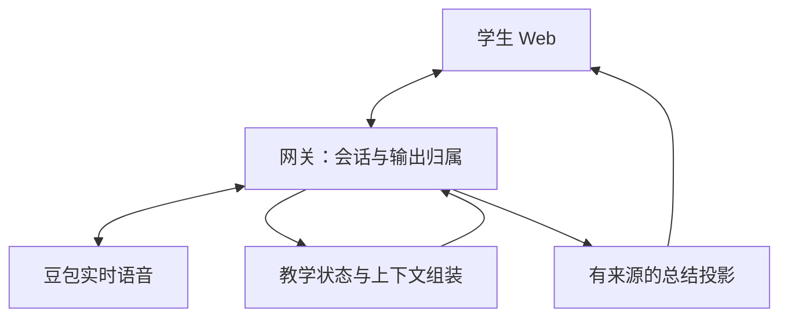

# 收尾 Task 04：POC Harness 改造设计

2026-10-12（Asia/Shanghai）。**本任务交付设计和 Task05 开发清单，未修改 Agent 运行代码，未进行新的豆包或评分模型调用。** 这里的 Harness 指智能体运行中的会话、教学状态、上下文、输出归属和证据管理。本文的接口与流程是后续改造方案，不代表已实现。

目标是改善已有独立 Web POC 的语言选择、教学自然度、回复长度及总结展示，并让每项改动可验证、可解释、可回滚。保留真实豆包语音、本地 mock HSKai 和三个入口。普通 Web 真实纵向验收已由用户确认完成；后续只补未覆盖项和受改造影响的回归。

## 1. 依据与结论强度

设计依据为[评分校准](eval-results/2026-10-12-task01-calibration.md)、[采集证据](eval-results/2026-10-12-task02-evidence.md)、[预注册根因对照](eval-results/2026-10-12-task03-root-cause.md)、[产品需求 §4–6](prd/ask-kai-agent-prd-v1.1.md)及当前源码。Pi 理想设计仅用于参考模块边界，当前方案继续使用自研运行壳；本轮不引入 Pi、第二个在线规划模型、数据库、后台服务或外部 HSKai。

| 事实或观察 | 证据强度 | 对应设计 |
| --- | --- | --- |
| 8 次明确只中文请求均被解析为关闭英文支架，2 次完整文字回复仍配英文 | Task03 已确认本轮识别与文字违规；模型采用何种内部上下文未知 | 明确语言请求优先级、作用范围和旧状态冲突；解析成功与回复遵守分别验收 |
| 40 步的上下文更新及确认回执均晚于可见回复开始；8 次只中文请求中有 6 次仍遵守 | 本轮时序已确认；晚到不是违规的充分原因 | 保留自然全双工，不把普通回复统一改成等待确认；不能追溯宣称新策略影响了已生成音频 |
| 不需要的英文均出现在先前确认的双语状态下，另有相同旧状态仍遵守的反例 | 旧双语状态干扰有支持，精确因果未完全隔离 | 统一上下文组装与语言来源，减少冲突；用成功和失败样本一起回归 |
| 018-t02 错误纠正正确句，006-t11 无视拒绝，027／035 结束后邀请，029／030／033 未澄清歧义 | Task01 保留的内容观察，未在 Task03 验证各自根因 | 设计通用纠正、澄清、拒绝和收束契约；不把这些内容问题全部归因于时序 |
| 预算低分涉及 20 案／23 轮，语言支持低分涉及 18 案／32 轮；48 份总结均无学习条目 | 模型辅助复核观察；不是人工批准或独立评分模型验证 | 保留预算与评分尺度，分开内容密度、语言支架、总结来源和产品覆盖 |
| Task02 的 040 一份输入产生多个识别终轮，Task03 同音频四次未复现；036 残段及旧 Hmm 超时未复现 | 输入与供应商回合不必一一对应有证据；旧精确原因未知 | 设计输入段与真实回合的独立关联；缺段仍留证，不跨标识拼接或补参考回复 |

案例编号完整前缀为 `ask-kai-v2-`，语言对照为 `ask-kai-language-`；正文采用简号便于阅读。未复核的低分条目、派生 040 的一次只英文回复和拼音待教研项保留为待核验观察，不直接决定全系统改动。

## 2. 最小模块边界

保持模块化单体。先在现有位置增加明确的数据边界和函数，再按必要性拆文件，不为架构整洁先重写网关。

图表示改造后的职责边界。独立评测通过同一网关观察实际结果，作者参考、未来脚本、预期语言模式和评分要求不得进入教学状态或上下文。

| 职责 | 当前落点 | 最小改造 |
| --- | --- | --- |
| 会话、回合、回复和取消归属 | `packages/agent-core/session.js`、`apps/realtime-gateway/src/realtime.js`、`output-gate.js` | 保留校验和旧事件隔离；统一上下文待发送／待确认／已确认记录，补关联元数据 |
| 语言策略 | `packages/agent-core/language-support.js` | 增加请求作用范围，保留来源、理解自述和已知表达限制；不从词语使用推断掌握 |
| 教学动作 | `packages/agent-core/natural-teaching.js`、`teaching.js` | 明确拒绝、换题、收束、澄清和纠正的状态及优先级；动作仍是建议 |
| 上下文组装 | 当前 `TeachingSession.instructions()` | 提取纯函数，拟放 `packages/agent-core/context-snapshot.js`；单一入口产生版本、来源段、哈希和作用范围 |
| 回复预算 | `packages/agent-core/reply-policy.js` | 保持共享预算，减少重复和相互冲突的教学指令；完整回复审计与实际听感分开 |
| 总结与展示 | `learning-summary.js`、Web `summary-cards.js` | 扩展有来源的回顾与受审表达目录，保留空／部分／不可用状态及撤权清理 |
| 候选评测 | `apps/eval-runner/`、评测脚本及专用工作流 | 增加独立候选版本契约；旧基线校验、历史观测和评分尺度不变 |

## 3. 状态与接口契约

字段是拟议最小内部接口；实施时沿用已有标识并验证兼容性，不直接替换供应商协议。供应商确认、模型内容和浏览器播放分别观察。

| 对象 | 必要字段或内容 | 不变量 |
| --- | --- | --- |
| 教学快照 | 会话标识、状态版本、来源学生回合／事件、模式、主要目标、拒绝／收束／澄清状态、语言支架及预算 | 来自本轮与已发生历史；不能使用未来案例或参考；同版本快照不随外部修改变化 |
| 语言请求 | 值、来源、作用范围、来源回合、被取代或消费状态 | 本次回复、当前会话、已保存画像分开；引语和讨论语言规则不改偏好 |
| 上下文快照 | 快照哈希、基于的状态版本、来源段版本、语言状态、适用回合或后续范围 | 组装一次；待发送、待确认及已确认都引用原快照，不能晚到后重写旧记录 |
| 更新确认记录 | 会话及连接归属、请求版本、请求／确认观察时间、状态与超时结果 | 仅匹配当前待确认请求；旧连接、错误版本、重复确认不得覆盖新状态 |
| 回复观察 | 回合／回复标识、开始通知时的已确认快照、本轮来源决策、完整／取消／部分状态、转发证据 | 决策生成、后台确认、内容遵守是三个判断；开始通知不等于真实生成起点 |
| 呈现观察 | 当前回复标识、转发范围、浏览器报告的播放进度、字幕片段计数、停止／清理原因 | 播放进度是端侧估计，不能证明听见、理解或掌握；没有记录时保持未知 |
| 总结条目 | 观察类型、有限内容或目录条目、会话／回合／事件来源、规则版本、完整性与呈现范围 | 无来源不展示成果；规划、教师文本和学生尝试分别记录 |

每个会话通过既有协调入口处理状态，不新增跨会话可写共享状态。异步回调保留会话、连接和版本检查。更新中的新请求可合并为最新待发送快照，但正在等待确认的快照不可变；取消或确认后再按最新版本发送。模型回答始终不作为后台画像写入授权。

## 4. 语言优先级与更新时序

### 请求作用范围

安全和服务约束始终优先。在语言选择内，当前有效显式请求优先于旧会话偏好和已保存画像；默认规则最后兜底。

| 表达或状态 | 作用范围 | 后续行为 |
| --- | --- | --- |
| “这句只说中文”“这个词加英文解释” | 当前回复 | 消费后恢复先前有效偏好，不改理解画像；重复或迟到事件不能重复消费 |
| “接下来只说中文”“恢复自动语言模式”；直接语言设置请求如 `Please speak Chinese only.` | 当前会话，直到新的明确请求 | 替换先前会话语言设置；新会话重新读取授权画像 |
| 学生说没听懂、询问新表达 | 当前帮助需求 | 自动模式下补必要短英文；只中文偏好下先简化中文，明确请求英文可形成本轮例外 |
| Web 保存语言偏好或理解自述 | 已保存画像 | 经现有授权接口；后续会话读取；当前会话相关旧设置按既有更正机制失效 |
| 引语、翻译练习、否定、讨论语言规则、普通中文产出 | 不产生控制请求 | 保留给模型理解；服务端不据此更改偏好或水平 |

窄规则不能可靠理解的作用范围保持未知，先交给豆包理解，不猜测写入画像。新解析覆盖需包含否定、引语、混合语言和相邻回合反例。上述局部请求规则是待实现合同；现行代码仍主要维护会话级偏好。

### 时序决策

1. 初始连接前组装授权画像和默认策略；学生音频持续走现有全双工路径。
2. 有归属的最终识别到达后，服务端更新教学／语言状态。豆包可能已经依据音频开始回答；新后台决策不能被标成已控制本轮生成。
3. 在现有安全回复／取消边界下发送不可变上下文快照；收到匹配的更新确认回执后，登记为已确认。待确认期间继续保持音频和打断能力。
4. 当前回复同时记录开始通知时的已确认快照与当前请求，语言遵守另按完整实际文字判断。更新确认晚到仍可能遵守，确认到达也不保证回复正确。
5. 新的学生意图取代旧动作建议。上下文清楚写明旧状态的来源和后续作用，避免把旧 `required` 或旧示范变成对最新请求的强制要求。

优先实施上下文去冲突、作用范围和状态来源。**不把“所有回复等待上下文更新确认”作为默认修复，不因预算超限裁切语音或独立改译字幕。** 若这些最小改动仍不足，再单独验证生成前控制能力、延迟和打断代价；严格受控路径留为条件方案，本轮不预设供应商能力或新事件。

## 5. 教学动作、收束与回复预算

当前保守规则识别器不能充当通用语义评审；端到端豆包仍依据真实音频和历史理解学生。本阶段先完善通用动作契约与上下文，不增加在线评分模型或逐例答案表。

| 场景 | 目标行为与状态 | 验收反例 |
| --- | --- | --- |
| 明确拒绝或换题 | 暂停原目标；自然回应当前话题；只有主动恢复原练习才重启 | 谈新话题或求助新表达不能重启旧目标；不要求拒绝理由 |
| 明确告别 | 进入收束，短告别，零追问、零练习邀请、零长口头总结 | 翻译“再见”、引用告别语和问题中的 goodbye 不触发收束；学生后来明确继续可退出收束 |
| 用户点击结束／离开 | 沿用立即停止采音、播放、字幕和关闭连接 | 不为了播完告别或总结延迟用户退出；口头告别不新增固定关麦计时器 |
| 含糊但有多种合理解释 | 结合实际前文先问一个短澄清问题；仍不清楚则低压回应并等待 | “play football”不因 play 被强制澄清；“that”有明确前文指代时不重新盘问 |
| 可能的表达错误 | 不确定先澄清；确认有价值的错误只给一个自然修正，保留原意 | 正确中文不被要求添动词；转写偏离、单词或英文回答不自动判能力差或发音错 |
| 普通交流或目标已尝试 | 允许零知识点、零追问，减少重复示范；维持教学冷却 | 不为命中评测要求强制继续问题、读完整 HSK 标签或多次要求跟读 |

动作优先级为安全／服务约束、结束与拒绝、理解意图、自然回应、必要教学。澄清次数、目标暂停、教学冷却独立记录。若旧动作仅在轮后得到确认，它仅是带来源的后续建议，不作为本轮已经做过的事实。

预算继续使用现有 `kai-reply-v2`：默认一句短中文，最多两句；36 汉字、24 英文词、48 合计单位、180 总字符；至多一个主要问题或任务、一个新点和一个短示范。英文消耗同一预算。安全必要回应仍优先。实施先整理重复指令、明确动作互斥和把长解释移到卡片，不能通过放宽预算或更改评分权重制造改善。

纠正策略的首要检查包括 018，但必须同时覆盖正确句、真实错误、含糊意图、拒绝纠错和运动目标已尝试等类别。语义正确性仍用已有十维逐项证据评审，不能因选出了“纠正”动作就自动打通过。

## 6. 输入段、供应商回合与呈现证据

评测作者的一段音频可以对应零个、一个或多个供应商回合；真实 Web 输入是持续音频流，没有评测作者段号。两种来源分别建模。

- 评测侧保留作者段号、脚本／音频哈希、入队与发送完成、供应商回合及回复的关联列表。多个识别终轮保留原标识和有界片段；评分适配未能验证完整输入对应时，继续记部分／不可评，不能合并文本假装完整。
- 运行侧只接受供应商适配后的合法回合和回复；保持现有事件去重、取消及旧输出隔离。不能把评测段号注入模型或拿它覆盖供应商标识。
- 浏览器可增加当前回复的播放和字幕观察，经过会话与回复校验后仅用于诊断及受影响的 Web 回归。观察缺失不阻塞正常对话，也不创建学生学习事实。
- 整理网关／浏览器的独立时钟及关联标识，不用跨机器时间戳直接减法计算延迟。日志和导出只保留受限元数据；完整文本只在现有获准评测证据中保存。

040、036、011作为保留原因未知的回归探针，不通过改静音、帧速或超时后宣称旧根因修复。若要调整这些条件，独立记录单变量实验和全部失败尝试。内部记忆操作仍不可见时继续标未覆盖，不用外围端口审计替代。

## 7. 有来源的结构化总结

目前规则只覆盖运动喜好表达。改造目标是增加自由会话的可用回顾，同时保留证据层级；不要求每场聊天都有知识点，也不追求这 40 个案例全部生成学习条目。

拟以新版本总结策略和兼容投影增加两层内容：

| 层 | 内容与范围 | 来源及限制 |
| --- | --- | --- |
| 会话回顾 | 最多两个有明确来源的主题、最多三条学生中文表达观察 | 只取已接受的最终学生输入或明确话题请求；保留有限原文片段和来源，不自动判断中文正确，也不把引用／教师示范标为学生尝试 |
| 学习表达 | 经版本化、审阅的有限表达目录，显示汉字／拼音／英文及尝试来源 | 目录应覆盖多个常见交流主题；不是按失败案例逐条写参考答案。不支持的表达保持未评估，不由模型随意生成已掌握词卡 |

已有计划目标、完整转发的教师文本、后续学生尝试继续分开。若需要直接学生表达匹配规则，单独发布规则版本并验证引用、否定、重复、错误回合和上下文；不能以关键词命中替代。自由会话中已有短语而没有可靠示范或规则证据时，可展示为“学生表达观察”，不冒充“练习成果”。

保持最多一个有来源且自愿的再练项；口头告别不读卡片全文。模型生成、网关转发、浏览器报告播放、学生尝试均不同；总结不能认证理解、独立使用、掌握或发音。取消／缺失回复不能补成完整教学，部分、空白、不可用和规则覆盖范围保留。撤权或安全限制后不展示敏感旧总结，迟到结果不得恢复已清理内容。

接口以新 `schema_version` 或明确新增字段版本迁移，Web 和评分适配共同验证，不静默改变 `learning_items` 的含义。当前会话内数据仍通过已有授权路径使用，默认不新增长期逐字稿、真实录音或跨会话学习记忆。

## 8. 实施与验收

具体顺序见[Task05 分项开发与回归清单](task05-implementation-tasking.md)。第一步先补独立候选评测契约，再进行上下文、语言、教学与总结修改；每类单独提交并推送。不能删除旧基线校验后把候选结果标成旧 Agent。

每项交付同时包含行为合同、实际改动范围、受影响回归、旧基线／候选版本和未覆盖项。先通过工程校验，再用真实同类案例检查内容；最终跑 40 个原案及 8 个语言对照，分别统计采集覆盖、输入可比性、逐项分数、关键失败、改善和退化。固定音频可复用的部分先复用；旧全量未保存的音频不能声称字节相同。

原正式结果保留 244/255 实际回复及缺口；Task02／03诊断不拼接成新版正式全量分数。未采集、不确定或能力缺口仍不填分。语速、自然停顿、插话、字幕同步与总结实际展示走受影响的真实 Web 验收；自由会话评分不能替代三个入口旅程。

完成 Task04 的条件：修改面和依据可追溯，状态与作用范围明确，Task05 每项能独立实施／验收／回滚，未知原因保留，README及任务状态同步。Task04 完成不表示上述行为已修复，也不表示 POC 已最终验收。

## 9. 版本与交付边界

- 设计输入主干：`5fe9500499abf1016baeb156378c53fca90b2034`，树 `2ca9422843832044b29b570b526cf9bca8ad1cda`。
- 冻结 Agent：`6661d7ba3ecf7f3eef8f23f74c5d625cb8f457e2`，运行文件摘要 `e81fb28f2c1fa0083281cb2d99a44cd20eecd8ffa766e3f949afec03fceb6dde`。
- 数据集：`freechat-v3.1-20261011`；十维口径 `kai-content-v3`，校准口径 `kai-recorded-review-v2`；历史原始记录、作者数据及分数均不覆盖。
- Pi 完整目标架构、长期记忆、独立发音评分、教研后台、生产部署和真实外部业务接入继续在后续范围。

正文使用“上下文更新确认回执”。源码里既有 `context.updated`／`context.applied` 等名称只用于定位内部契约，不当作供应商原始事件名。当前设计不假定模型内部生成起点或实际应用快照可见。

本次文档交付已通过差异格式、118个本地文件链接、源码语法／JSON／回放 fixture合同和原评测集准备校验。核对46个冻结运行文件、依赖／锁文件、原数据及历史报告哈希，全部未改；仅新增两份设计／任务文档并更新README、实施计划和收尾TODO。未重跑真实内容或设备验收；历史测试结果不冒充本次改造通过。
