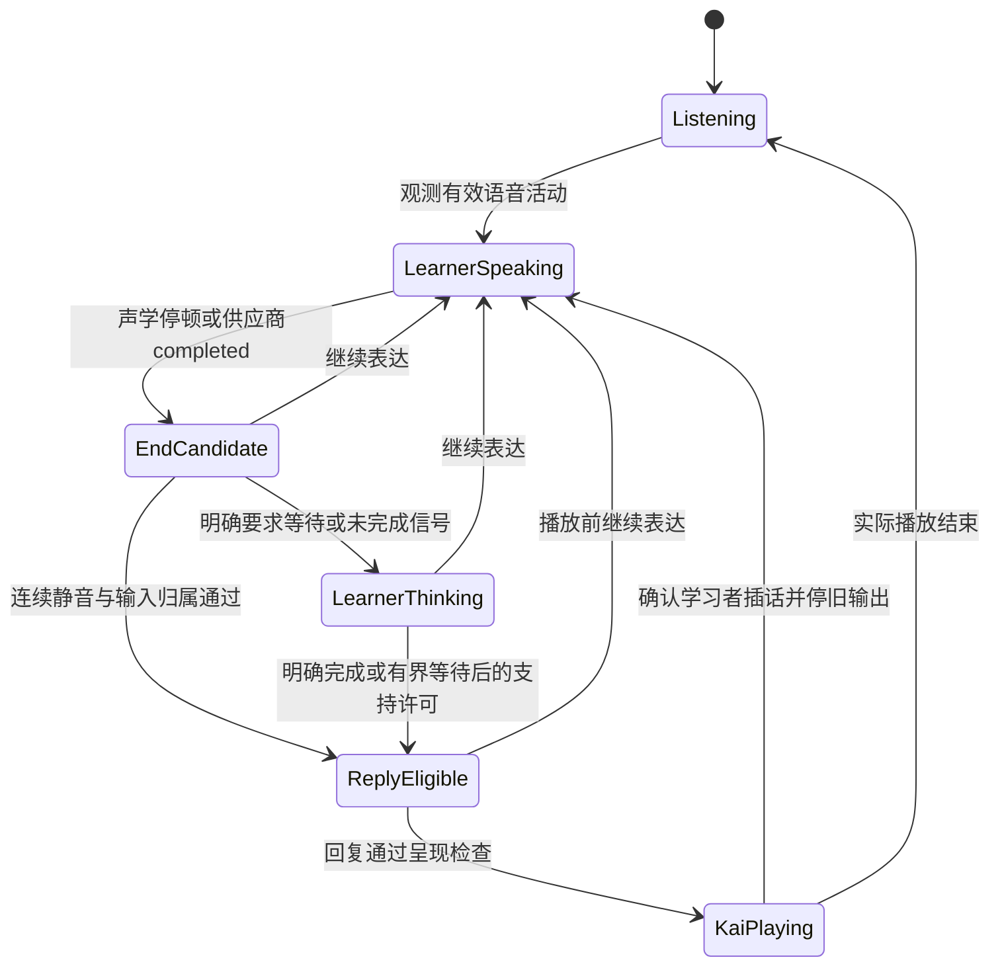

# 学习者话轮与 AI 提前开口控制设计

2026-10-14，设计提案，尚未实施。适用于 Ask Kai／Tutor 的持续采音、豆包实时全双工链路。另一项目也使用豆包全双工，但未检查其代码、配置或时序，本文不能认定其根因。

遵循当前独立 POC 边界：真实豆包语音与本地 Mock 业务分开；保持 `next_turn_advisory`，`controlled` 继续关闭；不新增外部 HSKai 集成或独立 ASR／TTS。产品依据为 PRD §6.4、AK-UX-08，实施范围以 README 和 implementation-plan 为准。

## 1. 当前决策与证据等级

当前只推进 **M5 的供应商判停参数核验，以及 M3 的等待指令对照设计**。先检查是否存在客户端提前 commit、采音断续或旧播放残留；确认这些因素后再做参数实验。M2 网关门控和 M1 新增活动接口暂列条件方案，尚无端到端有效性证据。

| 事项 | 证据等级 | 当前可依赖的结论 |
| --- | --- | --- |
| 全双工返回转写 completed | 官方全双工下行事件表明确列出 | 可观测模型判停；不证明学习者真正说完，也不证明模型尚未生成 |
| `session.instructions` | 官方全双工字段明确列出 | 可请求耐心等待，属于软约束；遵循效果需测 |
| `enable_custom_vad`／`end_smooth_window_ms` | 旧版明确字段＋全双工配置迁移说明 | `extension.asr.extra.*` 是有依据的实验候选；当前型号实际效果未验证 |
| 网关延迟播放 | 现有局部保护＋拟议扩展 | 可以限制本地转发时机；是否改善自然对话、取消后是否正确续答未验证 |
| 关闭自主生成、每轮显式放行 | 本次公开文档读取范围没有完整契约；独立 FC 实验覆盖有限 | `controlled` 不启用，不把工具调用或缓存当作每轮生成门控保证 |

**术语固定：**供应商事件写作 `conversation.item.input_audio_transcription.completed`（下文简称 `transcription.completed`）；Ask Kai 将其映射为内部 `user.final`。Speech-to-Speech 不排斥旁路转写事件，当前链路没有新增独立 ASR→LLM→TTS 服务。另一项目是否收到／消费这些事件仍需检查。

两套判定分开：Kai 接话可以更耐心；学习者插话仍需迅速停止旧输出。调整接话窗口不得延长学生打断 Kai 的确认窗口。

**主要成功条件是完整表达被接住、抢话减少且正常响应和打断可用。**只看到 completed 更晚、cancel 次数减少或音频更晚播放，都不足以宣布问题解决。

## 2. 可能原因与定位方法

| 可能问题 | 典型现象 | 要核对的证据 | 优先干预位置 |
| --- | --- | --- | --- |
| 供应商把思考停顿判为说完 | “我喜欢……足球”被分成两段，前半段后已有回复 | 同一网关时钟中的声学活动、transcription.completed、首输出、继续表达顺序 | M5 判停配置；M2 开口许可 |
| 客户端过早强制提交 | 每次短暂停顿都迅速有 committed／transcription.completed／回复 | 上行 `input_audio_buffer.commit` 的调用位置、原因和时机 | M1／M2 的提交策略 |
| 自主接话／填充语 | 尚无完整表达，AI 插入“嗯？”“然后呢？”或代答 | 首输出与 transcription.completed 顺序；提示词是否要求积极回应、每轮追问 | M3 指令与沉默支持预算；M2 全输出门控 |
| 音频处理或上传断续 | 弱声、尾音被切掉；网络卡顿像停顿 | 实际 AEC／降噪设置、PCM 帧间隔、丢帧／积压与 VAD 活动 | M1 采音；M2 输入健康检查 |
| 回声或噪声被识别为新输入 | 扬声器更易出现自问自答／自我打断 | 耳机对照；播放时无真人发声却出现 ASR／VAD | M1 AEC；M2 候选确认 |
| 迟到输出或播放队列残留 | 已继续表达，上一句仍播出来 | response 归属、stop 后旧包、浏览器队列与字幕 | M2 取消／隔离；M1 队列清理 |
| 多条回复路径同时运行 | 同一输入有两次回复，或多个独立闲置提示 | 自主回复、外部文本替换、工具回传、闲置定时器的发起来源 | M2 单一回复仲裁；M5 控制串行 |

不能仅凭“全双工”推断一定是 VAD 参数问题。先区分供应商提前输出、网关提前放行、客户端过早 commit 和旧播放残留。

## 3. Ask Kai 现有保护与明确缺口

| 当前实现 | 代码位置 | 本次发现的边界 |
| --- | --- | --- |
| 等待指令、过滤单独犹豫声 | `packages/agent-core/turn-taking.js` | 提示词和文本规则不能证明人声结束或真人来源 |
| ASR started 仅作候选，completed 映射 `user.final` | `packages/provider-doubao/seeduplex.js` | started 是识别首字；completed 是供应商判停。已结束的 provider item 不重新打开 |
| 有内容的新 ASR 确认后取消旧回复 | `apps/realtime-gateway/src/realtime.js` | 必须等文字；弱声／ASR 延迟时保护可能晚于首音频 |
| `TurnOutputGate` 等 final，再留 350ms | `apps/realtime-gateway/src/output-gate.js` | 从 final 到达时计时，未测真实连续静音；350ms 未经本次校准 |
| 只为已观测的对应 ASR turn 等待 | 同上 | 回复先于候选、未知 turn 或主动输出可能直接通过；不能把它们都当开场 |
| 连续上传 20ms PCM；申请 AEC、降噪、AGC | `apps/realtime-gateway/public/audio.js` | 当前没有独立声学活动判定；申请不等于设备消除回声成功 |
| 手动打断立即停播；取消控制串行、旧事件隔离 | 网关、专用 adapter、`public/presentation.js` | 保留这些不变量；供应商无目标 ID 的 cancel 不能误伤更新后的回复 |
| 内部 user.final 到达即可进入教学与逐轮规划 | `packages/agent-core/teaching.js`、网关 | 供应商分段可能使学习者一句话提前变成多个教学回合 |

350ms 是呈现缓冲；5s 是缺少 final 的等待上限；1500ms 是取消／更新 ACK 超时。这三个数均不是已验证的“学生停顿阈值”。

## 4. 分模块控制与接口边界

| 模块 | 建议功能 | 现有或拟议接口 | 负责的效果 |
| --- | --- | --- | --- |
| M1 Web／后续 App | AEC 检查、输入健康、播放前活动复核、立即停播、可选“我说完了／继续等我” | 现有采音和 `output.stop`；网关已接收 `playback.report`，普通 Web 待发送；拟议 `client.audio.activity`、`client.turn.complete`、`client.turn.hold` | 减少端侧抢播，保留学习者控制；客户端提示只作运行信号 |
| **M2 网关（条件方案）** | `TurnTakingCoordinator`：话轮占用、判停候选、开口许可、回复失效、沉默提示仲裁 | 拟议内部 `observeAudio`、`observeTranscript`、`decideRelease`、`confirmContinuation`；升级 `TurnOutputGate` | 参数／指令不足且局部试验有效时，执行呈现许可与旧回复隔离 |
| M3 Agent Core | 耐心档位、当前练习类型、求助条件、一次低压支持和冷却 | `TurnTakingPolicy`；未来可选 `TurnCompletionPort`，先 shadow | 给策略建议，不直接控制每个音频包或取消请求 |
| M5 Doubao Adapter | 准确事件映射、配置能力核验、取消、强制判停、必要时文本干预 | 现有 `sendAudio`、`cancel`、`updateContext`；能力核验后的专用扩展 | 尽可能改善供应商判停和回复行为，保留协议归属 |
| M4 业务与课程 | 已授权的偏好／课程类型输入 | 现有资料和课程端口；长期偏好另行定义 | 为等待策略提供依据；不进入实时开口判定路径 |

新接口名称是 Ask Kai 的设计契约，不是豆包 wire 事件。尚未加入现有契约或客户端消息白名单。

### 豆包侧实际可以做什么

2026-10-14 重新查阅[全双工 API](https://docs.volcengine.com/docs/DoubaoVoice/endtoend-realtime-voice-full-duplex-version?lang=zh)与[接入必读](https://docs.volcengine.com/docs/DoubaoVoice/access-mustread?lang=zh)。前者显示更新于 2026-10-12，后者于 2026-09-28。

| 能力 | 用途与限制 |
| --- | --- |
| `session.create/update` 的 `instructions` | 请求耐心等待、减少填充语；ACK 不保证模型遵循或在当前生成前生效 |
| `input_audio_buffer.commit` | 强制判停。频繁提前发送可能加剧抢答；不能用于延长等待 |
| `response.cancel`／`response.canceled` | 取消进行中的回复。立即停本地播放后再等待实际 ACK；不能撤回已播内容 |
| `speech_text_buffer.replacement.append/commit` | 干预回复文本；不等于已核验的关闭自主生成开关 |
| Function Calling | 工具结果回传后可继续回复；普通 Web 未启用，每轮必经工具尚未核验 |

旧版[端到端实时语音 API](https://docs.volcengine.com/docs/DoubaoVoice/End-to-endreal-timespeechlargemodelAPIaccessdocument?lang=zh)列出了 `asr.extra.enable_custom_vad` 和 `end_smooth_window_ms`。全双工接入必读允许存量 `asr/tts/dialog` 配置迁到顶层 `extension`，因此 `extension.asr.extra.*` 是值得核验的配置路径；但本次读取的全双工字段表没有明确列出这两项的当前判停语义。

优先通过独立实验、使用已授权的准确账号核验这两项在 `1.2.6.1` 的实际效果；无法说明或效果不明确时再向供应商确认组合、范围、建连与动态更新差异、对语义判停和主动接话的影响。不能把旧版默认值或“请求未报错”当作全双工实际生效。当前专用 profile 校验拒绝未审核 extension，新增能力须走独立实验与审核，不直接改生产 profile。

本次读取范围未找到足以确认“关闭自动回复＋显式触发本轮生成”的完整契约。该结论限定于这些公开文档；不推断所有账号都不支持。旧版 `push_to_talk` 或其他供应商的 `turn_detection`／`response.create` 不能直接套用。

## 5. 先实施的最小验证方案

此节是未来实验的执行设计，本轮没有开始真实调用。优先实现独立 M5 probe；候选配置仅在显式实验入口中使用，结果不得自动把正式 profile 标为已审核。不借此放宽普通 adapter 的 profile 校验，不修改默认语音、规划模式或学习证据契约。

### 5.1 预检查与固定项

先核对准确 endpoint／model、当前 session.create 配置、转写事件是否可观测，以及 `input_audio_buffer.commit` 的发起原因。若客户端每次短停顿都强制 commit，先独立定位该路径；不把它和 VAD 参数一起改动后归因。

固定模型、音色、提示词、输入 PCM、音频格式、实时发送节奏和超时／取消规则。使用固定作者合成语音，按输入样本标记的继续表达起点和真实结束边界计算时序，不需要先新增本地 VAD。供应商转写到达顺序不能代替这些作者边界。首轮采用新连接的 session.create，不先引入动态更新生效时机的额外变量。

### 5.2 参数实验：每次只改候选配置

| 组别 | 配置变化 | 目的 |
| --- | --- | --- |
| C0 | 当前配置原样保留并记录是否显式配置参数 | 基线；不把旧版 1500ms 当作当前全双工默认值 |
| C1 | `enable_custom_vad=true`、`end_smooth_window_ms=1500` | 验证开启候选配置的表现 |
| C2 | 相对 C1 只将窗口改成 2500ms | 检查窗口变化是否改变模型判停和实际首输出 |
| C3，可选 | 相对 C1 只将窗口改成 3500ms | 仅在 C1／C2 有效果或需澄清时追加；不默认遍历参数 |

候选片段在 `session.create` 顶层，与 `session` 同级；依据为旧版字段和全双工迁移说明，尚不是已验证配置：

```json
{
  "extension": {
    "asr": {
      "extra": {
        "enable_custom_vad": true,
        "end_smooth_window_ms": 2500
      }
    }
  }
}
```

首批使用四个固定样本：完整短回答；“我喜欢”停顿 1200ms 后说“足球”；句中停顿 2000ms 后补完表达；Kai 播报时学习者明确插话。前三案的 PCM 与输入时间标记完全固定；插话案以同归属回复的首音频事件为锚点，在固定偏移后注入同一语音片段并沿用原有归属取消规则。该案只验证供应商时序与取消／续答，实际可听停播延迟另由设备测试验收。每组每案两次独立会话，C0～C2 共最多 24 次；若参数被拒绝，不继续用同一非法配置跑余下样本。C3 最多追加 8 次，另列分母。该样本量用于能力探查，不能代替发布验收或证明对全部口音／年龄有效。

每次分开记录：配置请求是否报错、真实 ready、transcription.completed 时机、首个供应商文本／音频、是否在继续表达前开口、是否回应后半句、取消 ACK 和新回复恢复。端点或回复归属不明、超时、缺少输出都计 unknown／失败，不能从有效分母静默剔除。通过局部序号／fixture 时间关联；供应商内部生成起点保持 unknown。

### 5.3 等待指令实验：保持其余配置相同

参数实验有结论后，对原指令和调整等待规则后的指令单独做同案对照；参数不支持时可以在原配置上测试提示词。P0 保存实际编译后的初始 instructions 版本与哈希；P1 只替换 `packages/agent-core/turn-taking.js` 对应的等待规则，不重复追加同义规则，不改变安全、语言、教学目标和回复预算。两组都通过新连接应用初始指令，不把动态更新 ACK 时机混入此实验。

建议候选规则：

> 学习者找词、犹豫、句中停顿或重新组织表达时保持聆听，不代答，不插入“嗯？”“然后呢？”等催促。等学习者完成当前意思、让出话轮后再回应；学习者明确求助时再提供简短帮助。学习者继续说或要求停止时，让他先说完。

这是行为引导，不能把“等待两秒”等自然语言当作可靠计时器。检查弱声、单字／数字回答和告别没有因过度等待被误伤。

### 5.4 按结果决定下一步

| 实验结果 | 判断 | 后续动作 |
| --- | --- | --- |
| 首输出确实后移，接住后半句，正常完成与学生插话保持可用 | 参数或指令在固定样本上有效 | 选最小必要等待，进入真实设备／更多输入验证；不自动建设新网关 |
| completed 后移，但首输出仍抢在后半句之前 | 转写判停与自主输出不同步 | 不计成功；向供应商核对控制对象，进入局部呈现试验前评估内容过时问题 |
| 只延迟播放，旧回答仍只理解前半句 | 听感被延迟，完整对话未改善 | 不发布“已解决”；验证旧回复失效后正确恢复的能力 |
| 配置报错或重复对照没有稳定变化 | 参数不支持，或实际效果仍未知 | 保存非敏感错误类别与分母；不将请求未报错当作参数生效，可验证提示词并核对供应商 |
| 提示词有效但偶尔仍抢话 | 软约束有帮助，仍无硬保证 | 按实际残留类型决定是否做局部 M2 试验，不直接启用完整逻辑话轮 |
| 取消后回复缺失、误取消新回复、打断变慢 | 候选方案有不可接受回归 | 停止提升为默认配置；保留原路径和缺陷，先解决对应能力缺口 |

进入任何运行默认值前，除固定样本改善，还要完成耳机／扬声器的可听时序、回声、弱声、噪声和正常响应验收。响应延迟容忍度在正式对照前按体验基线确定；不在看到结果后临时改变口径。没有真实验证结果时，状态始终为 candidate／unverified。

## 6. 诊断、指标和验证

建议新增白名单元数据：活动候选／确认、判停候选、开口许可／撤销、逻辑话轮与版本、回复 held／invalidated／released、输入健康、实际派发取消与客户端播放估计。只导出匿名引用、时间间隔、计数、状态和策略版本，不保存原始音频、转写、供应商 trace 或密钥。

分开测量：供应商首输出、网关放行、浏览器首次调度／输出时钟估计、设备可听首响。现有 `response.first_audio` 从 response.started 计时，不能直接用作学习者真正说完到首响。网关与浏览器单调时钟不能直接相减；跨层用归属关联，真实人声起止与可听时间用获准的统一采集或人工标注校准。

| 指标 | 定义与限制 |
| --- | --- |
| AI 抢话率 | 被标注为学习者仍占有话轮时 Kai 开口的次数／可评估学习者话轮；VAD 重叠只是代理指标 |
| 供应商误判停率 | 被标注为同一表达的继续语音被提前拆段的次数／可评估表达；主动新话轮不算误判 |
| 完整表达到可听首响 P50／P95 | 同一真实设备测量基准；同时报告额外门控等待与不可评估样本 |
| 学习者插话成功率与停播延迟 | 插话后旧音频／字幕失效；ACK 延迟与可听停播分别统计 |
| 误取消／误拦截率 | 噪声、回声、有效短回答被误判的次数／对应测试机会 |
| 回复失效后的恢复率 | 继续表达后获得正确归属新回复的次数／需恢复次数；缺失单列 |
| 重复提示与学习回合重复 | 同一沉默多次催促或同一逻辑表达重复规划／记账，分别计数 |

必测“我喜欢……足球”、句中 300／700／1200／2000ms 停顿、长思考、单字／数字、弱声／口音、中英混合、自我修正、“让我想想／等一下”、真正新问题、扬声器回声、背景人声、输入卡顿，以及 final／回复／cancel／update 交错。

验证分三层报告，不能互相替代：

- **Synthetic**：确定性时钟、PCM fixture、供应商样式事件验证版本、重置计时、未知输入、缓存、归属、迟到隔离与错误路径。实现运行／契约变化后执行 `npm run verify` 和 `npm run replay`。
- **Real provider**：固定作者合成语音按实时节奏上传，检查实际判停／早输出／取消与恢复。配置请求被接受和行为改善分开记录；旧字段核验使用独立 probe。此层不代表真人或设备通过。
- **Browser／设备音频**：合成浏览器检查采音、门控、清队列／字幕；再用耳机与扬声器实际试听、弱声与噪声测试，校准 AEC 和可听时序。

先保存当前基线，再对同一批场景比较。人工标注话轮完成和自然新输入；报告分母、失败与 unknown，不只报 cancel 数下降。选择抢话率与首响延迟的合理折中；明确“停”、旧输出不串入新轮与持续采音属于硬性回归要求。

## 7. 建议实施顺序

| 阶段 | 具体交付 | 进入下一阶段的证据 |
| --- | --- | --- |
| TT-01 定位与配置核验 | 输入／回复／播放时序基线；检查 commit；独立比较 extension 判停字段和等待指令 | 能区分供应商、网关、端侧原因，字段效果明确或标为未验证；若已改善则不自动扩展网关 |
| TT-02 条件性网关呈现控制 | TT-01 不足时，先验证局部 hold／继续表达／cancel 后恢复；通过后再考虑 M2 coordinator＋VAD 与完整输出 gate | Synthetic 回归；真实供应商早输出／恢复对照通过，且实际改善未被回复缺失或内容过时抵消 |
| TT-03 端侧保护 | M1 本地活动与播放前许可复核、播放回执、学习者等待／完成控件 | 合成浏览器及耳机／扬声器实测，不降低插话可用性 |
| TT-04 教学逻辑话轮 | 多 ASR 段的来源与修订模型、一次回合提交、旧规划失效 | 分段、自我修正、拒绝／结束、attempted 来源回归 |
| TT-05 可选生成端增强 | 经核验的判停控制或每轮生成门控；独立实验能力转正式 adapter | 精确账号契约、多轮／取消／失败／重连证据，满足 controlled 独立门槛 |

不直接把当前 350ms 调成一个更大的常数就宣布问题解决。建议先做 TT-01，执行第 5 节的参数和指令小范围实测；按决策表决定是否进入 TT-02。转写 completed 可用于观测与归属，不能单凭它证明学习者实际已说完，亦不能证明模型尚未生成。

## 8. 本轮交付范围

本轮只读取代码与公开官方文档、形成设计；未修改运行代码、契约、profile、提示词或其他项目，未连接豆包或上传音频，未运行新的 synthetic／browser 音频验收。现有工作区其他修改保持原样。后续实施需按上面三层分别验证。

相关资料：[现有等待与打断](turn-taking.md)、[协议映射](protocol/seeduplex-integration.md)、[本轮生成控制核验](protocol/seeduplex-planning-control.md)、[体验诊断基线](experience-baseline.md)、[实施边界](implementation-plan.md)。

## 附录 A：条件性 M2 话轮与呈现设计

仅在第 5 节证明供应商参数／指令不足，且局部缓冲、取消与恢复实验没有上述回归后，再考虑实施本附录。它控制可观测的呈现顺序，不控制或证明豆包内部生成时机。


### A.1 状态与来源

增加独立话轮状态，不把它塞进教学目标状态：



另存 `logical_turn_id`、`input_revision`、`floor_epoch` 和 provider item／response 映射。一个学习者逻辑话轮可以包含多个供应商 ASR item；原 `turn_id`／`question_id` 不改写、不复用。

`floor_epoch` 在学习者继续表达、手动打断、结束、撤权等使旧开口许可失效时递增。回复与许可绑定明确的 session、原 response、原 provider turn、逻辑话轮及当时版本。供应商 ID-less 音频仍只能通过现有独占 audio lane 绑定，不能根据“最新逻辑话轮”猜归属。

### A.2 输入与快路径

条件方案通过局部验证后，可在 M2 对已接收的原始 PCM 做增量 VAD，不改变给豆包的音频、发送节奏或保活方式。使用经合成与真实设备校准的语音活动检测；单一 RMS／音量阈值不能作为完成或真人插话证明。音频只在有界内存中处理，不新增录音保存。

M1 的本地活动检测用于降低网络往返导致的首音频竞态，作为随后端侧保护。活动信号需绑定 `capture_epoch` 与帧序号，M2 校验和同连接音频序列对应；旧捕获周期、重放、乱序与过期信号不影响新会话。不让客户端自行证明“说完”或生成学习事实。

ASR 新增内容或实质修订也是继续表达信号；当前 adapter 的累积假设应整体比较，相同快照、重复事件和迟到旧 item 不重置静音窗口。“嗯／让我想想”可延长占用话轮，不能继续只按 `hasSpeechText` 的取消规则解释。结束检测与插话确认使用各自规则。真正一词回答、数字和明确“停”继续有效，不因语法不完整被强制等待。

### A.3 允许回复的条件

对于正常学习者输入产生的回复，满足以下条件才释放文本、音频和完成事件：

1. session／response／provider turn 已经通过原有归属校验；已观测的输入具备对应 transcription.completed（映射为内部 user.final），或具备经专门核验的等价结束证据。若另一项目没有消费转写事件，先补观测验证；不能用本地 VAD 合成一条供应商 completed 来满足条件。
2. 收到连续、健康的输入帧，声学活动已停止达到本会话策略所需窗口；ASR 与活动没有新的继续信号。
3. 没有有效“继续等我”、取消屏障、过期输入版本或安全／结束限制。
4. 回复仍对应当前被允许回应的输入；开口许可尚未失效。
5. M1 首次调度前再次检查许可和本地新活动；字幕和词卡同样遵守该许可，不能先泄漏回答。

等待以**最新语音活动之后的连续静音**为主，不能仅从 final 到达后固定等待。若供应商本来已等够时间，final 到达后只做必要竞态检查，不机械叠加完整静音窗口和 350ms。

输入丢帧、浏览器冻结、网络积压或断流标为 unknown，暂停自动释放；不能把缺少输入帧算成静音。等待超时或缓冲超限时丢弃待输出并显示可理解状态，不为省缓存抢播。首期保留现有 5s 缺 final 上限、256 包／262144 字节缓存边界，调整需专门验证。

只有显式发起且可追溯的开场允许不依赖 learner final；开场也须尊重已出现的学习者活动。未知 question／主动闲置输出先隔离，不能通过“没有 ASR”自动归为开场。支持性提示由同一个 M2 仲裁器许可，每次最多一个，不让多个定时器独立开口。

### A.4 继续表达、取消与恢复

- 在缓冲期间发现继续活动：立即撤销释放计时与许可。若确认输入增加或修正，旧回复失效、丢弃并按现有归属请求取消；迟到 ACK／旧包不得恢复它。
- 已经播放时：明确停止指令／按钮立即停播；保留当前有内容 ASR 确认路径。经设备校准的高置信持续近端 VAD 可增加更早的确认路径，回声来源不确定的活动只作为候选。
- 候选只能暂缓尚未播放的输出；若要支持播放中的短暂暂停与恢复，需新增保留游标的呈现能力。现有 `stopPlayback` 清空队列，不能当作可恢复 pause；也不能 suspend 整个 AudioContext 而影响持续采音。
- `provider.cancel` 继续串行且捕获旧 response；派发时旧回复已完成或被替换则跳过，不发送无目标 cancel 去碰新回复。
- 停掉旧回复后，等待与新输入关联的自主回复。不能假设 cancel ACK 会自动重新生成完整回答，也不能稍后把旧缓存重新播出。恢复回复缺失进入有界等待／明确重试状态；这是当前供应商控制能力的剩余风险。

这套许可只证明我们观测到的输入与呈现顺序。回复开始的本地版本号不证明豆包实际读到了全部音频；内容是否理解后半句必须独立评测。

## 附录 B：条件性策略参数与教学回合

拟议 `TurnTakingPolicy` 使用本会话可见的 `balanced`／`patient` 档位、当前任务类型和明确“让我想想”来选择窗口；可以让用户选择“多给我一点思考时间”。不能仅因 HSK1／年龄推断说话能力或永久写入慢速标签。

以下仅是实验候选，均未验证，**不是当前豆包参数或生产默认值**：

| 独立参数 | 初始实验候选 | 作用 |
| --- | --- | --- |
| 完整短回答的连续静音 | 700／1000／1400ms | 对比抢话与首响延迟 |
| 找词／表达未完成时的连续静音 | 1600／2000／2600ms | 给后半句更多时间；一词有效回答不走此规则 |
| VAD 插话确认的持续活动 | 100／150／200ms | 与 ASR 一起校准；绝不能复用接话窗口 |
| 明确思考后的首次支持等待 | 6／8s | 活动停止且学生未完成时，允许一个可选帮助入口；不是到点必播 |
| 支持冷却／次数 | 首期每次沉默最多一次，冷却 15s 候选 | 不重复“然后呢”或自动连续追问 |

用同一批固定输入做对照，先选择少量参数组合；不遍历所有组合，也不一开始加入实时大模型判停。现有 MiniMax 逐轮 Planner 的秒级预算不适合承担每个停顿的开口许可。未来 `TurnCompletionPort` 仅提供 complete／incomplete／uncertain，绑定输入版本和截止时间，先 shadow 校准；声学活动与显式学生控制始终优先。

教学回合分两步实施：

1. **呈现保护阶段**维持现有 `user.final` 契约与 attempted 来源，只增加占用话轮／输出控制。观测到供应商分段时使旧在线规划失效，阻止其进入后续新输入；不宣称已经完成逻辑话轮级教学。
2. **逻辑话轮阶段**新增 provider item 观察与 learner turn 提交的边界，结束许可后才提交一次教学回合／规划。保存每个 final 的原始来源引用；累积 ASR 假设不能机械拼接，明确区分修订、相邻段与不同意图。替换输入会产生新版本，不篡改已接纳事件或补造 response 来源。

分段合并需修改教学输入与规划取消契约，单独评审和回归。输入风险检查仍实时处理 partial／final，不等逻辑话轮提交。学习证据继续 attempted-only；被压住的 Kai 输出不计呈现，转发不等于学生听到，合并不增加独立／掌握证据。
