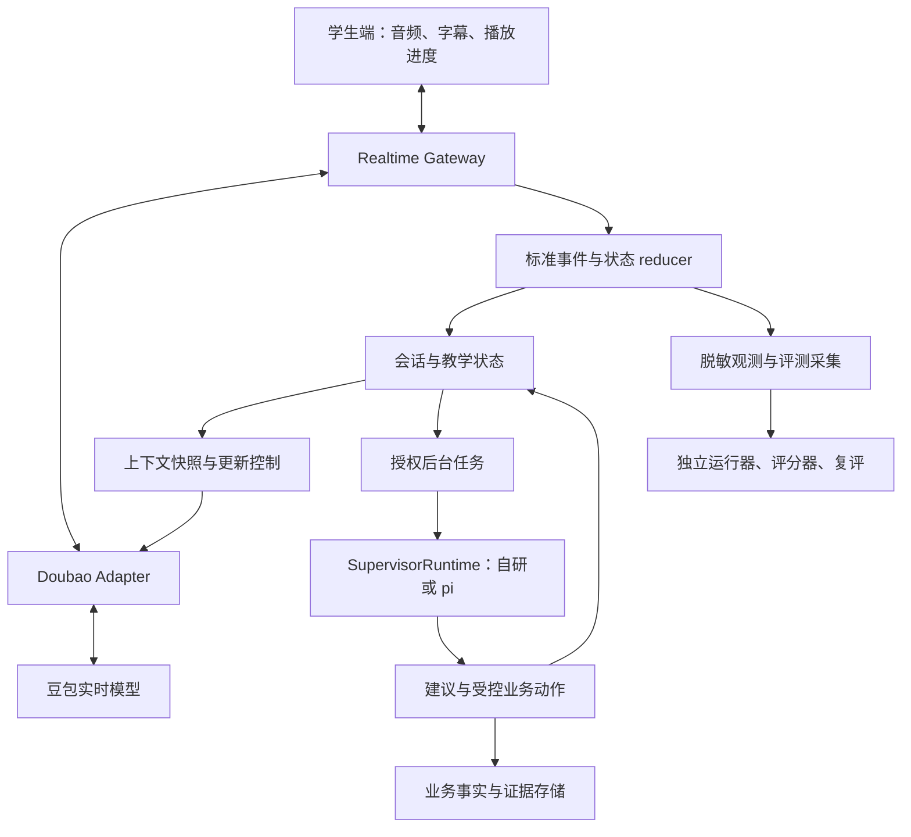

# Ask Kai Tutor Agent Harness Review：结果与建议

审查日期：2026-10-11。对象：独立 Ask Kai POC。本文汇总现状审查、业界实践、pi 选型判断与后续架构建议。

> **文档状态：审查存档，建议暂不实施。** 本次仅将 review 与建议纳入仓库并建立 README 引用，不启动 harness 完善、不引入 pi、不调整 Agent 行为，也不发起新的真实语音或 Judge 调用。本文的目标架构与 H01–H05 是待评估建议，不是已批准或已完成的任务。
>
> **快照边界：** 主体审查基于 `7233a4bce7eb9c56b2cc748ec3404cbcbfbc803c`。归档前核对的 main 为 `d9adb1cd0cae8fce5d8e75ae01d2beb99895301e`，其中评测工具已有后续更新，见第 2 节归档补注。最新实施进度以 [实施计划](implementation-plan.md)、[评测优先顺序](evaluation-first.md) 和 [真实记录评分／批量评测](recorded-scoring.md) 为准。

## 1. 结论与推荐

Ask Kai 已有自研的基础 Agent harness，且在实时会话归属、旧事件隔离、中文优先、自然教学规则、学习尝试证据和失败状态表达方面具有值得保留的基础。它尚未形成完整、可持久化、可定位因果、可用全量评测约束变更的 Tutor harness。

推荐采用：**现有实时语音链路 + Tutor 专属运行壳 + 独立评测闭环**。借鉴 pi 的模块边界与扩展机制；如果引入依赖，先限于后台、可替换的编排实现。暂不把 pi 编码 CLI 或第二个模型循环插入豆包首句生成路径。

“完善”应以以下结果衡量：能解释每轮依据什么状态做了什么决策、哪一版上下文实际得到确认、模型返回什么、客户端消费到哪里、哪些证据获准保存；错误可分层定位；后台任务可安全恢复；修改可通过相同案例比较并回滚。增加工具、提示词、子 Agent 的数量不能代替这些结果。

保留既有方向作为后续参考：**固定 Agent → 完善评测 → 全量运行与分析 → 设计修改面 → 分项改 harness 并复评**。本次只归档已有审查与设计建议；暂不安排 harness 完善，是否实施及具体范围留待后续决定。

## 2. 审查依据与事实边界

| 项目 | 本次核实值 |
| --- | --- |
| 仓库 | `yqhuang-cyber/ask-kai` |
| 审查快照 main | `7233a4bce7eb9c56b2cc748ec3404cbcbfbc803c` |
| 固定待测 Agent | `6661d7ba3ecf7f3eef8f23f74c5d625cb8f457e2` |
| 审查快照与固定 Agent 的差异 | GitHub compare 显示只有 5 个文档文件改变，未新增 Agent 行为代码 |
| 产品范围 | 独立 POC，业务服务默认为 local mock HSKai；外部 HSKai 集成仍在当前范围之外 |
| 数据集 | `freechat-v3.1-20261011`；40 个原始案例 / 244 轮，8 个独立语言对照 / 11 轮 |
| 原有评分器 | `kai-content-v3`，十维，0/1/2 锚点 |
| 审查快照的评测状态 | baseline JSON 的全量运行与评分标记为 `false`；该快照中的固定基线 guard 尚未实现。后续评测工具更新见下方补注 |
| pi 对象 | Mario Zechner 的 Pi；旧地址 `badlogic/pi-mono` 当前重定向到 `earendil-works/pi` |
| pi 版本依据 | 主要按稳定发布 `v1.1.0` 的源码与 README 核查，另用官方主分支文档确认机制 |

没有把语音首案采集成功、协议探针成功、合成回放或代码测试通过当成全量内容合格，也没有把 mock 人工处理 ACK 当成真实人工接手。

用户提供的 PRD v1.1 说明产品方向。较早的 `agent-runtime-platform-technical-architecture(1).md` 描述的是另一个 Spring Boot 智能体底座，本文没有据此认定 Ask Kai 已拥有其中的持久化、委托或能力包实现。

### 归档补注：审查后的评测工具更新

归档前的 README 与 [真实记录评分／批量评测说明](https://github.com/yqhuang-cyber/ask-kai/blob/d9adb1cd0cae8fce5d8e75ae01d2beb99895301e/docs/recorded-scoring.md) 已记录以下工程实现：真实多轮观测的逐轮评分适配、criteria 与实际文本证据绑定、评分输入哈希、固定基线约束、受控批量采集与失败重跑、全量分母和报告汇总。因此，第 4、10、11 节提到的这些评测缺口应按**审查快照**理解，不能据此认定当前仓库仍缺少相应工具。

此处只核对文档所声明的后续实现，不新增运行或验收结论。工具实现、实际全量采集、语义评分与人工校准、Web／真实设备验收仍是不同状态；最新结果应查对应评测记录。本次归档不改变既有评测安排。

## 3. 两种 harness 的边界

| 类型 | 负责什么 | 当前落点 |
| --- | --- | --- |
| Agent harness | 处理输入、会话生命周期、教学状态、上下文、模型适配、权限、工具和输出控制 | `packages/agent-core/`、`apps/realtime-gateway/`、provider 与 policy 模块 |
| Evaluation harness | 创建独立试验、输入脚本/音频、采集实际记录、评分、失败重跑与版本比较 | `apps/eval-runner/`、评测脚本与 workflows |

`apps/eval-runner/src/agent-harness.js` 是评测驱动：启动生产网关、mock 业务端口与豆包适配器，发送学生音频并采集实际结果。**这个文件不等于 Tutor 的生产运行壳。**

完整系统需要两者，但评分器不能成为待测 Agent 的答案来源；独立语言预期、参考回复和未来学生脚本不能进入运行时上下文。

## 4. 审查快照的实现盘点

以下“已实现”指审查快照源码具备相应机制，不代表真实模型或设备验收已经通过。评测工具的后续更新见第 2 节补注。

| 能力 | 已有实践与代码 | 完善方向 |
| --- | --- | --- |
| 会话生命周期 | `SessionRuntime` 做 event 校验、去重、session/turn/response 归属、终态和取消状态管理 | 将 runtime 从网关协调代码中抽出；明确异常转换与生命周期契约 |
| 实时输出与打断 | 网关、`TurnOutputGate`、豆包 adapter 做归属绑定、输出缓冲、取消 ACK、过时事件隔离 | 增加客户端消费进度与跨层时间线；继续实测噪声、回声、暂停和真实打断 |
| 教学状态 | `TeachingSession` 支持 sports/free/mission、阶段、上下文版本和可信 Mission 目标 | 拆出统一状态契约，增加有来源的变更记录和快照 |
| 教学动作 | `NaturalTeaching` 选择 RESPOND/FOLLOW_UP/CLARIFY_INTENT/TEACH_TARGET/CLOSE，处理拒绝、换题、澄清上限和 cooldown | 当前为规则与正则驱动的保守建议；后续是否引入语义决策需靠跨案例证据 |
| 上下文与语言 | 人设、语速、短回复、自然教学、授权偏好分段拼接；`LanguageSupport` 管理英文支架 | 统一 ContextSnapshot，保留各段来源、预算、版本及实际应用时间 |
| 上下文应用 | 维护 requested/pending/applied 状态及 ACK | 当前更新主要在回复完成/取消后提交；不能声明本轮新决策已影响本轮生成 |
| 学习证据与总结 | `LearningSummary` 区分目标、实际转写尝试、转发目标文本；明确不判断掌握或发音 | 扩展到经授权的证据存储与审查；客户端消费进度不能自动升级成“理解/掌握” |
| 记忆 | 授权、字段白名单、偏好读写与删除端口；POC mock 为进程内数据 | 尚非完整长期学习记忆；需要证据、冲突、更正、TTL/留存与隔离契约 |
| 工具 | `authorizeTool()` 对词卡和尝试记录做归属/课程/来源校验 | helper 存在，但不能认定豆包原生工具链已接通；补统一注册表、执行与副作用回执 |
| 安全与隐私 | 规则底线、后续输出停止、真实/mock handoff 区分、撤销授权与数据权利端口 | 规则不是完整语义安全模型；危险披露流程和语音先于文本时的边界仍需验收 |
| 资源与诊断 | 会话时长、容量、消息/音频速率、缓冲、心跳、ACK timeout；可选诊断与聚合指标 | 增加标准 trace、分层延迟、成本和后台任务预算；观测不能反向控制会话 |
| 持久化与恢复 | live 状态主要在内存，产品默认不持久化完整对话/原始音频 | 需要按数据许可设计 journal/checkpoint/outbox；恢复业务状态不等于恢复原语音连接 |
| 评测与发布 | 同网关音频采集、真实 ASR/回复、逐轮 checkpoint、十维评分、可选 Judge/Langfuse、release gate | 真实记录与逐轮评分适配、批量入口/重跑、固定基线 guard、全量结果尚未闭环 |

审查快照中的一个具体差距是：原有通用 `JUDGE_SCHEMA` 主要返回十维分数和安全/审核布尔值，没有逐条 criterion 的证据定位及不可评说明。`scoreCase()` 的输入字段也不能直接容纳 V3.1 的逐轮规范与总结契约。不能只把新采集记录塞入旧 case 结构就宣称适配完成。

### 来源提交

| 层 | 首次或关键提交 |
| --- | --- |
| 可执行事件回放底座 | `6c8385407c28c2f54bf7979280d8c37a3d5a10df`，2026-10-03 |
| Web 音频和实时会话传输 | `f1061b945ec9097ac7d5612ff086583a58282bee`，2026-10-03 |
| 有来源的教学闭环与 context ACK | `0af5d81c6bf4237cdffe04ea5ff8d0009a3aaef9`，2026-10-03 |
| 自然教学动作与上下文快照 | `6921691aeb859aafaab42dd8b76c39e2528e80e0`，2026-10-09 |
| 学习总结证据 | `03fccf6d4fa3e2aef0cf1b37e318c378440fb9f4`，2026-10-09 |
| 自适应英文支架 | `039a9bbf855b97af600d56c2c4e9742126b26184`，2026-10-10 |

因此，这套 harness 是逐步建设的自研实现。当前依赖清单没有 pi，不能把它解释成引入框架后自动拥有的完整能力。

## 5. 值得参考的现行实践

这是对代表性一手实践的归纳，不是所有框架的穷尽调查。右列均为本项目的设计推论。

| 实践 | 一手来源中的机制 | 对 Tutor 的借鉴 |
| --- | --- | --- |
| 小核心、可替换边界 | Pi 将模型访问、Agent 核心与应用外壳拆开，提供类型化扩展 [S1–S4] | 教学策略、记忆、权限和观测可独立替换；避免网关同时承担全部责任 |
| 结构化状态与可恢复执行 | LangGraph 的 checkpoint/持久化 [S7]；pi-durable 的任务、提交和恢复 [S4] | 状态源清晰；后台总结、证据整理等任务可恢复，副作用需幂等 |
| 请求前、工具前后和回合后边界 | Pi Agent 的 lifecycle hooks [S2]；Agents SDK 的 guardrail 边界 [S8] | 分清硬校验、策略建议与异步观测，不把所有检查放在生成完成后 |
| 语音交互专属治理 | LiveKit 区分 turn detection、interruption 与播放历史处理 [S9] | 将识别、生成、转发、客户端播放进度分别记录；被打断的完整生成文本不能冒充完整呈现 |
| 结构化交接与进展证据 | Anthropic 长任务实践强调交接材料与增量进度 [S10] | 会话结束留下可核验学习尝试、待复习候选和未知项；不是不断扩写聊天摘要 |
| 环境约束与反馈回路 | OpenAI harness engineering 强调上下文组织与可执行约束 [S11] | 权限、状态转换、证据规则、预算和回归应由代码落实 |
| 任务、试验、评分、最终结果分开 | Anthropic Agent evals [S12]；Langfuse 外部实验与比较 [S13] | 真实记录 → 独立评分 → 人工校准 → 跨案例汇总，验证实际结果而非模型自述 |
| 面向复杂工作的完整外壳 | Deep Agents 包含规划、上下文、工具及委托能力 [S14] | 适合后台长任务选型参考；首句语音路径未必需要整个通用外壳 |

上述框架分别解决不同层的问题。选型必须先确定缺的是语音调度、后台 Agent loop、持久化工作流还是评测展示，不能仅用“功能更多”作为替换依据。

## 6. pi 的具体借鉴与引入判断

### 6.1 分层评估

| pi 组件 | 机制 | 对 Ask Kai 的判断 |
| --- | --- | --- |
| `pi-ai` | 多供应商模型 API、工具消息、流式事件和用量 | 可作为后台文本/结构化模型适配候选；所查版本没有现成豆包 Seeduplex 双向音频适配 |
| `pi-agent-core` | Agent loop、上下文转换、事件、工具 hooks、取消及输入队列 | 适合需要模型和工具循环的后台编排；单独引入它不会自动获得完整持久化或 Tutor 教学逻辑 |
| `pi-durable` | 持久化 conversation/document/task、恢复、fork、工具 replay 策略 | 适合单独验证后台任务恢复；v1.1.0 README 明确标为 Experimental，API 可跨版本改变 |
| `pi-telemetry` | 显式、供应商无关的观测契约 | 可以借鉴或复用；还需自行接 exporter、脱敏与 Langfuse/OTel 适配 |
| `pi-coding-agent` SDK/CLI | 编码应用的 session、资源发现、扩展和工具外壳 | 可以定制，但默认关注编码工作流，不作为本项目推荐的实时 Tutor 入口 |

`pi-agent-core` 与 `pi-durable` 是两条不同的后台 runtime 候选，不需要在同一任务外面同时套两层模型循环。前者轻量但要自己补 persistence/jobs；后者更完整但带入实验性 API 和存储/调度约束。

所查 pi-durable 存储默认由单进程独占，未提供跨进程锁。引入它不等于现成解决多实例租约、业务授权、数据留存、跨系统副作用幂等或真人语音会话恢复。这些仍归宿主服务负责。[S4]

### 6.2 最值得借鉴的机制

| 机制 | Tutor 的具体用法 |
| --- | --- |
| 请求前的规范上下文 | 每次后台模型请求绑定 ContextSnapshot；评测预期与参考不属于运行上下文 |
| 应用事件与模型消息分离 | ASR 修订、播放进度、ACK、工具失败都是应用事件；只把需要的受控投影送给模型 |
| 类型化工具与前后 hooks | 参数检查后验证 owner/session/课程/数据许可；执行后记录真实业务回执，不能只信模型描述 |
| steer/follow-up 分别排队 | 新意图、更正可使旧建议失效；后台总结等待合适边界。队列语义不能代替语音 VAD/打断协议 |
| 任务归属与取消传播 | 子任务绑定会话和轮次；旧轮模型结果迟到时丢弃；允许脱离会话的任务必须明确拥有者与许可 |
| 原始事件与上下文压缩分开 | 压缩仅改变模型可见投影；保留获准保存的证据及来源，拒绝把摘要当成未经核验的长期事实 |
| 可替换 registry/extension | 将教学、语言、记忆、安全、能力注册成受信任版本包，按模式选择；避免任意动态插件进入儿童会话 |
| 提交、重试与 replay 明确 | 总结生成可重试；偏好/证据写入先用幂等键与真实回执核验；不盲目重放外部写入 |

这些是将 pi 机制应用于 Tutor 的设计建议，不表示 Pi 已实现中文教学规则或豆包音频控制。

### 6.3 三条路径的取舍

| 路径 | 收益 | 成本/限制 | 推荐 |
| --- | --- | --- | --- |
| A：保留自研 runtime，借鉴 pi 接口 | 最大限度复用已验证的音频/归属机制，依赖少，边界可定制 | 生命周期、上下文与恢复仍需自己维护 | **当前主路径** |
| B：只在后台嵌入 pi 核心或 durable | 获得通用模型/工具循环或任务恢复，减少部分底座工作 | 要做 Tutor adapter、业务端口与数据策略；仍需验证维护收益 | **证据表明需要模型编排时做受控 PoC** |
| C：用 pi 编码 SDK/CLI 替换完整 Tutor | 复用应用外壳及扩展生态 | 需要改造语音协议、权限、状态源、默认工具与资源发现；不直接解决时序问题 | 当前不采用 |

如果后台工作只是少量确定性规则加一个结构化模型请求，也应比较简单 job worker；不必为了“有 Agent”新增多轮工具循环。

### 6.4 如果选择直接引入，如何验证

在 E05 之后建立独立候选实现，以应用自己的 `SupervisorRuntime` 端口屏蔽 pi。第一项任务选择“将已授权的会话片段整理成学习证据候选与总结候选”，只在模拟业务端口写入，不更新正在运行的学生会话。

PoC 比较 A/B 的输出契约通过率、证据可追溯性、崩溃恢复、重复提交、取消、成本、延迟、适配代码量与升级维护成本。门槛在运行前声明，经校准后再做选型，不能预填“pi 一定更好”。

若采用 pi-agent-core：冻结确切版本；通过 beforeToolCall 等 hooks 映射宿主权限；用平台 job/checkpoint 解决持久化。若采用 pi-durable：单独验证 replay 策略、恢复和部署 ownership；API/数据格式变更有迁移测试。二者均只加载明确列出的 Tutor 工具和受信任资源，设置模型调用/工具调用/耗时预算。

## 7. Tutor harness 目标架构

核心拆为实时交互、教学控制、异步任务和独立评测四个职责域。部署可仍为模块化单体；职责分离不要求立即增加服务数量。

模型 adapter 维护供应商连接状态；应用 reducer 维护会话和响应归属；教学状态由服务端负责；业务存储保存获准提交的事实。后台建议通过状态版本校验再进入状态，不能自行重写当前活动响应。

实时硬控制在 Gateway/adapter/output 层执行。耗时模型 Judge、发音评测、长期记忆整理与复杂规划不进入首句路径。异步故障按功能降级；供应商连接本身不可用时，明确失败并允许新建连接，不能用模拟语音表示“已接通”。

### 必备模块与验收结果

| 模块 | 责任 | 验收结果 |
| --- | --- | --- |
| SessionLifecycle | 创建、授权、就绪、关闭、失败、撤销 | 每条事件绑定同一租约/会话；终态不可重启；新连接使用新身份 |
| EventReducer | 排序、去重、归属、迟到事件 | 合成乱序/重复/取消测试下不污染新回合 |
| TutorState | 模式、软目标、暂停、支架、当前意图与证据 | 可查询来源及版本；学生更正优先；没有隐式掌握结论 |
| ContextCompiler | 固定规则与动态事实、优先级、预算、压缩 | 同状态与版本产生同快照；受控信息来源可查 |
| UpdateCoordinator | desired/requested/acknowledged 与下一轮可用性 | 更新丢失/超时/迟到可识别；不夸大 ACK 的证明范围 |
| CapabilityRegistry | 课程资料、词卡、练习、证据候选、外部服务 | 每个能力有 schema、权限、预算、幂等与数据策略 |
| ActionExecutor | 校验、提交、真实回执、失败 | 模型建议不能越权；取消或过时建议不能形成不当写入 |
| EvidenceMemory | 偏好、尝试、经评估候选、总结 | 字段有来源；证据层级不能自动提升；隔离与删除可验证 |
| JobRuntime | 后台任务、预算、重试、取消、恢复 | 崩溃/重复消息不产生重复效果；任务所有权可查 |
| VoicePresentation | 输入持续性、播放、字幕、打断 | 文本/音频/播放位置绑定 response；不靠普通说话静音破坏全双工 |
| SafetyPrivacy | 规则/语义保护、工具治理、数据许可、人工流程 | 真实与 mock 状态清晰；观测及存储使用相同数据策略 |
| EvaluationRelease | 真实采集、逐轮评分、根因归纳、版本比较 | 内容、采集与设备结果分列；关键失败不能被均分抵消 |

### 建议代码落点

| 建议模块 | 从当前实现复用/抽取 |
| --- | --- |
| `packages/tutor-harness/runtime/` | `SessionRuntime` 与 realtime 协调职责；保留现有归属和取消语义 |
| `packages/tutor-harness/context/` | `TeachingSession.instructions()`、language/reply/persona 的规范投影 |
| `packages/tutor-harness/capabilities/` | `authorizeTool()`、课程与业务端口，增加 registry/executor |
| `packages/tutor-harness/evidence/` | `LearningSummary`、偏好端口及有来源的证据契约 |
| `packages/tutor-harness/jobs/` | 新增 JobRuntime/SupervisorRuntime，具体实现可以替换 |
| `packages/tutor-harness/observability/` | 现有 diagnostics/metrics 的可选观测出口 |
| `apps/eval-runner/` | 继续作为外部试验驱动，独立版本化，不混入学生 runtime |

以上为建议路径，尚未创建到仓库。抽取代码与改变教学行为分成不同变更，分别对照复评。

## 8. 实时控制是最重要的适配边界

当前首案已有证据：教学 context ACK 可晚于 response.started。源码中 `flushContext()` 在运行中的响应、取消或更新尚未完成时不会提交新上下文，且学生 final 后不直接立即调用 flush；回复结束/取消时再尝试更新。

这证明当前应用能够准备后续轮次的状态更新，**不能证明当前回合的新决策已经用于生成**。接收 response.started 本身也可能晚于供应商实际开始生成。输出 hold 只延迟转发/播放，不会改变已生成内容。

| 需求 | 本地控制范围 | 不能预设的供应商能力 |
| --- | --- | --- |
| 会话开始规则 | 创建前编译人设、语言、预算、课程状态 | 模型百分之百服从提示词 |
| 本轮取消 | 本地停止输出、请求 cancel、隔离旧事件 | 已播放内容可撤回、远端已无任何生成 |
| 本轮更正/教学决策 | 及时记录事实与版本；若协议验证允许，可提交受控更新 | 更新 ACK 自动意味着应用于已开始的当前回复 |
| 下一轮策略 | 回合边界提交并等待 ACK，绑定来源回合和状态版本 | 下一轮输出必然符合该策略 |
| 精确生成前教学选择 | 需要供应商提供经验证的生成前控制点，或明确切换到受控分段架构 | 从本地增加一个 hook 就能得到该控制点 |

推荐先保留原生全双工，采用“创建前固定约束 + 明确的后续回合更新 + 可取消的当前输出”。若全量结果证明某类即时教学选择必须在生成前完成，再以独立实验评估供应商控制能力或受控轮次架构的延迟与打断代价。

每个 adapter 建议暴露 capability 证据表：bidirectional_audio、cancel_ack、context_update_ack、pre_response_context_control、native_tool_calls、playback_context_truncation 等。能力状态至少区分已实测、协议声明但未实测、不支持、未知。内部 interface 和 mock 成功不能用来填“已实测”。

## 9. 状态、证据与动作契约

以下是建议的应用契约，不是当前已存在的 API，也不依赖特定框架。

### 9.1 ContextSnapshot

至少记录：session/turn/epoch、snapshot_id、state_revision、persona/teaching/language/reply/safety/curriculum 版本、context_hash、字段来源与过期条件、生成时间、预算和不可用原因。

将 stable_rules、authorized_facts、recent_actual_dialogue、current_intent 和 advisory_decision 分开。规则优先级明确；学生内容和课程 JSON 都作为数据处理；同一状态与版本能重建相同快照。评测参考、未来脚本、未核验掌握度和未经许可的历史不进入快照。

### 9.2 TeachingDecision 与应用记录

decision 至少包含：decision_id、source_event_id、source_turn_id、based_on_state_revision、goal、action、support_level、reason_code、expires_at、applicability 和 policy_version。reason_code 为业务理由，不要求存储模型隐藏思考过程。

应用记录分别保存 desired、requested、acknowledged、response_start_observed_at 与已观察到的内容符合性；“acknowledged”不是“已按该策略生成”。建议的有效范围应写成 session-start、next-turn 或经验证的 current-turn，而不是含糊的“已应用”。

异步结果回来时比较 epoch、状态版本、学生是否更正/换题、会话是否结束以及数据许可是否仍有效。失配建议标记 stale；不让旧轮建议覆盖新意图。

### 9.3 学习证据必须分层

| 层 | 可证明什么 | 不可自动推出什么 |
| --- | --- | --- |
| planned | 计划教授一个点 | 实际已教授 |
| generated | 模型生成了文本/音频 | 客户端收到或播出 |
| forwarded | 网关转发了相关内容 | 用户已听完 |
| playback_progress_observed | 客户端报告消费到某个 sample/segment | 学生注意到、理解或完整听到 |
| attempted | 最终输入有可定位的表达尝试 | 发音合格或掌握 |
| assessed | 经明确评测方法得到一个有版本的评价 | 可直接升级为长期熟练度 |
| mastery_candidate | 基于产品定义的多次证据形成候选 | 正式能力认证 |

当前已存在 attempted-only 与 forwarded-text 的诚实边界，完善时应继续保留。播放进度按 sample/segment 与 response 绑定；文本和音频若无法精确对齐，记录误差/不确定性，不伪造字级播放证明。

### 9.4 工具与副作用

第一批能力可包括可信课程读取、词卡、学习证据候选、总结候选、经许可的发音评测请求及偏好修改端口。工具是否由实时模型提出，仍取决于 adapter 能力验证；服务器主动调用的能力不必伪装成模型工具调用。

每个工具定义 name/version/schema、read/write 类别、权限范围、owner/session 检查、允许模式、耗时与次数预算、idempotency_key、replay_policy、数据策略、取消语义与回执验证。读请求可在声明预算内重试；外部写入优先使用唯一键/去重/查回执，进程恢复不能仅凭 runtime 标记宣称“exactly once”。

pi-durable 的 replay-safe 是调用方声明，不等于远程业务天然幂等。单会话状态写入默认串行；并行只用于互不依赖的读取或明确无冲突的任务。

### 9.5 持久化与恢复

现有产品默认不保存完整对话或原始音频。引入 journal、pi session 或其他 checkpoint 必须显式执行相同 DataPolicy，不能因为框架默认持久化就新增全部对话留存。

默认可保存必要元数据、版本、脱敏状态和获准的证据引用；测试脚本与授权的实际记录走受限评测存储。是否保存文本、音频、摘要及保留多久分别声明；删除需覆盖引用、后台任务和评测衍生数据。

业务变更与 outbox 可原子提交；Worker 按幂等键执行。重新启动后恢复允许恢复的业务状态和任务。豆包连接失败后新建 provider session，旧 response 不继续播放；不承诺恢复原 WebSocket 或未播放音频。

## 10. 评测 harness 的闭环建议

本节记录审查时的闭环要求；其中逐轮适配、证据、批量与报告工具已有后续实现，见第 2 节补注与 [当前评分文档](recorded-scoring.md)。这些要求不等于新建实施任务，也不代表全量评分已完成。

### 10.1 保留现有尺度，补适配与证据

| 十维 | 权重 |
| --- | ---: |
| intent 意图 | 15 |
| correctness 正确性 | 15 |
| instructions 指令遵循 | 10 |
| level 水平适配 | 12 |
| expression 表达 | 8 |
| continuity 连贯 | 8 |
| progress 教学进展 | 10 |
| personalization 个性化 | 5 |
| persona 人设 | 5 |
| safety 安全 | 12 |

保留 `kai-content-v3` 及 0/1/2，不为方便接入而重新定义十维权重。新增逐轮 criteria 与证据结构，分别标注规则校验、人工或模型 Judge；关键失败和 safety gate 单独保留。criterion 映射到现有维度，汇总规则须明确，不能靠简单平均逐轮分数暗中改变案例级尺度。

每条评分至少带 criterion_id、turn/response、score、evidence_refs、reason_code、evaluable 状态、不可评原因、judge/rubric 版本和人工复核记录。证据可用受限记录中的事件/片段引用；外部观测平台默认只接脱敏元数据与数字结果。

独立语言预期来自作者标注及已核验实际上下文。当前 Judge 内的 runtime-derived language_contexts 只能作为对照诊断，不能继续作为新评测的唯一正确答案。待测策略的错误不应被同一策略生成的评测预期合理化。

### 10.2 四类诊断分别统计

| 类别 | 判断依据 | 处理 |
| --- | --- | --- |
| 采集失败 | 缺失 final/reply/summary、ownership 错、断线、超时、采集不完整 | 保留部分记录及具体失败；不能填参考或直接判内容失败 |
| ASR 偏离 | 作者脚本与实际识别不一致 | 先判断是否语义改变；同时评实际输入回应与原案例覆盖 |
| 上下文失配 | 回复开始时实际快照/ACK/来源轮次与预期不匹配，或前文已发生分叉 | 记录最早分叉、时序与依赖范围；后续连锁失败不重复归为独立根因 |
| 内容问题 | 对截至本轮的实际输入与前文确实不正确、不适龄、冗长等 | 按独立逐轮规范评分，保留语义证据与人工复核 |

四者可能同一轮并存，不能硬归成互斥标签。标明主导的最早偏离、并存问题和连锁影响；因果未验证时标为假设。ASR 表面差异不自动导致不可评，语义变更也不自动替 Agent 的错误开脱。

### 10.3 批量、重跑与版本

固定 40 个原始案例 / 244 轮，8 个语言对照 / 11 轮独立报表。每案从声明的初始状态开新会话；失败案例重跑从第一轮开始，保留旧 attempt，不续接已失效会话。评分重跑复用同一原始记录，不必重新调用语音模型。

RunManifest 分开记录 agent_revision、evaluation_revision、运行代码指纹、model/profile/voice/pace、数据/音频 hash、runner/adapter/policy/rubric/judge 版本。审查快照相对 Agent baseline 只改文档；归档前 main 另有评测工具更新。实际待测 Agent 是否相同需以运行代码与依赖指纹约束，不能只因 HEAD 改变就宣布 Agent 行为版本变化。

批量预算涵盖 cases、并发、每轮 timeout、session 时间、语音与 Judge 调用成本、重试次数和总 deadline。普通 CI 跑离线 schema/fixture/归属测试；真实调用有显式入口。失败重跑和观察记录重评各有独立入口。

先对小批案例和人工标注校准采集/评分工具，再完成首轮全量。模型随机性较大的结论需重复试验；选中的候选版本要在相同脚本、尽可能相同音频、相近运行时间和同 Judge/rubric 下比较。重复试验次数和预算预先声明。

Langfuse 可以保存实验版本、trace 关联、分数、人工审核与版本比较；运行器仍负责生产路径采集和真实输入。无需为了第一轮全量先引入平台。现有代码仅有可选 score 推送，不能认定已完成 trace/dataset/experiment 链路。[S13]

### 10.4 根因报告与发布

每个问题簇给出案例/轮次分布、有效分母、最早偏离、实际证据、假设、支持/反证、需要的对照实验、修改模块与回归范围。示例：若“本轮改为中文后仍输出英文”频繁出现，候选原因包括更新时序、识别偏离、状态解释或模型遵循；不能直接写成“提示词不够强”。

内容结果、采集覆盖、ASR、上下文、语音设备体验和安全关键失败独立报告。文本/固定音频实验不能验收自然停顿、回声、真人口音、字幕同步和真实打断。内部 POC 与未来生产发布也有不同验收范围，完整 harness 不自动等于生产上线。

## 11. 后续顺序建议与完成标准（暂不启动 harness 完善）

### 既有评测顺序 E01–E05

| 阶段 | 交付 | 完成标准 |
| --- | --- | --- |
| E01 | 真实观测 → 评分输入、固定 Agent guard | 数据/ASR/回复/前文/总结对应可查；参考不入模型；运行源码指纹匹配 baseline |
| E02 | 逐轮 requirements/evidence 与十维适配 | 可评/不可评清晰；人工与 Judge 共用结构；语言预期独立；同记录可版本化重评 |
| E03 | 批量入口、预算、checkpoint 与失败重跑 | 每案隔离；中断后清楚知道哪些案完成；失败案新会话重跑；普通 CI 不调用模型 |
| E04 | 小批校准与 40 案全量，语言对照另列 | 原始集与对照有实际覆盖分母；不把部分完成宣称全量 |
| E05 | 跨案例问题与根因假设 | 每项修改面均有证据、反证/实验和回归范围 |

E01–E03 默认只改评测路径。需要改共享组件时先检查是否改变 Agent 行为或事件时序；如会改变，归入 H 阶段。观测开销也要记录并控制，不以“只是打日志”为由忽略时序变化。

### 待后续评估的 Agent harness 建议

| 阶段 | 建议工作 | 验收 |
| --- | --- | --- |
| H01 | 从现有代码抽取 runtime/state/context/ports，补正式契约 | 合成回放与运行/归属回归通过；与 baseline 的差异可解释，行为变化单列 |
| H02 | 上下文快照、决策有效范围、应用时序与证据关联 | 能重建某轮实际状态；过时决策无效；区分 ACK 与生成遵循 |
| H03 | 工具注册/执行、EvidenceMemory、授权持久化与 JobRuntime | 越权/重复/取消/崩溃/删除测试有效，外部写入查真实回执 |
| H04 | 依据 E05 改自然教学、语言等行为；必要时比较 pi 后台实现 | 每类变更独立版本，用原集与对照复评；保留修改前后证据 |
| H05 | 真实设备、自然交互和发布范围验收 | 内容、体验、安全、隐私与业务流程按声明范围闭环；可回滚到原实现 |

上表仅归档后续建议，本次不启动 H01–H05，也不把它们加入当前实施范围。E 阶段的实际进度以现有评测文档和运行记录为准；H 阶段是否启动与细分范围仍待后续决定，并应由 E05 证据支持，不能先把所有问题归为教学策略或默认引入第二个模型。

### “完善的 harness”验收清单

1. 任意一轮能追到输入、实际状态、决策、上下文版本、供应商结果及客户端消费进度。
2. 身份、权限、取消、归属和 evidence 层级在代码中有可验证约束。
3. 当前轮与下一轮控制范围明确，未知供应商能力不会被接口声明掩盖。
4. 后台任务有预算、归属、幂等、取消和恢复；不会反向阻塞首句。
5. 长期记忆有来源、更正、隔离、留存与删除；完整 transcript 持久化不是框架默认副作用。
6. Agent、runner、dataset、音频、模型、prompt、rubric 与 Judge 都能独立版本化。
7. 全量评测有真实覆盖、逐轮证据、四类诊断和人工校准，关键失败单列。
8. 修改有对照实验、回归证据与回滚路径，真实语音体验单独验收。

## 12. 一手来源与源码索引

### Ask Kai 审查快照源码与现状

- [固定基线及 E01–E05](https://github.com/yqhuang-cyber/ask-kai/blob/7233a4bce7eb9c56b2cc748ec3404cbcbfbc803c/docs/evaluation-first.md)
- [基线清单](https://github.com/yqhuang-cyber/ask-kai/blob/7233a4bce7eb9c56b2cc748ec3404cbcbfbc803c/docs/eval-baselines/freechat-v3.1-baseline.json)
- [实施状态](https://github.com/yqhuang-cyber/ask-kai/blob/7233a4bce7eb9c56b2cc748ec3404cbcbfbc803c/docs/implementation-plan.md)
- [实时会话协调](https://github.com/yqhuang-cyber/ask-kai/blob/7233a4bce7eb9c56b2cc748ec3404cbcbfbc803c/apps/realtime-gateway/src/realtime.js)
- [教学状态](https://github.com/yqhuang-cyber/ask-kai/blob/7233a4bce7eb9c56b2cc748ec3404cbcbfbc803c/packages/agent-core/teaching.js)
- [自然教学策略](https://github.com/yqhuang-cyber/ask-kai/blob/7233a4bce7eb9c56b2cc748ec3404cbcbfbc803c/packages/agent-core/natural-teaching.js)
- [学习总结证据](https://github.com/yqhuang-cyber/ask-kai/blob/7233a4bce7eb9c56b2cc748ec3404cbcbfbc803c/packages/agent-core/learning-summary.js)
- [多轮采集](https://github.com/yqhuang-cyber/ask-kai/blob/7233a4bce7eb9c56b2cc748ec3404cbcbfbc803c/apps/eval-runner/src/multiturn.js)
- [现有十维评分](https://github.com/yqhuang-cyber/ask-kai/blob/7233a4bce7eb9c56b2cc748ec3404cbcbfbc803c/apps/eval-runner/src/content.js)
- [现有 Judge](https://github.com/yqhuang-cyber/ask-kai/blob/7233a4bce7eb9c56b2cc748ec3404cbcbfbc803c/apps/eval-runner/src/langchain-judge.js)

### 外部一手资料

- S1：[Pi 官方仓库](https://github.com/earendil-works/pi)；[v1.1.0 发布](https://github.com/earendil-works/pi/releases/tag/v1.1.0)
- S2：[Pi Agent core v1.1.0](https://github.com/earendil-works/pi/blob/v1.1.0/packages/agent/README.md)
- S3：[Pi extensions v1.1.0](https://github.com/earendil-works/pi/blob/v1.1.0/packages/coding-agent/docs/extensions.md)
- S4：[Pi durable v1.1.0](https://github.com/earendil-works/pi/blob/v1.1.0/packages/durable/README.md)
- S5：[Pi telemetry v1.1.0](https://github.com/earendil-works/pi/blob/v1.1.0/packages/telemetry/README.md)
- S6：[Pi AI v1.1.0](https://github.com/earendil-works/pi/blob/v1.1.0/packages/ai/README.md)；[编码 SDK](https://github.com/earendil-works/pi/blob/v1.1.0/packages/coding-agent/docs/sdk.md)
- S7：[LangGraph persistence](https://docs.langchain.com/oss/javascript/langgraph/persistence)
- S8：[OpenAI Agents SDK guardrails](https://openai.github.io/openai-agents-python/guardrails/)；[sessions](https://openai.github.io/openai-agents-python/sessions/)
- S9：[LiveKit turn handling](https://docs.livekit.io/agents/logic/turns/)
- S10：[Anthropic：Effective harnesses for long-running agents](https://www.anthropic.com/engineering/effective-harnesses-for-long-running-agents)
- S11：[OpenAI：Harness engineering](https://openai.com/index/harness-engineering/)
- S12：[Anthropic：Demystifying evals for AI agents](https://www.anthropic.com/engineering/demystifying-evals-for-ai-agents)
- S13：[Langfuse：Evaluate with Datasets](https://langfuse.com/docs/evaluation/get-started/offline)
- S14：[LangChain：Deep Agents](https://docs.langchain.com/oss/javascript/deepagents/overview)

机制事实以所列官方文档和源码为依据；适配判断、目标模块、契约与实施阶段为本次对 Ask Kai 的设计建议。
